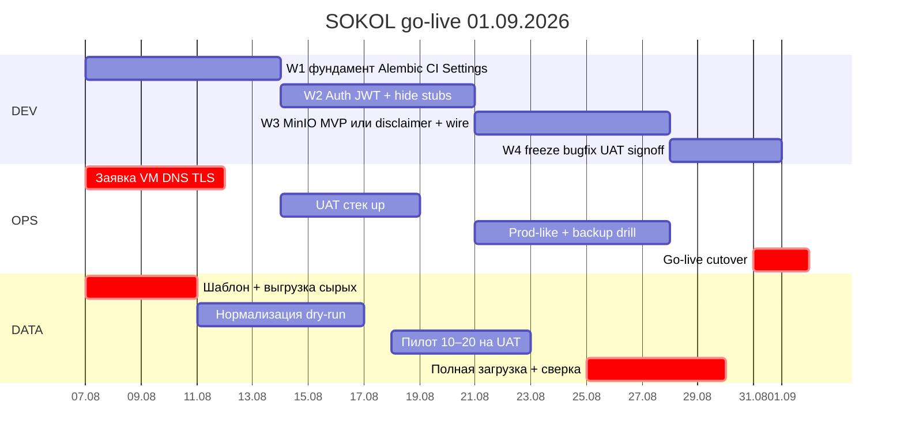
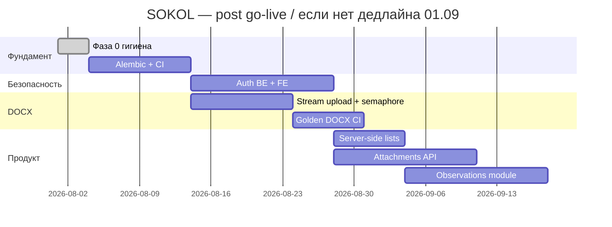
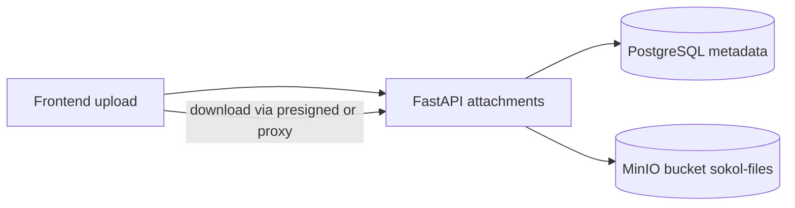
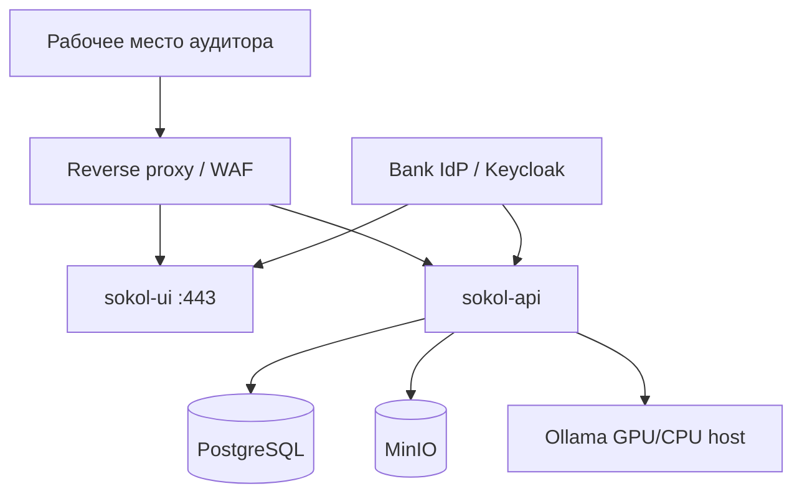

# План развития SOKOL

**Актуально:** 7 августа 2026  
**Жёсткий дедлайн go-live:** **1 сентября 2026 (пн)**  
**Окно:** 7 авг → 1 сен = **25 календарных / ~18 рабочих дней** (без учёта выходных; при работе в сб — запас).

**Назначение:** единый план дальнейших действий. Playbooks A–D ниже — технические детали; **календарь и scope freeze** — в разделе [Go-live 01.09.2026](#go-live-01092026--жёсткий-план).

Детальные разборы кода: [sokol-backend/docs/CODE_REVIEW.md](sokol-backend/docs/CODE_REVIEW.md), [sokol-frontend/docs/CODE_REVIEW.md](sokol-frontend/docs/CODE_REVIEW.md).

---

## Go-live 01.09.2026 — жёсткий план

### Definition of Done (что значит «готово полностью» к 1 сен)

К **09:00 01.09.2026** на UAT/prod-контуре банка:

| # | Критерий | Обязательно |
|---|----------|-------------|
| G1 | Приложение доступно по внутреннему HTTPS (UI + API behind reverse proxy) | ✅ |
| G2 | PostgreSQL с актуальной схемой; процедура backup/restore проверена | ✅ |
| G3 | Auth: вход только авторизованным пользователям (минимум internal JWT **или** OIDC; stub login **выключен**) | ✅ |
| G4 | CRUD проверок и рекомендаций работает на реальных/пилотных данных | ✅ |
| G5 | Справочники (аудиторы, виды аудита, виды проверок, оценки) заполнены и используются | ✅ |
| G6 | Виды проверок подключены к форме проверки (не только Settings) | ✅ |
| G7 | DOCX-инструменты (Раздел II ± ссылки, ДЗ, parse recommendations) smoke-ok на 2–3 эталонных АЗ | ✅ |
| G8 | Аналитика открывается без ошибок на загруженном объёме данных | ✅ |
| G9 | Вложения: либо **MinIO работает**, либо UI **явно** пишет «не сохраняется» + бизнес подписал риск | ✅ (один из двух) |
| G10 | Загружен согласованный объём реальных проверок + сверка count | ✅ |
| G11 | Runbook: старт/стоп, backup, контакты, откат — у сопровождения | ✅ |
| G12 | Подписан акт пилота / go-live checklist (ИБ + владелец данных) | ✅ |

**Ollama / раздел I «Аудиторское мнение»:** желательно на UAT к 28.08; если GPU/модель не готовы — **не блокирует** 01.09 (инструмент скрыт или disabled с текстом).

### Scope freeze — что НЕ делаем до 01.09

Чтобы успеть, **вне scope go-live** (после 1 сен, backlog):

- Полноценный модуль **Наблюдения** (CRUD) — оставляем демо-таблицу или скрываем пункт
- **Планирование**, **Канцлер** — скрыть из nav
- Server-side analytics API, виртуализация таблиц
- Golden DOCX CI, полный рефакторинг docx_generator
- Keycloak «как в банке навсегда», если IdP не выдадут вовремя → fallback: **internal JWT + список пользователей из env/БД** (см. неделю 2)
- Полный FK всех справочников на домен (достаточно combobox + validation «значение из списка»)

**Правило:** любой новый запрос бизнеса после **14.08** → в backlog после 01.09, кроме P0-блокеров ИБ.

### Три параллельных трека

| Трек | Владелец (роль) | Фокус |
|------|-----------------|-------|
| **DEV** | разработка | auth, alembic/import, wire check_kinds, attachments/disclaimer, smoke |
| **OPS** | инфра / DevOps + ИБ | VM, DNS, TLS, firewall, docker, backup, доступы |
| **DATA** | методолог / аудитор-владелец данных + 1 разработчик | Excel, справочники, нормализация, загрузка, сверка |

Без ежедневного синка **DATA** с **DEV** go-live срывается даже при готовом коде.

---

### Календарь с жёсткими дедлайнами



#### Неделя 1 — 07.08 (пт) → 13.08 (чт) — «Фундамент и данные»

| Дедлайн | Трек | Задача | DoD |
|---------|------|--------|-----|
| **07.08 EOD** | ALL | Kickoff: утвердить этот DoD и scope freeze; назначить владельцев DEV/OPS/DATA | протокол / чат с именами |
| **08.08 EOD** | DATA | Зафиксировать **шаблон Excel** колонок = поля API (checks + recommendations); выдать бизнесу | файл `templates/import_checks.xlsx` + README маппинга |
| **08.08 EOD** | OPS | Подана заявка: VM, диски, DNS, TLS-сертификат, firewall rules, доступ к registry | номер заявки |
| **11.08 EOD** | DEV | Единый pydantic `Settings` (CORS, upload); Alembic init + **baseline stamp**; `upgrade head` в dev | `alembic upgrade head` на чистой БД ок |
| **12.08 EOD** | DEV | CI: backend `unittest` + frontend `lint`+`build` (хотя бы GitHub Actions или внутренний CI) | зелёный pipeline на main |
| **12.08 EOD** | DATA | Получена **сырая выгрузка** проверок/рекомендаций (как есть) | файл в защищённом share |
| **13.08 EOD** | DATA | Справочники согласованы (виды проверок = seed; аудиторы список) | подписанный список / Excel sheet «dicts» |
| **13.08 EOD** | DEV | Import: флаг **dry-run** + CSV отчёт reject; wire `check_kinds` → select на форме проверки | PR merged |

**Gate W1 (13.08 17:00):** без baseline Alembic + шаблона Excel + заявки на инфру — **эскалация**, сдвиг объёма данных (не кода).

#### Неделя 2 — 14.08 (пт) → 20.08 (чт) — «Доступ и UAT»

| Дедлайн | Трек | Задача | DoD |
|---------|------|--------|-----|
| **14.08 EOD** | DEV | Решение auth: **путь A** OIDC (если IdP готов) / **путь B** internal JWT + users table/env | записано в PLAN/README |
| **15.08 EOD** | OPS | UAT: docker compose up (API+UI+Postgres); HTTPS proxy черновик | `https://…` открывает login |
| **18.08 EOD** | DEV | Auth на API (Bearer обязательно кроме `/status`); FE login + interceptor; stub выключен в UAT | нельзя вызвать CRUD без токена |
| **18.08 EOD** | DEV | Убрать/disabled fake «смена пароля»; скрыть Планирование/Канцлер из nav | UI без ложных обещаний |
| **19.08 EOD** | DATA | Нормализованный Excel + dry-run: reject rate **&lt; 5%** или список ручных правок | `normalized.xlsx` + `reject_report.csv` |
| **20.08 EOD** | DATA+DEV | На UAT загружен **пилот 10–20 проверок**; сверка глазами 3 карточек | чеклист DATA sign-off |

**Gate W2 (20.08 17:00):** UAT с auth + пилот данных. Если IdP не выдали — **включаем путь B (JWT)** без ожидания Keycloak.

#### Неделя 3 — 21.08 (пт) → 27.08 (чт) — «Файлы, объём, стабилизация»

| Дедлайн | Трек | Задача | DoD |
|---------|------|--------|-----|
| **21.08 EOD** | DEV | **Решение по вложениям:** MinIO MVP **или** disclaimer + подпись риска | один вариант зафиксирован |
| **25.08 EOD** | DEV | Если MinIO: upload/list/download для check+recommendation; если нет — disclaimer на всех формах | G9 выполнен |
| **25.08 EOD** | OPS | Backup Postgres прогнан; restore на чистый том успешен | протокол restore |
| **26.08 EOD** | DATA | **Полная** загрузка согласованного объёма на UAT; count Excel = count API | отчёт сверки |
| **26.08 EOD** | DEV | Smoke DOCX: 3 АЗ × (section-ii, section-ii-links, memorandum, parse) | чеклист tools |
| **27.08 EOD** | ALL | Bugfix: только P0/P1; feature freeze | список открытых багов ≤ P2 |

**Gate W3 (27.08 17:00):** feature freeze. После этого — только hotfix go-live.

#### Неделя 4 — 28.08 (пт) → 01.09 (пн) — «Cutover»

| Дедлайн | Трек | Задача | DoD |
|---------|------|--------|-----|
| **28.08 EOD** | OPS+DEV | Prod-like контур = UAT-конфиг (или promote); Ollama optional | health `/api/v1/status` 200 |
| **28.08 EOD** | ALL | Регрессия: login → create/edit check → recommendation → analytics → tools | скрипт smoke 30 мин |
| **29.08 EOD** | DATA | Финальная догрузка дельты (если были правки после 26.08) | дельта &lt; 5% объёма |
| **29.08 EOD** | OPS | Runbook v1.0 у сопровождения; контакты 24/7 на первую неделю | файл + рассылка |
| **31.08 12:00** | ALL | **Go/No-Go** совещание (DEV+OPS+DATA+ИБ+владелец) | протокол Go |
| **31.08 EOD** | OPS | Cutover window: финальный dump → migrate → load → DNS/TLS final | простой объявлен |
| **01.09 09:00** | ALL | **GO-LIVE**; мониторинг ошибок первый день | G1–G12 |

**No-Go 31.08** допустим только если: нет auth, нет данных, или нет HTTPS/backup. Тогда — сокращённый режим (read-only + пилот), не «тихо сломанный» прод.

---

### Быстрая подготовка данных (fast track) — как успеть

Цель: **не идеальный data lake**, а **загружаемый нормализованный Excel за 10–12 рабочих дней**.

#### D-fast: календарь данных (строго)

| День | Дата | Действие | Кто | Результат к EOD |
|------|------|----------|-----|-----------------|
| D0 | **07.08** | Kickoff DATA; список обязательных полей (must) vs optional | DATA+DEV | 1 страница «must fields» |
| D1 | **08.08** | Шаблон Excel из `import_seed_data` / generate_seed_excel; инструкция заполнения | DEV | шаблон в share |
| D2 | **11.08** | Бизнес отдаёт сырую выгрузку (даже «грязную») | DATA | raw.xlsx |
| D3 | **12.08** | Автомаппинг + ручной словарь замен статусов/видов (1 файл `mappings.yaml`) | DEV+DATA | mappings v1 |
| D4 | **13.08** | Первый dry-run; топ-20 ошибок → правки mappings | DEV | reject &lt; 15% |
| D5–D6 | **14–15.08** | Чистка Excel (даты, статусы, serial_number); справочник аудиторов | DATA | normalized v1 |
| D7 | **18.08** | Dry-run v2; reject **&lt; 5%** | DEV | green dry-run |
| D8 | **19.08** | Загрузка пилота 10–20 на UAT | DEV | пилот в UI |
| D9 | **20.08** | Приёмка пилота аудитором (3 карточки end-to-end) | DATA | sign-off пилот |
| D10–D11 | **21–22.08** | Дочистка полного объёма по замечаниям пилота | DATA | normalized v2 |
| D12 | **25.08** | Полная загрузка UAT + сверка count + выборочно 10 карточек | DATA+DEV | отчёт сверки |
| D13 | **26–27.08** | Багфикс данных (дубли ключей, пустые сроки) | DATA | freeze данных |
| D14 | **29.08** | Только дельта | DATA | final |
| D15 | **01.09** | Прод = UAT данные (или повторный load из freeze-файла) | OPS+DEV | go-live data |

#### Must-поля для быстрой загрузки (минимум)

**Проверка:** `serial_number` (или генерируемый ключ), `check_name`, `status`, `start_date`/`end_date` (хотя бы одна), вид проверки (label из справочника), аудитор/руководитель (строка).

**Рекомендация:** связь с проверкой (`serial_number` или check key), `sequence_number`, текст/описание, `status`, `deadline` (если есть), материальность (дефолт `средний` если пусто).

Всё остальное — optional; пустые → NULL/дефолт, **не блокировать** строку.

#### Ускорители (делать обязательно)

1. **Один формат дат** при выгрузке: `DD.MM.YYYY` → нормализатор в import.
2. **Словарь статусов** 1 раз: «Исполнена» → `completed`, и т.д. — не править каждую строку руками.
3. **Виды проверок** только из seed (15 значений); неизвестное → лист `unmapped_kinds` → решение DATA за 1 день, не раздувать справочник на лету.
4. **Не грузить файлы АЗ в MinIO в первую волну** — сначала карточки; файлы волной 2 (после 01.09) или точечно на пилоте.
5. **Пилот 10–20 раньше полной массы** — ловит 80% проблем маппинга.
6. **Запрет** «поправим в UI руками тысячу строк» — только Excel → import.

#### Критерий «данные готовы» (чекбокс)

- [ ] `serial_number` уникальны
- [ ] статусы ∈ enum
- [ ] виды ∈ `check_kinds` (≥95% строк)
- [ ] count checks / recommendations совпал с Excel (±0)
- [ ] 10 карточек проверены аудитором
- [ ] freeze-файл положен в backup share с датой

---

### Решения go/no-go по спорным блокам (заранее)

| Тема | Если успеваем к дате | Fallback к 01.09 |
|------|----------------------|------------------|
| Keycloak/OIDC | полный SSO | Internal JWT + список пользователей ДВА |
| MinIO | MVP attachments | Disclaimer + риск-ack; файлы вне системы |
| Ollama | раздел I на UAT | Кнопка disabled |
| Наблюдения/Канцлер/План | — | Скрыть из меню |
| Server-side pagination | — | limit 1000 ок для пилотного объёма |

---

### Ежедневный ритм до 01.09

| Когда | Что |
|-------|-----|
| **10:00** (15 мин) | Standup DEV+OPS+DATA: вчера / сегодня / блокер |
| **Каждый пт 16:00** | Gate недели (W1–W3) — go/no-go по таблице выше |
| **P0-блокер** | эскалация владельцу продукта в тот же день |

### Риски срыва 01.09 (и митигация)

| Риск | Вероятность | Митигация |
|------|-------------|-----------|
| IdP/Keycloak не выдадут | высокая | JWT path B с 14.08 |
| Сырые данные опоздают | высокая | D2 дедлайн 11.08; иначе грузим только пилот на 01.09 |
| VM/TLS заявка долгая | высокая | OPS заявка 08.08; параллельно локальный UAT на временном хосте |
| Scope creep | высокая | freeze 14.08 / feature freeze 27.08 |
| Один разработчик на всё | средняя | DATA делает Excel, DEV только import+баги |

### Команда (минимум)

| Роль | Занятость до 01.09 |
|------|-------------------|
| Backend (1) | 100% |
| Frontend (1) | 80% (можно совмещать с backend, если один full-stack) |
| DATA owner (аудитор) | 50% с 08.08 |
| OPS/DevOps | 50% с 07.08 |
| ИБ (ревью) | точки: 18.08 auth, 28.08 go/no-go |

---

## Текущее состояние

| Область | Готово | Не готово / ограничения |
|---------|--------|-------------------------|
| **Проверки и рекомендации** | CRUD, фильтры на клиенте, экспорт XLSX/DOCX/PDF, импорт рекомендаций из АЗ | Server-side pagination/filter не используется UI; вложения только в браузере |
| **Справочники** | CRUD: аудиторы, виды аудита, **виды проверок**, оценки эффективности; Settings UI DRY | Нет FK/валидации строковых полей домена против справочников; «вид проверки» ещё не подключён к форме проверки |
| **Инструменты DOCX** | Раздел II (± ссылки), ДЗ, парсинг рекомендаций, раздел I (Ollama) | Upload in-memory; нет очереди; слабое покрытие audit-opinion тестами |
| **Аналитика** | Клиентские дашборды «Проверки», «Рекомендации», «Мониторинг», «ДВА» и экспорт из `SokolDataContext` | Нет analytics API (пока не нужен) |
| **Auth** | Stub login на фронте | Нет JWT/OIDC на API; fake «смена пароля» |
| **БД** | PostgreSQL + `create_all` + ad-hoc `migrate_*.py` | Нет Alembic; риск расхождения prod/dev |
| **Файлы** | DOCX tools: temp на диске + cleanup; compose MinIO в `profiles: ["extras"]` | Приложение **не** использует MinIO; вложения форм — только браузер |
| **CI/CD** | Ручные `unittest` / `npm run lint` | Нет GitHub Actions / pipeline на PR |
| **Наблюдения, планирование, канцлер** | Наблюдения: демо-таблица со связями на рекомендации; планирование/канцлер: UI-заглушки | Нет backend/API для наблюдений, планирования и канцлера |
| **Legacy** | `sokol-instruments/` — Streamlit-прототип DOCX | Не входит в основной стек; логика перенесена в `sokol-backend` |

**Тесты backend:** 61 unittest (1 skipped), фокус на DOCX. **Тесты frontend:** отсутствуют.

---

## Принципы приоритизации

1. **Безопасность и целостность данных** — auth и миграции раньше новых фич.
2. **Согласованность FE ↔ BE** — один контракт, явные ограничения (вложения, auth).
3. **Минимальный инкремент** — каждая фаза даёт измеримый результат, без «big bang».
4. **Документация следует за кодом** — после каждой фазы обновлять README, API.md, USER_STORIES.

---

## Фаза 0 — гигиена и onboarding (1–3 дня)

**Цель:** снизить путаницу у новых разработчиков, убрать шум в репозитории.

| # | Задача | Ответственность | Критерий готовности |
|---|--------|-----------------|---------------------|
| 0.1 | Зафиксировать два режима портов (Docker **8800**, local **8802**) | docs | ✅ Сделано в README, DOCKER.md, `*/docs` |
| 0.2 | Пометить `sokol-instruments/` как legacy | docs | README с явной отсылкой к основному стеку |
| 0.3 | Убрать или изолировать MinIO/MailHog в compose (`profiles: ["extras"]`) | infra | ✅ В backend compose MinIO/MailHog вынесены из default `docker compose up` |
| 0.4 | Свести env в единый `Settings` (CORS, max upload) | backend | Все `os.getenv` для app-конфига — через pydantic-settings |
| 0.5 | (Опционально) Унифицировать порт API в коде | backend + frontend | Один порт local/Docker, если onboarding всё ещё путает |

**Выход фазы:** новый разработчик поднимает стек по корневому README без расхождений в портах и env.

---

## Фаза 1 — фундамент для prod (1–2 недели)

**Цель:** воспроизводимая схема БД и автоматические проверки на PR.

### Backend

| # | Задача | Детали реализации |
|---|--------|-------------------|
| 1.1 | **Alembic** | `alembic init`; baseline-ревизия от текущей схемы; перенос `app/db/migrate_*.py` в ревизии |
| 1.2 | **Prod init** | `create_all` только для dev/test; prod — только `alembic upgrade head` |
| 1.3 | **Integration tests** | TestClient + тестовая Postgres (docker service в CI): smoke CRUD checks/recommendations/settings |
| 1.4 | **CI pipeline** | GitHub Actions: `compileall`, `unittest`, (опционально) ruff/mypy |

### Frontend

| # | Задача | Детали реализации |
|---|--------|-------------------|
| 1.5 | **CI pipeline** | `npm ci`, `npm run lint`, `npm run build` |
| 1.6 | **Vitest (минимум)** | Тесты mappers (`api/mappers`), `errors.ts`, status enums |

**Выход фазы:** PR не мержится без зелёного CI; схема БД версионируется.

**Зависимости:** 1.3 блокируется 1.1; 1.6 можно параллельно.

---

## Фаза 2 — безопасность (2–4 недели)

**Цель:** закрытый доступ к аудиторским данным; согласованный login FE ↔ BE.

### Backend

| # | Задача | Детали реализации |
|---|--------|-------------------|
| 2.1 | **Auth middleware** | JWT или OIDC (Keycloak); dependency `get_current_user` на всех `/api/v1/*` кроме health |
| 2.2 | **Роли** | Минимум: `auditor` (read/write домен), `admin` (справочники + delete) |
| 2.3 | **Audit log** | Structured logging критичных операций: delete check, tools generate, settings mutate |

### Frontend

| # | Задача | Детали реализации |
|---|--------|-------------------|
| 2.4 | **Keycloak / OIDC** | Замена stub `LoginPage`; Axios interceptor `Authorization: Bearer` |
| 2.5 | **AuthGuard** | Проверка валидности токена, не только localStorage flag |
| 2.6 | **Профиль** | Убрать fake «смена пароля» **или** disabled + текст «через SSO» |
| 2.7 | **«Мои» проверки** | Привязка к server-side identity (subject/displayName), не только localStorage ФИО |

**Выход фазы:** API недоступен без токена; UI не показывает ложных успехов auth.

**Зависимости:** 2.4–2.7 блокируются 2.1; можно начать с API key / internal JWT, затем Keycloak.

---

## Фаза 3 — платформа DOCX (ongoing, 2–4 недели на первый инкремент)

**Цель:** устойчивость `/tools` под нагрузкой и регрессии.

| # | Задача | Детали реализации |
|---|--------|-------------------|
| 3.1 | **Streaming upload** | Запись multipart на диск; не держать 100 MB в RAM |
| 3.2 | **Concurrency limit** | Семафор/async lock на параллельные DOCX jobs (например, max 2) |
| 3.3 | **Рефакторинг pipeline** | `docx_generator.py` / `docx_parser.py` → фазы: strip / parse / locate / build / rewrite |
| 3.4 | **Golden files CI** | Каталог эталонных `.docx` АЗ; snapshot/regression tests |
| 3.5 | **Audit opinion tests** | Мок Ollama; healthcheck Ollama в Docker CI (optional job) |
| 3.6 | **Exception handlers** | Единый JSON `{ "detail": "..." }` для 500 |

**Выход фазы:** параллельные upload не валят worker; регрессии DOCX ловятся CI.

---

## Фаза 4 — продуктовые улучшения (4–8 недель, параллельно по приоритету)

**Цель:** закрыть UX-дыры и масштабируемость списков.

### 4A — данные и списки (высокий приоритет)

| # | Задача | Backend | Frontend |
|---|--------|---------|----------|
| 4.1 | Server-side filter/pagination | Расширить query params list endpoints | `ChecksTab` / `RecommendationsTab` — запросы с `search`, `status`, `skip/limit` |
| 4.2 | Вложения | MinIO (или S3) + metadata table; `POST /attachments` | Upload с формы; явный статус «сохранено» / «ошибка» |
| 4.3 | Нормализация справочников | FK или validation `check_leader` / `check_type` against settings | Combobox из API вместо свободного текста (постепенно) |

### 4B — новые модули (средний приоритет)

| # | Модуль | Backend | Frontend |
|---|--------|---------|----------|
| 4.4 | **Наблюдения** | Модель `Observation`, CRUD, связь с check | Подключить существующий UI к API |
| 4.5 | **Планирование** | TBD (календарь проверок, ресурсы) | Заменить заглушку |
| 4.6 | **Канцлер** | Интеграция с СЭД (контракт TBD) | Заменить заглушку или скрыть из nav до готовности |

### 4C — аналитика (низкий приоритет, при росте данных)

| # | Задача | Условие |
|---|--------|---------|
| 4.7 | Server-side analytics API | Когда `limit=1000` на рекомендациях становится узким местом |
| 4.8 | Виртуализация таблиц | Длинные списки на клиенте |

**Выход фазы 4A:** вложения персистятся; списки не тянут 1000 записей без необходимости.

---

## Фаза 5 — качество UX и сопровождение (непрерывно)

| # | Задача | Детали |
|---|--------|--------|
| 5.1 | Разбить крупные компоненты | `CheckFormPage`, `ChecksTab`, `RecommendationsTab` → hooks + subcomponents |
| 5.2 | Единый error/toast UI | Заменить `console.error` в Settings |
| 5.3 | Playwright smoke | login → checks list → create recommendation round-trip |
| 5.4 | `npm audit` в CI | xlsx / docx dependencies |
| 5.5 | Structured logging + correlation id | Backend request tracing |

---

## Матрица готовности к промышленной эксплуатации

| Критерий | Сейчас | Цель (минимум prod) | Фаза |
|----------|--------|---------------------|------|
| Auth | ❌ | JWT/OIDC обязательно | 2 |
| Миграции БД | `create_all` | Alembic | 1 |
| CI | ❌ | unittest + lint + build | 1 |
| API integration tests | ❌ | smoke CRUD | 1 |
| Frontend tests | ❌ | Vitest mappers + smoke E2E | 1, 5 |
| Upload `/tools` | in-memory | stream + limit concurrency | 3 |
| Вложения | UI only | object storage + API | 4 |
| Analytics | client-side | client-side OK до роста данных | — |
| Документация | актуальна | обновлять после каждой фазы | 0+ |

---

## Рекомендуемый порядок спринтов

> **Актуально до 01.09.2026:** смотреть [жёсткий календарь go-live](#go-live-01092026--жёсткий-план).  
> Ниже — прежний ориентир «после go-live / если дедлайн сдвинут».



---

## Чеклист «что обновить в docs после реализации»

| Изменение в коде | Документы |
|------------------|-----------|
| Новый endpoint | `sokol-backend/docs/API.md`, Swagger |
| Auth | README (все уровни), USER_STORIES, ARCHITECTURE |
| Alembic | DEVELOPMENT.md, DATA_AND_DB.md |
| Новый модуль (observations) | USER_STORIES, ARCHITECTURE (FE+BE), корневой README «Текущие возможности» |
| CI | DEVELOPMENT.md, RUNBOOK.md |
| Порты/env | README, DOCKER.md, `.env.example` |

---

## Связанные документы

| Документ | Содержание |
|----------|------------|
| [README.md](README.md) | Быстрый старт, порты, возможности |
| [DOCKER.md](DOCKER.md) | Коробочный Docker |
| [sokol-backend/docs/ROADMAP.md](sokol-backend/docs/ROADMAP.md) | Backend-only backlog |
| [sokol-frontend/docs/ROADMAP.md](sokol-frontend/docs/ROADMAP.md) | Frontend-only backlog |
| [sokol-backend/docs/CODE_REVIEW.md](sokol-backend/docs/CODE_REVIEW.md) | Findings backend |
| [sokol-frontend/docs/CODE_REVIEW.md](sokol-frontend/docs/CODE_REVIEW.md) | Findings frontend |

---

## Playbook A — внедрение MinIO (файловое хранилище)

**Статус:** не реализовано. В compose уже есть заготовка MinIO под `profiles: ["extras"]`, код приложения к нему не обращается.  
**Цель фазы 4.2:** персистентные вложения проверок/рекомендаций (и опционально артефакты `/tools`).

### A.1 Текущая модель файлов

| Поток | Где живёт файл | Проблема |
|-------|----------------|----------|
| `/api/v1/tools/*` | multipart → RAM → `NamedTemporaryFile` → ответ → cleanup | нет архива исходников/результатов |
| Вложения на формах check/recommendation | `File` в React state | пропадают при reload; пользователь думает, что «сохранил» |
| Object storage | MinIO в extras, без env в API | не используется |

### A.2 Целевая архитектура



**Таблицы (черновик схемы):**

```
attachments
  uuid id PK
  string entity_type   -- check | recommendation
  int entity_id
  string object_key    -- minio path
  string original_name
  string content_type
  bigint size_bytes
  uuid uploaded_by     -- после auth
  timestamptz created_at
```

**Bucket layout:**

```
sokol-files/
  checks/{check_id}/{uuid}_{safe_name}
  recommendations/{recommendation_id}/{uuid}_{safe_name}
  tools/inbox/{job_id}/source.docx      # опционально, после очереди jobs
  tools/outbox/{job_id}/result.docx
```

### A.3 Пошаговая реализация (когда начнёте код)

1. **Инфра**
   - Включить MinIO в основной compose (или отдельный `compose.prod.yml`) с томами на банковском диске.
   - Секреты: `MINIO_ROOT_USER` / `MINIO_ROOT_PASSWORD` только в vault/env, не в git.
   - Создать bucket `sokol-files` + policy: API-сервис — read/write; UI напрямую к MinIO **не** ходит (только через API или presigned URL с коротким TTL).
2. **Конфиг backend**
   - В pydantic `Settings`: `minio_endpoint`, `minio_access_key`, `minio_secret_key`, `minio_bucket`, `minio_secure`, `minio_region`.
   - Клиент: `aiobotocore` / `miniopy-async` (выбрать один, зафиксировать в requirements).
3. **API**
   - `POST /api/v1/attachments` — multipart: `entity_type`, `entity_id`, `file`.
   - `GET /api/v1/attachments?entity_type=&entity_id=` — список метаданных.
   - `GET /api/v1/attachments/{id}/download` — stream или 302 на presigned.
   - `DELETE /api/v1/attachments/{id}` — удалить object + row (или soft-delete).
   - Лимиты: размер (`SOKOL_MAX_UPLOAD_MB`), whitelist MIME (`application/pdf`, OOXML, images), max файлов на сущность.
4. **Миграция БД**
   - Alembic revision: таблица `attachments` (после Playbook B).
5. **Frontend**
   - `FileAttachmentsPanel`: upload сразу после выбора или по «Сохранить»; статусы «загружается / сохранено / ошибка».
   - Явная пометка до готовности API: «не сохраняется на сервере» (временный UX-фикс, фаза 0 FE).
6. **Безопасность**
   - Только после auth (фаза 2): attachment привязан к роли; запрет path traversal в `original_name`; virus scan — политика ИБ банка (ClamAV sidecar или внешний шлюз).
7. **Наблюдаемость**
   - Логи: `attachment_id`, `entity`, `size`, `duration_ms`; метрики ошибок MinIO.

### A.4 Критерии готовности MinIO

- [ ] Файл переживает reload страницы и рестарт API.
- [ ] Удаление сущности optionally каскадом чистит objects (или orphan GC job).
- [ ] В банковском контуре MinIO недоступен с рабочих станций напрямую (только API).
- [ ] Документы: API.md, DOCKER.md, DATA_AND_DB.md обновлены.

### A.5 Что сознательно не делать в первом инкременте

- Публичный S3-compatible endpoint наружу банка.
- Версионирование объектов / lifecycle freeze (можно later).
- Хранение результатов Ollama как файлов (сначала только user attachments).

---

## Playbook B — подготовка миграций данных (Alembic + данные)

**Статус:** схема сейчас = `Base.metadata.create_all` + ad-hoc `app/db/migrate_*.py`.  
**Цель фазы 1:** воспроизводимые schema-миграции и контролируемый перенос данных между стендами.

### B.1 Два разных вида «миграций» (не смешивать)

| Тип | Инструмент | Примеры |
|-----|------------|---------|
| **Schema migration** | Alembic revisions | новая таблица `check_kinds`, ALTER enum статусов, `attachments` |
| **Data migration / load** | seed / import / ETL-скрипты | справочники, Excel реальных проверок, remap ФИО |

Ad-hoc `migrate_recommendation_statuses.py` и аналоги — это **временные** data+schema скрипты; их нужно либо превратить в Alembic revision с `upgrade()`/`downgrade()`, либо оставить как one-shot и пометить `DEPRECATED` после baseline.

### B.2 Порядок внедрения Alembic

1. Зафиксировать «золотую» схему текущего dev/demo (`pg_dump --schema-only` или SQLAlchemy metadata).
2. `alembic init` → async template под `postgresql+asyncpg`.
3. **Baseline revision** = пустой upgrade + `stamp head` на уже существующих БД (не пересоздавать таблицы).
4. Все новые изменения — только revision (включая `check_kinds`, если стенд ещё без таблицы — идемпотентный create).
5. Prod entrypoint: `alembic upgrade head` **вместо** `create_all`.
6. Dev: `alembic upgrade head` + опционально seed-скрипты.

### B.3 Подготовка data-migration для реальных проверок

**Входные артефакты (собрать до загрузки):**

1. Выгрузка проверок (Excel/CSV) с согласованным mapping колонок → поля `checks` / `recommendations`.
2. Справочники: аудиторы, виды аудита, виды проверок, оценки — эталонный список от методологов.
3. Правила нормализации:
   - даты → ISO `YYYY-MM-DD`;
   - статусы → значения enum (`not_started` / `in_progress` / `completed` и recommendation enums);
   - пустые ФИО / «н/д» → `NULL` или единый placeholder;
   - `serial_number` — уникальность; при коллизии — суффикс или отказ строки в отчёт ошибок.
4. Dry-run: `import_seed_data.py --dry-run` (добавить флаг, если нет) → отчёт: N ok / M reject / список причин.
5. Staging load → smoke UI → prod load в окне сопровождения.

**Рекомендуемый pipeline:**

```text
сырой Excel → validate_mapping.py → normalized.xlsx → import_seed_data.py
                                         ↘ reject_report.csv
```

Использовать существующие:

- `app/db/import_seed_data.py`
- `scripts/generate_seed_excel.py` / `generate_weighted_demo_excel.py` — как шаблон колонок
- `app/utils/check_key.py` — ключ проверки

### B.4 Чеклист перед первым prod-like import

- [ ] Backup Postgres (`pg_dump`).
- [ ] Alembic head применён.
- [ ] Справочники засеяны (`seed_*.py`) и сверены с бизнесом.
- [ ] Dry-run без записи или на копии БД.
- [ ] План отката: restore dump **или** soft-delete по batch_id (если добавите колонку `import_batch`).

### B.5 Риски

- Enum ALTER в Postgres требует осторожности (уже были ручные migrate для статусов) — только через Alembic + тестовый стенд.
- Свободный текст `check_view` / `check_type` vs справочник «Виды проверок» — до FK нужен data cleanup (маппинг старых значений → label из `check_kinds`).

---

## Playbook C — развёртывание во внутренней сети банка

**Статус:** документируется сейчас; отдельного bank-runbook ранее не было.  
**База:** корневой [DOCKER.md](DOCKER.md) + секреты вне git.

### C.1 Типовая целевая схема (intranet)



**Варианты размещения:**

| Вариант | Когда | Заметки |
|---------|-------|---------|
| **A. Docker Compose на одном VM** | пилот / UAT | проще всего; Postgres+API+UI(+MinIO); Ollama — отдельный хост с GPU при возможности |
| **B. Split: DB managed + app VM** | прод банка | Postgres у DBA; API/UI/MinIO на app-сервере |
| **C. K8s** | если есть платформа | позже; сейчас compose достаточен |

### C.2 Сетевые и ИБ требования (чеклист согласований)

1. **Сегмент:** VLAN/subnet для прикладных сервисов аудита; без выхода в интернет, если политика air-gap.
2. **DNS / URL:** например `https://sokol.audit.bank.local` → proxy → UI; API либо same-origin `/api`, либо `https://sokol-api.audit.bank.local`.
3. **TLS:** корпоративный сертификат на proxy; внутри docker — HTTP ok, если сеть доверенная.
4. **Firewall:**
   - пользователи → 443 proxy;
   - API → Postgres (5432 внутри), MinIO (9000 внутри), Ollama (11434) только с API-хоста;
   - **запретить** прямой доступ пользователей к Postgres/MinIO/Ollama.
5. **Auth:** интеграция с банковским IdP (OIDC) — фаза 2; до этого пилот только в закрытом контуре с ACL по IP.
6. **Секреты:** HashiCorp Vault / Ansible Vault / sealed files на хосте; ротация паролей Postgres/MinIO.
7. **Логи и аудит:** central syslog/SIEM — access log proxy + structured app logs (delete check, settings mutate, attachment upload).
8. **Антивирус / DLP:** политика на upload DOCX/PDF (шлюз или sidecar).
9. **Резервное копирование:** ежедневный `pg_dump` + том MinIO; проверка restore на UAT раз в квартал.
10. **Обновления образов:** внутренний container registry (mirror); запрет pull с Docker Hub из prod без proxy.

### C.3 Air-gap / offline пакет

Если хост без интернета:

1. На сборочной машине (внешняя/DMZ): `docker compose build` + `docker save` образов `sokol-be`, `sokol-ui`, `postgres:16`, `minio/minio`, `ollama/ollama`.
2. Перенос через согласованный канал (USB/SFTP jump).
3. `docker load` + `docker compose up` из внутреннего registry/файлов.
4. Модель Ollama: `ollama pull` на сборочной → копировать том `~/.ollama` / `docker-share/ollama` целиком.

### C.4 Конфигурация окружений

| Переменная | Dev | Bank UAT/Prod |
|------------|-----|----------------|
| `DATABASE_URL` | localhost:5433 | internal DNS Postgres |
| `SOKOL_CORS_ORIGINS` | `http://localhost:5180` | точный origin UI |
| `VITE_API_URL` | proxy / empty | absolute internal API URL на этапе build UI **или** same-origin nginx |
| `SOKOL_OLLAMA_URL` | `http://localhost:11434` | `http://ollama:11434` в docker net |
| MinIO_* | extras profile | обязательны после Playbook A |
| Auth | stub | OIDC client id/secret |

**Важно для UI:** Vite env вшивается на **build-time**. Для банка либо:

- собирать образ UI с `VITE_API_URL=https://sokol-api...`, либо  
- отдавать UI и API с одного origin через nginx (`/api` → backend) — предпочтительно.

### C.5 Порядок первого выката (UAT)

1. Согласовать VM, диски (`postgres-data`, `minio-data`, `ollama`), firewall, DNS, TLS.
2. Развернуть Postgres → Alembic upgrade → seed справочников.
3. Поднять API + UI за proxy; health: `/api/v1/status`.
4. Прогнать smoke: login (stub/OIDC) → список проверок → создать черновик → tools section-ii на тестовом АЗ.
5. Загрузить обезличенный/реальный пилотный набор (Playbook D).
6. Подключить Ollama (если раздел I нужен на UAT).
7. Чеклист ИБ + акт пилота.

### C.6 Операционные runbook-команды (черновик)

```powershell
# статус
docker compose ps
curl https://sokol.audit.bank.local/api/v1/status

# логи API
docker compose logs -f api --tail 200

# backup Postgres
docker exec postgres pg_dump -U postgres sokol_db > backup_$(Get-Date -Format yyyyMMdd).sql

# миграции (после внедрения Alembic)
docker compose exec api alembic upgrade head
```

Дополнить [DOCKER.md](DOCKER.md) и [sokol-frontend/docs/RUNBOOK.md](sokol-frontend/docs/RUNBOOK.md) ссылкой на этот раздел при реализации.

---

## Playbook D — подготовка данных реальных проверок

**Статус:** сейчас есть demo seed + Excel import; боевые данные не загружались процессом.

### D.1 Источники

| Источник | Что взять | Куда ляжет |
|----------|-----------|------------|
| Реестр проверок ДВА (Excel/СЭД) | карточки проверок | `checks` |
| Реестр рекомендаций / АЗ | рекомендации, сроки, статусы | `recommendations` |
| Кадры / список аудиторов | ФИО | `auditors` + строки в checks |
| Методология | виды проверок, оценки | `check_kinds`, `effectiveness_ratings`, `audit_types` |
| Файлы АЗ / приложений | docx/pdf | MinIO после Playbook A |

### D.2 Этапы подготовки (без кода — процесс)

1. **Заморозка шаблона колонок** — согласовать с бизнесом поля 1:1 с API (`Check` / `Recommendation` schemas).
2. **Очистка PII** для не-prod стендов (маскирование ФИО клиентов/сотрудников вне аудита, если требует политика).
3. **Нормализация справочников** — все «виды» из выгрузки → labels из Settings «Виды проверок» (Корпо, Риски, ИТ, …).
4. **Связка check ↔ recommendations** — один `serial_number` / `check_id`; `sequence_number` уникален в рамках проверки.
5. **Пилот 5–20 проверок** на UAT → обратная связь по полям → полная загрузка.
6. **Контрольная сверка:** count в Excel == count в API; выборочный audit trail 3 карточек глазами аудитора.

### D.3 Маппинг «виды проверок» (актуально)

Справочник `check_kinds` уже содержит seed: Корпо; Розница; Стратегия и финансы; Риски; ИТ; Безопасность; Комплаенс; Процессинг, трансформация; Маркетинг; Управление делами; АХД; Кадры; Мотивация; Юристы; Холдинг.

**Следующий продуктовый шаг (код позже):** поле формы проверки / фильтр аналитики читать options из `/settings/check_kinds`, а не из захардкоженного `CHECK_VIEW_OPTIONS` (если бизнес подтвердит, что это один и тот же смысл).

### D.4 Критерии «данные готовы к прод»

- [ ] Нет дублей `serial_number`.
- [ ] Все статусы из допустимого enum.
- [ ] Справочники покрывают ≥95% значений в фактах (остальное — решение: создать вид / отнести к «Иное»).
- [ ] Есть owner данных (кто правит после go-live).
- [ ] Backup + инструкция отката.

---

## Оставшиеся доработки по приложению (сводка backlog)

Сгруппировано по ценности для банковского пилота. Детали задач — в фазах 0–5 выше и в `*/docs/ROADMAP.md`.

### Must-have до пилота с реальными данными

| # | Доработка | Зачем |
|---|-----------|-------|
| 1 | Alembic + запрет create_all в prod | безопасные обновления схемы |
| 2 | Auth (OIDC/JWT) + убрать fake password | требование ИБ |
| 3 | CI lint/test/build | не ломать стенд регрессиями |
| 4 | Явный UX «вложения не сохраняются» **или** MinIO attachments | не терять доверие пользователей |
| 5 | Import dry-run + отчёт ошибок | загрузка реальных проверок |
| 6 | Bank deploy runbook (TLS, DNS, backup) — этот playbook C | воспроизводимый UAT |

### Should-have в первой промышленной версии

| # | Доработка |
|---|-----------|
| 7 | Server-side filter/pagination списков |
| 8 | Streaming upload + concurrency limit для `/tools` |
| 9 | Подключить «Виды проверок» к форме проверки / фильтрам |
| 10 | Validation справочников vs доменные строки (или FK) |
| 11 | Toast/error UI вместо `console.error` в Settings |
| 12 | Audit log критичных операций |

### Nice-to-have / следующий горизонт

| # | Доработка |
|---|-----------|
| 13 | CRUD наблюдений (заменить демо-таблицу) |
| 14 | Планирование и Канцлер (или скрыть из nav) |
| 15 | Golden DOCX в CI, мок Ollama для audit-opinion |
| 16 | Playwright smoke |
| 17 | Server-side analytics API — только при росте данных |
| 18 | Виртуализация больших таблиц |

### Техдолг после недавнего рефакторинга справочников

| Сделано (август 2026) | Ещё можно |
|-----------------------|-----------|
| FE: `makeSettingsCrud`, `SingleFieldDictionaryPanel` для label-справочников | вынести `auditTypes` (code+name) в аналогичную dual-field panel |
| BE: `dictionary_crud.py` shared helpers | factory для endpoint-роутов (опционально; не меняя URL) |
| Справочник `check_kinds` + seed | wire в Check form + analytics slices |

---

## Рекомендуемый порядок ближайших спринтов (уточнение)

С учётом банковского контура и MinIO:

1. **Спринт F1:** Alembic baseline + CI + единый Settings env (фазы 0.4, 1.x).
2. **Спринт F2:** Auth OIDC + CORS/TLS на UAT (фаза 2 + playbook C skeleton).
3. **Спринт F3:** Import dry-run + загрузка пилотных реальных проверок (playbook D) на UAT.
4. **Спринт F4:** MinIO attachments (playbook A) **или** временно жёсткий UX-дисклеймер по файлам.
5. **Спринт F5:** DOCX hardening (stream/semaphore) + wire «Виды проверок» в формы.
6. Далее — наблюдения / планирование по запросу бизнеса.
