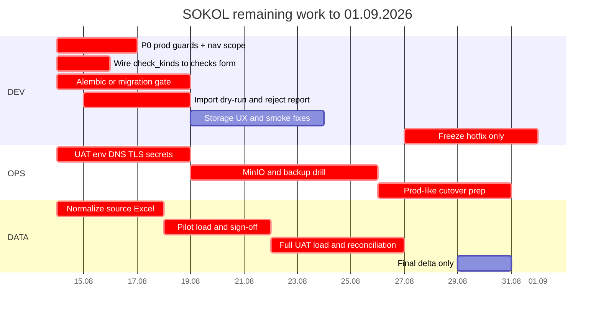

# План оставшихся работ SOKOL до 01.09.2026

**Актуально:** 13 августа 2026  
**Жёсткий go-live:** 1 сентября 2026, 09:00  
**Окно:** 14.08-31.08 = 18 календарных дней / около 12 рабочих дней.

Документ оставляет только незакрытые работы, решения до go-live и backlog после 1 сентября.

## Цель к 1 сентября

К go-live должен быть доступен ограниченный, но рабочий промышленный контур:

| Критерий | Минимум к 01.09 |
|----------|-----------------|
| Доступ | UI и API доступны во внутреннем контуре по HTTPS или через согласованный UAT/prod URL |
| Auth | Internal JWT включён, слабые prod-секреты запрещены, HTTP Basic отключён или явно запрещён в prod |
| БД | PostgreSQL со схемой через Alembic baseline или утверждённый временный migrate-runbook |
| Данные | Загружен согласованный объём проверок и рекомендаций, count сверены с источником |
| Вложения | MinIO настроен и проверен либо бизнес подписал временное ограничение по файлам |
| Документы | DOCX tools проходят smoke на эталонных файлах АЗ |
| Backup | Проверены backup/restore PostgreSQL и MinIO |
| Поддержка | Runbook, контакты и rollback-процедура переданы сопровождению |

## Scope Freeze

До 1 сентября не начинаем новые продуктовые модули. Любой новый запрос бизнеса идёт после go-live, кроме P0 по ИБ, потере данных или невозможности запуска.

Вне scope до 01.09:

- OIDC/Keycloak как обязательный flow, если банк не выдаёт IdP вовремя.
- CRUD наблюдений.
- Интеграция с СЭД Канцлер.
- Server-side pagination/search, пока фактический объём не превышает 10000 checks/recommendations.
- Streaming/queue для DOCX tools.
- Golden DOCX CI и большой рефакторинг exports.
- Полная FK-нормализация справочников.

## P0 - сделать до 18.08

| ID | Задача | Почему критично | DoD |
|----|--------|-----------------|-----|
| P0-01 | Скрыть `Канцлер` из production nav/route или закрыть feature flag | Сейчас это видимая заглушка без backend-контракта | В prod build нет пункта `Канцлер`; прямой `/kantsler` не показывает обещания интеграции |
| P0-02 | Принять решение по `Планированию`: скрыть до v2 или явно пометить beta/limited | Раздел есть в UI, но экспорт отключён и scope ограничен | В prod нет ложного обещания полноценного модуля планирования |
| P0-03 | Подключить `check_kinds` к форме и фильтрам проверок | Go-live критерий G6: виды проверок должны браться из справочника, а не из захардкоженного списка | Форма проверки и фильтры используют `/settings/check_kinds`; новые виды из Settings доступны без релиза frontend |
| P0-04 | Запретить demo-load по умолчанию в Docker | Сейчас `SOKOL_LOAD_DEMO_DATA` default `1`; пустой UAT/prod может сам загрузить demo | Default `0` в root compose и backend compose; demo включается только явным opt-in |
| P0-05 | Добавить prod guards для destructive seed/import | `--replace` очищает `checks` и `recommendations` | `SOKOL_ENV=prod` блокирует demo load / seed replace без явного break-glass confirm |
| P0-06 | Alembic baseline или утверждённый временный DB migration gate | Сейчас схема = `create_all` + ad-hoc `migrate_*`, что рискованно для UAT/prod | Предпочтительно: `alembic upgrade head` на пустой БД. Минимальный fallback: зафиксированный порядок `migrate_*`, проверенный на чистой БД |
| P0-07 | Import dry-run + reject report | Нельзя грузить реальные данные без отчёта ошибок | `python -m app.db.import_seed_data --dry-run --report reject_report.csv` не меняет БД и показывает ok/reject counts |
| P0-08 | Отключить HTTP Basic в prod | Basic сейчас второй auth-flow, который сложнее контролировать | `SOKOL_ENABLE_BASIC_AUTH=false` в prod; Bearer продолжает работать |
| P0-09 | Prod-safe `sync_dictionaries` | Сейчас sync может удалить пользователей/аудиторов/подразделения, которых нет в каноническом списке | В prod sync только добавляет недостающие записи; destructive sync только по explicit dev/demo flag |

## P1 - сделать до 25.08

| ID | Задача | Почему важно | DoD |
|----|--------|--------------|-----|
| P1-01 | Включить required CI checks в branch protection | Workflow есть, но без required gate его можно обойти | `Backend (Python 3.12)` и `Frontend (Node 22)` обязательны для merge |
| P1-02 | Import validation на bulk-загрузке | API CRUD валидирует справочники, но import пишет напрямую в модели | Import канонизирует и валидирует аудиторов, виды, объекты аудита; rejects попадают в report |
| P1-03 | Storage status UX для MinIO | Пользователь сейчас узнаёт о недоступном MinIO только после действия | UI показывает `storage disabled/unreachable`, upload disabled, есть retry |
| P1-04 | MinIO policy и backup/restore runbook | Файлы живут вне PostgreSQL dump | Документированы bucket policy, volume backup, restore и сверка `attachments` |
| P1-05 | UAT deploy checklist | Нужен воспроизводимый запуск в банковском контуре | `.env`/секреты/порты/DNS/TLS/CORS описаны; `/api/v1/status` и UI открываются |
| P1-06 | Загрузка пилотных данных 10-20 проверок | Ранний контроль маппинга до полной загрузки | 10-20 проверок и рекомендации видны в UI; 3 карточки сверены бизнесом |
| P1-07 | Полная загрузка согласованного объёма на UAT | Go-live без данных бессмысленен | Count checks/recommendations в API совпадает с freeze-файлом |
| P1-08 | DOCX smoke на эталонных АЗ | Инструменты - ключевая ценность пилота | 2-3 файла АЗ проходят `section-ii`, `section-ii-links`, `memorandum`, `parse-recommendations` |
| P1-09 | Backup/restore drill | Без восстановления нельзя идти в prod-like | Restore PostgreSQL на чистый том успешен; MinIO volume/object backup проверен |
| P1-10 | Сквозной smoke script | Нужна быстрая проверка перед freeze | Login -> list checks -> create/edit check -> recommendation -> attachments -> analytics -> tools |
| P1-11 | Runbook сопровождения | После 01.09 поддержка должна знать, что делать | Старт/стоп, логи, backup, restore, rollback, контакты, known limits |

## Календарь до go-live

## Daily Plan

### 14.08-18.08 - закрыть P0

| Дата | Фокус | Результат к EOD |
|------|-------|-----------------|
| 14.08 | Freeze scope, branch protection, nav scope, `check_kinds`, Docker demo default | Нет видимых заглушек в prod scope; CI required согласован; виды проверок идут из справочника |
| 15.08 | Prod guards: demo/replace/basic auth | Prod не стартует с опасными флагами; Basic выключаем для prod |
| 16-17.08 | Alembic baseline или проверенный migration fallback | Чистая БД поднимается воспроизводимо |
| 18.08 | Import dry-run и первый dry-run данных | Есть reject report и список правок DATA |

### 19.08-25.08 - UAT и данные

| Дата | Фокус | Результат к EOD |
|------|-------|-----------------|
| 19.08 | UAT env, CORS, TLS/proxy черновик | Login открывается на UAT URL |
| 20.08 | Пилотная загрузка 10-20 проверок | DATA sign-off по 3 карточкам |
| 21.08 | Storage UX + MinIO operational policy | Upload либо работает, либо явно заблокирован с понятным текстом |
| 22-23.08 | Полная нормализация Excel | Freeze-файл готов к загрузке |
| 24-25.08 | Полная UAT загрузка + сверка | Count API = count источника; расхождения разобраны |

### 26.08-01.09 - freeze и запуск

| Дата | Фокус | Результат к EOD |
|------|-------|-----------------|
| 26.08 | DOCX smoke + backup/restore | Протокол smoke и restore |
| 27.08 | Feature freeze | Новые фичи запрещены, только P0/P1 bugs |
| 28.08 | Prod-like regression | Сквозной smoke проходит за 30 минут |
| 29-30.08 | Финальная дельта данных, runbook | Runbook v1.0 у сопровождения |
| 31.08 | Go/No-Go | Протокол Go или сокращённый режим |
| 01.09 09:00 | Go-live | Мониторинг первого дня |

## DATA Track

Цель DATA-трека - не идеальная витрина, а загружаемый и сверенный набор данных.

| Шаг | Что сделать | Критерий |
|-----|-------------|----------|
| D1 | Зафиксировать freeze-шаблон Excel для `checks` и `recommendations` | Колонки соответствуют API/import |
| D2 | Нормализовать даты, статусы, виды проверок, аудиторов, объекты аудита | Dry-run reject меньше 5%; есть `mappings.yaml` или другой согласованный словарь замен |
| D3 | Загрузить пилот 10-20 проверок | 3 карточки проверены владельцем данных |
| D4 | Загрузить полный объём на UAT | Count совпадает с Excel |
| D5 | Заморозить файл источника | Freeze-файл лежит в backup share с датой |
| D6 | Перед cutover грузить только дельту | Дельта меньше 5% или явно согласована |

Минимальные обязательные поля:

| Сущность | Must-have |
|----------|-----------|
| Проверка | `serial_number` или данные для генерации, `check_name`, `check_type`, `check_view`, `start_date`, `check_leader`, `status` |
| Рекомендация | `serial_number`, `sequence_number`, `name`, `audit_object`, `auditor`, `manager`, `status`, `additional_status` |

## OPS Track

| Задача | DoD |
|--------|-----|
| VM / host | Есть CPU/RAM/disk под Postgres, API, UI, MinIO; доступы выданы |
| DNS / TLS | Пользователи открывают согласованный HTTPS URL |
| Firewall | Пользователи не ходят напрямую к Postgres/MinIO/Ollama |
| Secrets | JWT, DB, MinIO secrets не лежат в git; prod secret не default |
| Backup | PostgreSQL dump и MinIO backup запускаются вручную и документированы |
| Restore | Restore проверен на чистом томе |
| Logs | Понятно, где смотреть API/UI/Postgres/MinIO logs |
| Rollback | Есть инструкция: остановить сервисы, восстановить DB/MinIO, поднять предыдущий образ |

## Go/No-Go 31.08

Go разрешён только если все пункты ниже закрыты:

- Auth работает, prod-секрет не default, Basic не является открытым prod-flow.
- Нет автоматической загрузки demo data на UAT/prod.
- Есть безопасный путь применения схемы БД: Alembic или подписанный временный migration-runbook.
- Данные загружены и сверены.
- Backup/restore PostgreSQL и MinIO проверены.
- UI не показывает незавершённые модули как готовые функции.
- Виды проверок в форме берутся из справочника.
- DOCX tools прошли smoke на эталонных файлах.
- Вложения либо работают, либо риск временно подписан бизнесом.
- Runbook и контакты у сопровождения.

No-Go обязателен, если:

- нет auth;
- нет данных;
- нет backup/restore;
- схема БД не воспроизводится;
- есть риск автоматического удаления или подмены рабочих данных.

Fallback при No-Go: ограниченный read-only/UAT-pilot режим, а не тихий production.

## Backlog после 01.09

Эти задачи не должны мешать текущему дедлайну:

| Приоритет | Задача |
|-----------|--------|
| P2 | OIDC/Keycloak вместо internal JWT, если банк готов выдать IdP |
| P2 | Server-side pagination/search и backend export-all при росте сверх 10000 строк |
| P2 | Streaming upload + concurrency limit для DOCX tools |
| P2 | Golden DOCX CI |
| P2 | Route lazy loading и split крупных frontend exports |
| P2 | Planning export |
| P2 | Materialized views/cache для тяжёлой analytics при росте данных |
| P3 | CRUD наблюдений |
| P3 | Интеграция с СЭД Канцлер |
| P3 | Полная FK-нормализация справочников |
| P3 | Audit log / история изменений статусов |

## Связанные документы

| Документ | Для чего |
|----------|----------|
| [docs/ACTION_PLAN.md](docs/ACTION_PLAN.md) | Детализация findings из code review |
| [docs/CI.md](docs/CI.md) | Как включить required CI checks |
| [docs/APP_LIMITS_AND_GOTCHAS.md](docs/APP_LIMITS_AND_GOTCHAS.md) | Лимиты пилотной версии |
| [sokol-backend/docs/ALEMBIC_AND_DATA.md](sokol-backend/docs/ALEMBIC_AND_DATA.md) | Init/migrate/import/backup |
| [sokol-backend/docs/DATABASE_SCHEMA.md](sokol-backend/docs/DATABASE_SCHEMA.md) | Подробная схема БД |
| [sokol-backend/docs/STORAGE.md](sokol-backend/docs/STORAGE.md) | MinIO и вложения |
