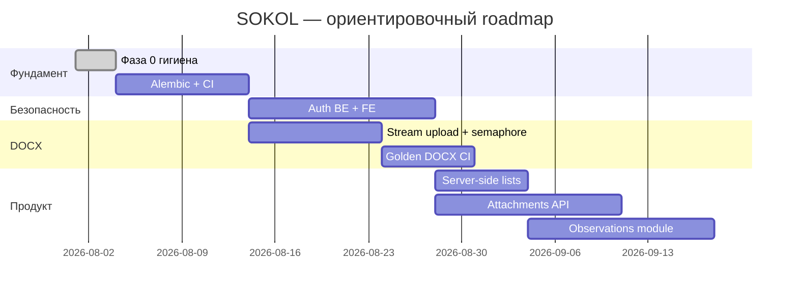

# План развития SOKOL

**Актуально:** август 2026  
**Назначение:** единый план дальнейших действий и реализации для всего репозитория (backend, frontend, инфраструктура).

Детальные разборы кода: [sokol-backend/docs/CODE_REVIEW.md](sokol-backend/docs/CODE_REVIEW.md), [sokol-frontend/docs/CODE_REVIEW.md](sokol-frontend/docs/CODE_REVIEW.md).

---

## Текущее состояние

| Область | Готово | Не готово / ограничения |
|---------|--------|-------------------------|
| **Проверки и рекомендации** | CRUD, фильтры на клиенте, экспорт XLSX/DOCX/PDF, импорт рекомендаций из АЗ | Server-side pagination/filter не используется UI; вложения только в браузере |
| **Справочники** | CRUD через API + Settings UI | Нет FK/валидации строковых полей домена против справочников |
| **Инструменты DOCX** | Раздел II (± ссылки), ДЗ, парсинг рекомендаций, раздел I (Ollama) | Upload in-memory; нет очереди; слабое покрытие audit-opinion тестами |
| **Аналитика** | Клиентские дашборды «Проверки», «Рекомендации», «Мониторинг», «ДВА» и экспорт из `SokolDataContext` | Нет analytics API (пока не нужен) |
| **Auth** | Stub login на фронте | Нет JWT/OIDC на API; fake «смена пароля» |
| **БД** | PostgreSQL + `create_all` + ad-hoc `migrate_*.py` | Нет Alembic; риск расхождения prod/dev |
| **CI/CD** | Ручные `unittest` / `npm run lint` | Нет GitHub Actions / pipeline на PR |
| **Наблюдения, планирование, канцлер** | Наблюдения: демо-таблица со связями на рекомендации; планирование/канцлер: UI-заглушки | Нет backend/API для наблюдений, планирования и канцлера |
| **Legacy** | `sokol-instruments/` — Streamlit-прототип DOCX | Не входит в основной стек; логика перенесена в `sokol-backend` |

**Тесты backend:** 61 unittest (1 skipped), фокус на DOCX. **Тесты frontend:** отсутствуют.

---

## Принципы приоритизации

1. **Безопасность и целостность данных** — auth и миграции раньше новых фич.
2. **Согласованность FE ↔ BE** — один контракт, явные ограничения (вложения, auth).
3. **Минимальный инкремент** — каждая фаза даёт измеримый результат, без «big bang».
4. **Документация следует за кодом** — после каждой фазы обновлять README, API.md, USER_STORIES.

---

## Фаза 0 — гигиена и onboarding (1–3 дня)

**Цель:** снизить путаницу у новых разработчиков, убрать шум в репозитории.

| # | Задача | Ответственность | Критерий готовности |
|---|--------|-----------------|---------------------|
| 0.1 | Зафиксировать два режима портов (Docker **8800**, local **8802**) | docs | ✅ Сделано в README, DOCKER.md, `*/docs` |
| 0.2 | Пометить `sokol-instruments/` как legacy | docs | README с явной отсылкой к основному стеку |
| 0.3 | Убрать или изолировать MinIO/MailHog в compose (`profiles: ["extras"]`) | infra | ✅ В backend compose MinIO/MailHog вынесены из default `docker compose up` |
| 0.4 | Свести env в единый `Settings` (CORS, max upload) | backend | Все `os.getenv` для app-конфига — через pydantic-settings |
| 0.5 | (Опционально) Унифицировать порт API в коде | backend + frontend | Один порт local/Docker, если onboarding всё ещё путает |

**Выход фазы:** новый разработчик поднимает стек по корневому README без расхождений в портах и env.

---

## Фаза 1 — фундамент для prod (1–2 недели)

**Цель:** воспроизводимая схема БД и автоматические проверки на PR.

### Backend

| # | Задача | Детали реализации |
|---|--------|-------------------|
| 1.1 | **Alembic** | `alembic init`; baseline-ревизия от текущей схемы; перенос `app/db/migrate_*.py` в ревизии |
| 1.2 | **Prod init** | `create_all` только для dev/test; prod — только `alembic upgrade head` |
| 1.3 | **Integration tests** | TestClient + тестовая Postgres (docker service в CI): smoke CRUD checks/recommendations/settings |
| 1.4 | **CI pipeline** | GitHub Actions: `compileall`, `unittest`, (опционально) ruff/mypy |

### Frontend

| # | Задача | Детали реализации |
|---|--------|-------------------|
| 1.5 | **CI pipeline** | `npm ci`, `npm run lint`, `npm run build` |
| 1.6 | **Vitest (минимум)** | Тесты mappers (`api/mappers`), `errors.ts`, status enums |

**Выход фазы:** PR не мержится без зелёного CI; схема БД версионируется.

**Зависимости:** 1.3 блокируется 1.1; 1.6 можно параллельно.

---

## Фаза 2 — безопасность (2–4 недели)

**Цель:** закрытый доступ к аудиторским данным; согласованный login FE ↔ BE.

### Backend

| # | Задача | Детали реализации |
|---|--------|-------------------|
| 2.1 | **Auth middleware** | JWT или OIDC (Keycloak); dependency `get_current_user` на всех `/api/v1/*` кроме health |
| 2.2 | **Роли** | Минимум: `auditor` (read/write домен), `admin` (справочники + delete) |
| 2.3 | **Audit log** | Structured logging критичных операций: delete check, tools generate, settings mutate |

### Frontend

| # | Задача | Детали реализации |
|---|--------|-------------------|
| 2.4 | **Keycloak / OIDC** | Замена stub `LoginPage`; Axios interceptor `Authorization: Bearer` |
| 2.5 | **AuthGuard** | Проверка валидности токена, не только localStorage flag |
| 2.6 | **Профиль** | Убрать fake «смена пароля» **или** disabled + текст «через SSO» |
| 2.7 | **«Мои» проверки** | Привязка к server-side identity (subject/displayName), не только localStorage ФИО |

**Выход фазы:** API недоступен без токена; UI не показывает ложных успехов auth.

**Зависимости:** 2.4–2.7 блокируются 2.1; можно начать с API key / internal JWT, затем Keycloak.

---

## Фаза 3 — платформа DOCX (ongoing, 2–4 недели на первый инкремент)

**Цель:** устойчивость `/tools` под нагрузкой и регрессии.

| # | Задача | Детали реализации |
|---|--------|-------------------|
| 3.1 | **Streaming upload** | Запись multipart на диск; не держать 100 MB в RAM |
| 3.2 | **Concurrency limit** | Семафор/async lock на параллельные DOCX jobs (например, max 2) |
| 3.3 | **Рефакторинг pipeline** | `docx_generator.py` / `docx_parser.py` → фазы: strip / parse / locate / build / rewrite |
| 3.4 | **Golden files CI** | Каталог эталонных `.docx` АЗ; snapshot/regression tests |
| 3.5 | **Audit opinion tests** | Мок Ollama; healthcheck Ollama в Docker CI (optional job) |
| 3.6 | **Exception handlers** | Единый JSON `{ "detail": "..." }` для 500 |

**Выход фазы:** параллельные upload не валят worker; регрессии DOCX ловятся CI.

---

## Фаза 4 — продуктовые улучшения (4–8 недель, параллельно по приоритету)

**Цель:** закрыть UX-дыры и масштабируемость списков.

### 4A — данные и списки (высокий приоритет)

| # | Задача | Backend | Frontend |
|---|--------|---------|----------|
| 4.1 | Server-side filter/pagination | Расширить query params list endpoints | `ChecksTab` / `RecommendationsTab` — запросы с `search`, `status`, `skip/limit` |
| 4.2 | Вложения | MinIO (или S3) + metadata table; `POST /attachments` | Upload с формы; явный статус «сохранено» / «ошибка» |
| 4.3 | Нормализация справочников | FK или validation `check_leader` / `check_type` against settings | Combobox из API вместо свободного текста (постепенно) |

### 4B — новые модули (средний приоритет)

| # | Модуль | Backend | Frontend |
|---|--------|---------|----------|
| 4.4 | **Наблюдения** | Модель `Observation`, CRUD, связь с check | Подключить существующий UI к API |
| 4.5 | **Планирование** | TBD (календарь проверок, ресурсы) | Заменить заглушку |
| 4.6 | **Канцлер** | Интеграция с СЭД (контракт TBD) | Заменить заглушку или скрыть из nav до готовности |

### 4C — аналитика (низкий приоритет, при росте данных)

| # | Задача | Условие |
|---|--------|---------|
| 4.7 | Server-side analytics API | Когда `limit=1000` на рекомендациях становится узким местом |
| 4.8 | Виртуализация таблиц | Длинные списки на клиенте |

**Выход фазы 4A:** вложения персистятся; списки не тянут 1000 записей без необходимости.

---

## Фаза 5 — качество UX и сопровождение (непрерывно)

| # | Задача | Детали |
|---|--------|--------|
| 5.1 | Разбить крупные компоненты | `CheckFormPage`, `ChecksTab`, `RecommendationsTab` → hooks + subcomponents |
| 5.2 | Единый error/toast UI | Заменить `console.error` в Settings |
| 5.3 | Playwright smoke | login → checks list → create recommendation round-trip |
| 5.4 | `npm audit` в CI | xlsx / docx dependencies |
| 5.5 | Structured logging + correlation id | Backend request tracing |

---

## Матрица готовности к промышленной эксплуатации

| Критерий | Сейчас | Цель (минимум prod) | Фаза |
|----------|--------|---------------------|------|
| Auth | ❌ | JWT/OIDC обязательно | 2 |
| Миграции БД | `create_all` | Alembic | 1 |
| CI | ❌ | unittest + lint + build | 1 |
| API integration tests | ❌ | smoke CRUD | 1 |
| Frontend tests | ❌ | Vitest mappers + smoke E2E | 1, 5 |
| Upload `/tools` | in-memory | stream + limit concurrency | 3 |
| Вложения | UI only | object storage + API | 4 |
| Analytics | client-side | client-side OK до роста данных | — |
| Документация | актуальна | обновлять после каждой фазы | 0+ |

---

## Рекомендуемый порядок спринтов

### Спринт 1 (неделя 1): фундамент
- Завершить 0.3–0.4 (compose profiles, Settings)
- Начать Alembic baseline (1.1–1.2)
- Поднять GitHub Actions (1.4, 1.5)

### Спринт 2 (неделя 2): тесты и стабильность
- Integration tests CRUD (1.3)
- Vitest mappers (1.6)
- Streaming upload POC (3.1)

### Спринт 3–4: auth
- Backend JWT/OIDC (2.1–2.3)
- Frontend Keycloak (2.4–2.7)

### Спринт 5+: продукт
- Server-side lists (4.1)
- Вложения (4.2) **или** явная пометка «не сохраняется» до 4.2
- Наблюдения (4.4) по запросу бизнеса

---

## Чеклист «что обновить в docs после реализации»

| Изменение в коде | Документы |
|------------------|-----------|
| Новый endpoint | `sokol-backend/docs/API.md`, Swagger |
| Auth | README (все уровни), USER_STORIES, ARCHITECTURE |
| Alembic | DEVELOPMENT.md, DATA_AND_DB.md |
| Новый модуль (observations) | USER_STORIES, ARCHITECTURE (FE+BE), корневой README «Текущие возможности» |
| CI | DEVELOPMENT.md, RUNBOOK.md |
| Порты/env | README, DOCKER.md, `.env.example` |

---

## Связанные документы

| Документ | Содержание |
|----------|------------|
| [README.md](README.md) | Быстрый старт, порты, возможности |
| [DOCKER.md](DOCKER.md) | Коробочный Docker |
| [sokol-backend/docs/ROADMAP.md](sokol-backend/docs/ROADMAP.md) | Backend-only backlog |
| [sokol-frontend/docs/ROADMAP.md](sokol-frontend/docs/ROADMAP.md) | Frontend-only backlog |
| [sokol-backend/docs/CODE_REVIEW.md](sokol-backend/docs/CODE_REVIEW.md) | Findings backend |
| [sokol-frontend/docs/CODE_REVIEW.md](sokol-frontend/docs/CODE_REVIEW.md) | Findings frontend |
