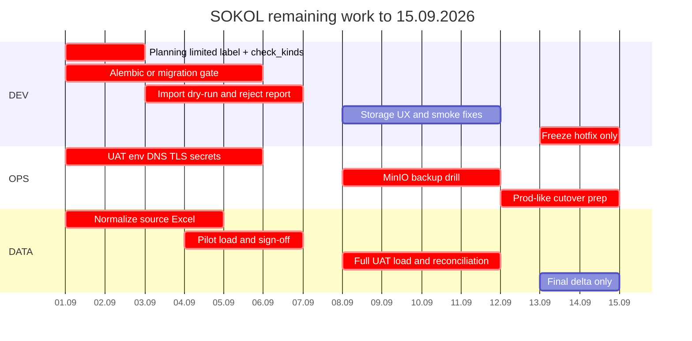

# План оставшихся работ SOKOL до 15.09.2026

**Актуально:** 4 сентября 2026  
**Исходный go-live:** 1 сентября 2026 — не уложились, перенос на **один спринт**.  
**Новый жёсткий go-live:** 15 сентября 2026, 09:00  
**Окно:** 01.09–14.09 = 14 календарных дней / около 10 рабочих дней.

Документ фиксирует текущее состояние продукта, закрытые работы августа, оставшийся объём до go-live и backlog после 15 сентября.

## Что уже есть в текущей версии

Продуктовый контур пилота собран и работает локально / в Docker. Это не go-live, но база для спринта 01.09–15.09.

| Область | Состояние на 04.09 |
|---------|--------------------|
| Auth | Internal JWT, RBAC `auditor` / `department_head` / `admin`, lookup `is_active` из БД. HTTP Basic в prod выключен. Слабый JWT-секрет в prod блокирует старт |
| Проверки / рекомендации | CRUD, фильтры, клиентский экспорт таблиц (XLSX/PDF/DOCX/HTML), yearly №, импорт рекомендаций из АЗ с undo, вложения через MinIO API |
| Справочники | Settings CRUD; физические FK на labels; in-use delete → 409. Виды проверок живут в `check_kinds`, но **форма и фильтры проверок всё ещё на захардкоженном списке** |
| Аналитика | Серверные SQL-агрегаты: проверки, рекомендации, мониторинг, ДВА, матрицы. Конструктор дашбордов — только frontend (`/constructor`) |
| Планирование | Дашборд `/planning` + visual export + отправка графиков в конструктор. В UI нет пометки limited/beta |
| Инструменты | Раздел II, ссылки, докладная, parse-recommendations, control file. Audit opinion / Ollama — вне scope |
| Канцлер | Убран из nav и routes. Неизвестный URL → `/checks` |
| БД | PostgreSQL + `create_all` + `migrate_*`. Alembic **не внедрён** |
| Import | Excel → checks/recommendations; `--replace` в prod только с `--confirm-prod-replace`. Нет dry-run и reject report: неизвестные справочники **досоздаются**, а не отклоняются |
| Demo | `SOKOL_ENV=prod` запрещает demo load и seed replace. Compose default `SOKOL_LOAD_DEMO_DATA=1` сохранён для local Docker |
| CI | Workflow `Backend (Python 3.12)` и `Frontend (Node 22)` есть. Merge в default branch блокируется ruleset `CI merge gate` ([docs/CI.md](docs/CI.md)) |
| Storage UX | Backend `GET /attachments/storage/status` + frontend `useStorageStatus`: banner, disabled upload, retry |
| Эксплуатация | Документы MinIO/backup есть. UAT URL, пилотные данные, restore drill, runbook сопровождения — не закрыты |

## Закрыто в августе (не повторяем)

| ID | Что сделано |
|----|-------------|
| P0-01 | `Канцлер` снят с production nav/route |
| P0-05 | Prod guards: `SOKOL_ENV=prod` блокирует demo load и `--replace` без `--confirm-prod-replace` |
| P0-08 | HTTP Basic выключен в prod (`SOKOL_ENABLE_BASIC_AUTH`) |
| P0-09 | `sync_dictionaries` в prod — merge-only, in-use labels не удаляются |

## Закрыто в сентябре (не повторяем)

| ID | Что сделано |
|----|-------------|
| P1-01 | Required CI checks: ruleset `CI merge gate` (`Backend (Python 3.12)`, `Frontend (Node 22)`). Поддерживает `.github/workflows/protect-main.yml` |

## Цель к 15 сентября

К go-live должен быть доступен ограниченный, но рабочий промышленный контур:

| Критерий | Минимум к 15.09 |
|----------|-----------------|
| Доступ | UI и API доступны во внутреннем контуре по HTTPS или через согласованный UAT/prod URL |
| Auth | Internal JWT включён, слабые prod-секреты запрещены, HTTP Basic отключён или явно запрещён в prod |
| БД | PostgreSQL со схемой через Alembic baseline или утверждённый временный migrate-runbook |
| Данные | Загружен согласованный объём проверок и рекомендаций, count сверены с источником |
| Вложения | MinIO настроен и проверен либо бизнес подписал временное ограничение по файлам |
| Документы | DOCX tools проходят smoke на эталонных файлах АЗ |
| Backup | Проверены backup/restore PostgreSQL и MinIO |
| Поддержка | Runbook, контакты и rollback-процедура переданы сопровождению |

## Scope Freeze

До 15 сентября не начинаем новые продуктовые модули. Текущая доработка аналитики (матрица существенности / visual export) добивается, если уже в работе; новые дашборды и рефакторинг экспортов — после go-live. Любой новый запрос бизнеса идёт после 15.09, кроме P0 по ИБ, потере данных или невозможности запуска.

Вне scope до 15.09:

- OIDC/Keycloak как обязательный flow, если банк не выдаёт IdP вовремя.
- CRUD наблюдений.
- Интеграция с СЭД Канцлер.
- Server-side pagination/search, пока фактический объём не превышает 10000 checks/recommendations.
- Streaming/queue для DOCX tools.
- Golden DOCX CI и большой рефакторинг analytics visual export.
- Полная FK-нормализация справочников (UUID вместо label).

## P0 — сделать до 08.09

Оставшиеся блокеры. Без них нельзя грузить UAT-данные и резать prod-like стенд.

| ID | Задача | Почему критично | DoD |
|----|--------|-----------------|-----|
| P0-02 | Явно пометить `Планирование` как limited/beta | Раздел в nav, дашборд и export рабочие — без пометки выглядит как полноценный модуль | На `/planning` видно, что модуль ограниченный |
| P0-03 | Подключить `check_kinds` к форме и фильтрам проверок | Виды проверок должны браться из справочника, а не из `CHECK_VIEW_OPTIONS` | Форма проверки и фильтры используют `/settings/check_kinds`; новые виды из Settings доступны без релиза frontend |
| P0-04 | Demo-load не должен быть default на UAT/prod | Compose default всё ещё `SOKOL_LOAD_DEMO_DATA=1`; пустой стенд без `SOKOL_ENV=prod` сам загрузит demo | UAT/prod: `SOKOL_ENV=prod` и `SOKOL_LOAD_DEMO_DATA=0`. Предпочтительно default `0` в root/backend compose; demo только явным opt-in |
| P0-06 | Alembic baseline или утверждённый временный DB migration gate | Схема = `create_all` + ad-hoc `migrate_*` | Предпочтительно: `alembic upgrade head` на пустой БД. Минимальный fallback: зафиксированный порядок `migrate_*`, проверенный на чистой БД, подписанный runbook |
| P0-07 | Import dry-run + reject report | Сейчас import досоздаёт справочники и пишет в БД без отчёта ошибок | `python -m app.db.import_seed_data --dry-run --report reject_report.csv` не меняет БД и показывает ok/reject counts |

## P1 — сделать до 12.09

| ID | Задача | Почему важно | DoD |
|----|--------|--------------|-----|
| P1-02 | Import validation на bulk-загрузке | API CRUD валидирует справочники; import сейчас `ensure_*` (досоздаёт labels) | Import канонизирует и валидирует аудиторов, виды, объекты аудита; неизвестные значения — reject в report, а не silent insert в справочник |
| P1-03 | Storage status UX для MinIO | **сделано** | UI показывает `storage disabled/unreachable`, upload disabled, есть retry |
| P1-04 | Backup/restore drill MinIO + PostgreSQL | Документы `docs/MINIO.md` и dump-команды есть; операционный drill не подтверждён | Restore PostgreSQL на чистый том успешен; MinIO volume/object backup проверен; сверка `attachments` |
| P1-05 | UAT deploy checklist | Нужен воспроизводимый запуск в банковском контуре | `.env`/секреты/порты/DNS/TLS/CORS описаны; `/api/v1/status` и UI открываются |
| P1-06 | Загрузка пилотных данных 10–20 проверок | Ранний контроль маппинга до полной загрузки | 10–20 проверок и рекомендации видны в UI; 3 карточки сверены бизнесом |
| P1-07 | Полная загрузка согласованного объёма на UAT | Go-live без данных бессмысленен | Count checks/recommendations в API совпадает с freeze-файлом |
| P1-08 | DOCX smoke на эталонных АЗ | Инструменты — ключевая ценность пилота | 2–3 файла АЗ проходят `section-ii`, `section-ii-links`, `memorandum`, `parse-recommendations` |
| P1-09 | Сквозной smoke script | Нужна быстрая проверка перед freeze | Login → list checks → create/edit check → recommendation → attachments → analytics → tools |
| P1-10 | Runbook сопровождения | После 15.09 поддержка должна знать, что делать | Старт/стоп, логи, backup, restore, rollback, контакты, known limits |

## Календарь до go-live

## Daily Plan

### 01.09–08.09 — закрыть P0

| Дата | Фокус | Результат к EOD |
|------|-------|-----------------|
| 01–02.09 | Scope freeze, `check_kinds` в форме/фильтрах, метка limited на Планировании, demo default / UAT env flags | Нет ложного обещания планирования; виды проверок идут из справочника; UAT не грузит demo сам |
| 03–05.09 | Alembic baseline или проверенный migration fallback | Чистая БД поднимается воспроизводимо |
| 08.09 | Import dry-run и первый dry-run данных | Есть reject report и список правок DATA |

### 09.09–12.09 — UAT и данные

| Дата | Фокус | Результат к EOD |
|------|-------|-----------------|
| 09.09 | UAT env, CORS, TLS/proxy; CI required checks | Login открывается на UAT URL; merge без зелёного CI запрещён |
| 10.09 | Пилотная загрузка 10–20 проверок; Storage UX | DATA sign-off по 3 карточкам; upload либо работает, либо явно заблокирован |
| 11.09 | Полная нормализация Excel + MinIO/PG restore drill | Freeze-файл готов; протокол restore |
| 12.09 | Полная UAT загрузка + сверка | Count API = count источника; расхождения разобраны |

### 13.09–15.09 — freeze и запуск

| Дата | Фокус | Результат к EOD |
|------|-------|-----------------|
| 13.09 | DOCX smoke + feature freeze | Протокол smoke; новые фичи запрещены, только P0/P1 bugs |
| 14.09 | Prod-like regression, финальная дельта, runbook, Go/No-Go | Сквозной smoke за 30 минут; runbook v1.0 у сопровождения; протокол Go или сокращённый режим |
| 15.09 09:00 | Go-live | Мониторинг первого дня |

## DATA Track

Цель DATA-трека — не идеальная витрина, а загружаемый и сверенный набор данных.

| Шаг | Что сделать | Критерий |
|-----|-------------|----------|
| D1 | Зафиксировать freeze-шаблон Excel для `checks` и `recommendations` | Колонки соответствуют API/import |
| D2 | Нормализовать даты, статусы, виды проверок, аудиторов, объекты аудита | Dry-run reject меньше 5%; есть `mappings.yaml` или другой согласованный словарь замен |
| D3 | Загрузить пилот 10–20 проверок | 3 карточки проверены владельцем данных |
| D4 | Загрузить полный объём на UAT | Count совпадает с Excel |
| D5 | Заморозить файл источника | Freeze-файл лежит в backup share с датой |
| D6 | Перед cutover грузить только дельту | Дельта меньше 5% или явно согласована |

Минимальные обязательные поля:

| Сущность | Must-have |
|----------|-----------|
| Проверка | `serial_number` или данные для генерации, `check_name`, `check_type`, `check_view`, `start_date`, `check_leader`, `status` |
| Рекомендация | `serial_number`, `sequence_number`, `name`, `audit_object`, `auditor`, `manager`, `status`, `additional_status` |

## OPS Track

| Задача | DoD |
|--------|-----|
| VM / host | Есть CPU/RAM/disk под Postgres, API, UI, MinIO; доступы выданы |
| DNS / TLS | Пользователи открывают согласованный HTTPS URL |
| Firewall | Пользователи не ходят напрямую к Postgres/MinIO/Ollama |
| Secrets | JWT, DB, MinIO secrets не лежат в git; prod secret не default |
| Backup | PostgreSQL dump и MinIO backup запускаются вручную и документированы |
| Restore | Restore проверен на чистом томе |
| Logs | Понятно, где смотреть API/UI/Postgres/MinIO logs |
| Rollback | Есть инструкция: остановить сервисы, восстановить DB/MinIO, поднять предыдущий образ |

## Go/No-Go 14.09

Go разрешён только если все пункты ниже закрыты:

- Auth работает, prod-секрет не default, Basic не является открытым prod-flow.
- Нет автоматической загрузки demo data на UAT/prod.
- Есть безопасный путь применения схемы БД: Alembic или подписанный временный migration-runbook.
- Данные загружены и сверены.
- Backup/restore PostgreSQL и MinIO проверены.
- UI не показывает незавершённые модули как готовые функции.
- Виды проверок в форме берутся из справочника.
- DOCX tools прошли smoke на эталонных файлах.
- Вложения либо работают, либо риск временно подписан бизнесом.
- Runbook и контакты у сопровождения.

No-Go обязателен, если:

- нет auth;
- нет данных;
- нет backup/restore;
- схема БД не воспроизводится;
- есть риск автоматического удаления или подмены рабочих данных.

Fallback при No-Go: ограниченный read-only/UAT-pilot режим, а не тихий production.

## Backlog после 15.09

Эти задачи не должны мешать текущему дедлайну:

| Приоритет | Задача |
|-----------|--------|
| P2 | OIDC/Keycloak вместо internal JWT, если банк готов выдать IdP |
| P2 | Server-side pagination/search и backend export-all при росте сверх 10000 строк |
| P2 | Streaming upload + concurrency limit для DOCX tools |
| P2 | Golden DOCX CI |
| P2 | Route lazy loading и split крупных frontend visual-export |
| P2 | Materialized views/cache для тяжёлой analytics при росте данных |
| P3 | CRUD наблюдений |
| P3 | Интеграция с СЭД Канцлер |
| P3 | Полная FK-нормализация справочников |
| P3 | Audit log / история изменений статусов |

## Связанные документы

| Документ | Для чего |
|----------|----------|
| [docs/ACTION_PLAN.md](docs/ACTION_PLAN.md) | Детализация findings из code review |
| [docs/CI.md](docs/CI.md) | Как включить required CI checks |
| [docs/APP_LIMITS_AND_GOTCHAS.md](docs/APP_LIMITS_AND_GOTCHAS.md) | Лимиты пилотной версии |
| [sokol-backend/docs/ALEMBIC_AND_DATA.md](sokol-backend/docs/ALEMBIC_AND_DATA.md) | Init/migrate/import/backup |
| [sokol-backend/docs/DATA_AND_DB.md](sokol-backend/docs/DATA_AND_DB.md) | Модель данных и схема БД |
| [sokol-backend/docs/STORAGE.md](sokol-backend/docs/STORAGE.md) | MinIO и вложения |
| [docs/MINIO.md](docs/MINIO.md) | Бакеты, консоль, backup MinIO |
