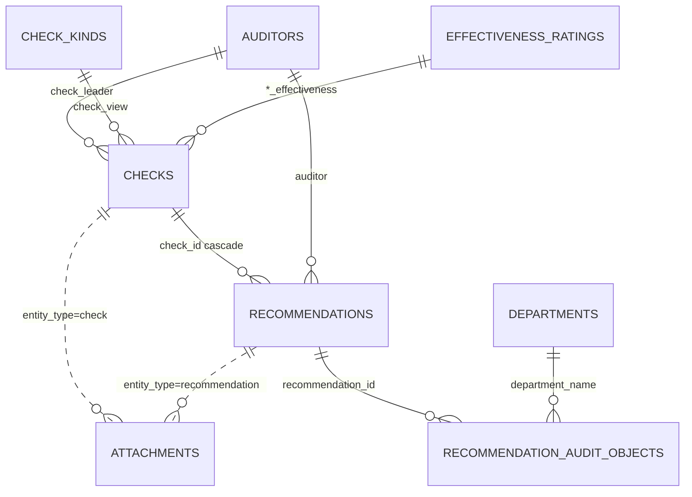

# Данные и БД

PostgreSQL 16 · SQLAlchemy 2 async · `asyncpg` · порт хоста **5433**. Схема: `create_all` + идемпотентные `python -m app.db.migrations NAME`. Alembic **нет**. Файлы: [STORAGE.md](STORAGE.md).

## Сущности

| Таблица | PK | Связи |
|---------|-----|-------|
| `checks` | int | → recommendations (`ON DELETE CASCADE`) |
| `recommendations` | int | FK `check_id` |
| `recommendation_audit_objects` | `(recommendation_id, department_name)` | FK на rec и `departments.name` |
| `attachments` | int | полиморфно `entity_type` + `entity_id`; bucket `check-{serial}` |
| `auditors` | UUID | unique `full_name`, unique `code` (3 латинские буквы) |
| `departments`, `check_kinds`, `effectiveness_ratings` | UUID | unique labels |
| `audit_types` | UUID | `code` + `name`, без unique и без FK в домен |
| `users` | UUID | unique `username`; роли `admin` / `department_head` / `auditor` |

Доменные ссылки на справочники — строки с физическим FK (`ON UPDATE CASCADE`; delete `RESTRICT`, для оценок `SET NULL`). Массив `recommendations.audit_object` дублируется для аналитики; целостность — в junction.



## Enum'ы

В БД пишутся **values**. API переходы не ограничивает.

| Enum | Значения |
|------|----------|
| `check_status` | `not_started`, `in_progress`, `completed` |
| `recommendation_status` | `completed`, `unresolved`, `on_control`, `in_progress` |
| `recommendation_additional_status` | `on_time`, `deadline_violated`, `on_control`, `in_progress` |
| `users.role` | `admin`, `department_head`, `auditor` |

Автостатус открытых rec: [ARCHITECTURE.md](ARCHITECTURE.md).

## Ключ проверки

`serial_number` уникален, клиент не задаёт. Формат: `{YY}{AUDITOR_CODE}{QUARTER}{P\|V\|K}{N}`.

Пример: `26KVS3P1` — год `start_date`, `auditors.code`, квартал, тип (`planned`→P, `unscheduled`→V, `thematic`→K), порядковый среди того же руководителя/типа/года.

Смена `start_date` / `check_quarter` / `check_leader` / `check_type` или `auditors.code` → каскад rec/attachments + MinIO (`check_serial_cascade.py`). Массово: `python -m app.db.recalculate_check_serial_numbers`.

`check_type` — код ключа, не FK на `audit_types`.

## Валидация справочников

- `check_leader`, `auditor` ∈ `auditors.full_name`
- `check_view` ∈ `check_kinds.label`
- непустые `*_effectiveness` ∈ ratings (пустое → `NULL`)
- `audit_object` канонизируется по `departments`; неизвестное в API → **400**; пустое → «Не указан»
- `manager` — свободный текст
- delete in-use и «Не указан» → **409**; дубликаты labels → **409** (кроме `audit_types`)
- переименование каскадно обновляет FK; массив `audit_object` — отдельно (`replace_recommendation_audit_object_label`)
- смена `auditors.code` переписывает ключи проверок этого руководителя

Import/seed: `ensure_*` досоздаёт labels, затем вставляет строки. UI так не делает.

Общий seed label-таблиц: `app/db/seeds/label_rows.py` (`seed_exact_label_rows`).

## Поля

**checks:** `id`, `serial_number` UK, `check_name`, `short_name?`, `check_type` (≤32), `check_view` FK, `check_quarter` 1–4, `start_date`, `end_date?`, `check_leader` FK, `status`, `created_at` (PATCH не меняет), `description?`, `order_*` / `program_*` / `az_*` / `dz_*`, `process|svk|sur|svik_effectiveness` FK ratings.

List search: имя, руководитель, ключ.

**recommendations:** `id`, `check_id` cascade, `serial_number` (денорм.), `sequence_number` (сервер), `name`, `observation_name?`, `description` default `''`, `indicator` / `additional_indicator` default `не указан`, `materiality_level` default `средний`, `audit_object` `text[]` + GIN, `deadline` (контроль), `execution_deadline` (исполнение, аудитор), `auditor` FK, `manager` текст, `status` / `additional_status`, `created_at`, `actual_completion_date?`, legacy `extension_1_*` / `extension_2_reason|comment` (без `extension_2_date`), `remove_from_control_*`, JSON `deadline_extensions` / `control_removals` (`{date?, comment?}`; `create_all` → JSON, migrate может дать JSONB), `closure_*`.

Create/batch ищут проверку по `serial_number`. Вход `audit_object` — массив или строка `,`/`;`.

**attachments:** нет физического FK на домен. `entity_type` `check`\|`recommendation`, `entity_id`, `slot`, `check_serial_number`, `bucket` `check-{serial}` lowercase, `object_key`, имя/MIME/size, `created_at` timestamptz.

Слоты check: `order`, `program`, `az`, `dz`, `dz_appendix`. Rec: `recommendation_files`, `control_removal_files`.

**users:** `username` UK, `password_hash`, `role`, `display_name`, `aliases?` (через запятую), `is_active` default true. Аватаров нет.

Нет soft-delete и audit log. Прямой SQL по `serial_number` / labels / `attachments.bucket` ломает целостность.

## Индексы

Из моделей: PK, unique serial/labels/username/auditor code, FK indexes.

Из `analytics_indexes`: `ix_checks_start_date`, `ix_checks_status`, `ix_checks_check_leader`, `ix_recommendations_deadline`, `ix_recommendations_auditor`, GIN `audit_object`, `ix_recommendations_status`, `ix_recommendations_materiality_level`, `ix_recommendations_deadline_status`. Плюс `ix_attachments_entity_lookup`.

Аналитика — без data mart. Период проверок и planning — `checks.start_date`; рекомендаций/мониторинга — `deadline`. Контракт: [API.md](API.md), [ANALYTICS.md](ANALYTICS.md).

## Пути к данным

| Что | Где |
|-----|-----|
| Excel seed (`checks.xlsx`, `recommendations.xlsx`) | корневой `sokol/data/` или `SOKOL_DATA_DIR` |
| Шаблон файла контроля, картинки существенности | `sokol-backend/data/` |
| Резолв | `app/utils/paths.py` |

## Init и seed

```bash
python -c "import asyncio; from app.db.init_db import init_db; asyncio.run(init_db())"
python -m app.db.seed_auditors
python -m app.db.seed_departments
python -m app.db.seed_audit_types
python -m app.db.seed_check_kinds
python -m app.db.seed_effectiveness_ratings
python -m app.db.seed_users
```

Либо `python -m app.db.sync_dictionaries`. Пароли: `SOKOL_ADMIN_PASSWORD` (default `admin`) для admin/department_head, `SOKOL_DEFAULT_USER_PASSWORD` (default `auditor`) для аудиторов.

Dev-логины (если `users` пуста): `Админ А.А.` / `admin` (alias `admin`), `Ковалев С.С.` / `admin` (`department_head`), аудиторы (ФИО) / `auditor`.

## Import

```bash
python -m app.db.import_seed_data              # добавить новые serial
python -m app.db.import_seed_data --replace    # TRUNCATE — только с бэкапом
# SOKOL_ENV=prod|production ещё требует --confirm-prod-replace
python -m app.db.import_seed_data --checks PATH --recommendations PATH
```

Неизвестные labels **досоздаются**. После импорта при MinIO: `python -m app.db.sync_check_buckets`.

| Команда | Назначение |
|---------|------------|
| `python -m app.db.seed_demo_data` | синтетика без Excel |
| `python -m app.db.bootstrap_presentation_demo` | Excel + import (`--replace` по умолчанию) |
| `python -m app.db.seed_demo_attachments` | демо-файлы во все слоты (`--check-id`, `--replace`) |
| `python -m app.db.recalculate_check_serial_numbers` | пересчёт ключей и buckets |

Скрипты `sokol-backend/scripts/`: генераторы Excel/demo, `import_catalog_excel.py`, `check_db_tables.py`, `delete_check_by_name.py`.

Docker: `SOKOL_LOAD_DEMO_DATA` в entrypoint default **on** (если checks уже есть и нет `SOKOL_SEED_REPLACE` — skip). Compose обычно `SOKOL_LOAD_DEMO_DATA:-1`. Prod запрещает demo; `--replace` без `--confirm-prod-replace` тоже.

Перед `--replace` и ручными migrate на shared/prod — **бэкап**.

## Bootstrap-миграции

Единый пакет: `python -m app.db.migrations --list|--bootstrap|--all|NAME`.

Порядок Docker (`--bootstrap` / `BOOTSTRAP_MIGRATIONS`):

1. `auditor_codes`
2. `check_quarter`
3. `check_effectiveness`
4. `attachments`
5. `dictionary_uniqueness`
6. `recommendation_execution_deadline` — колонка + enum value `in_progress`
7. `dictionary_foreign_keys`
8. `recommendation_observation_name`
9. `recommendation_indicator_on_control`
10. `recommendation_additional_indicator`
11. `analytics_indexes`

`--all` гоняет идемпотентные патчи для стендов старше `create_all` (short_name, recommendation fields, closure, audit_object array/canonical, statuses, materiality). `recommendation_indicators` — одноразовый remap, **не** для живой БД; только по имени.

## Новый стенд

1. Postgres (+ MinIO)
2. `init_db` + bootstrap-миграции
3. seed справочников + users
4. import / demo
5. `sync_check_buckets`; опционально `seed_demo_attachments`
6. smoke: `/api/v1/status`, `/checks`, `/analytics/checks`

## Бэкапы

```bash
export PGPASSWORD=postgres
pg_dump -h 127.0.0.1 -p 5433 -U postgres -d sokol_db -F c -f sokol_db.dump
pg_restore -h 127.0.0.1 -p 5433 -U postgres -d sokol_db --clean --if-exists sokol_db.dump
```

Dump **не** включает MinIO. После restore: `sync_check_buckets`, сверка `attachments`. Проверка таблиц: `python scripts/check_db_tables.py`.
