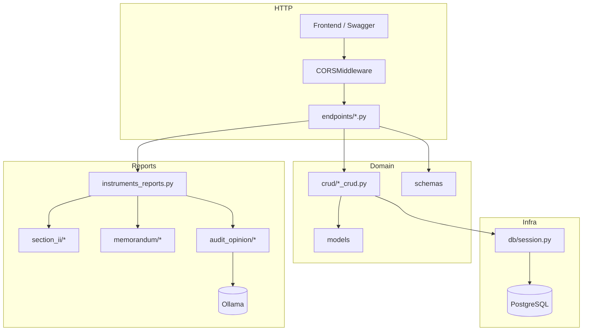
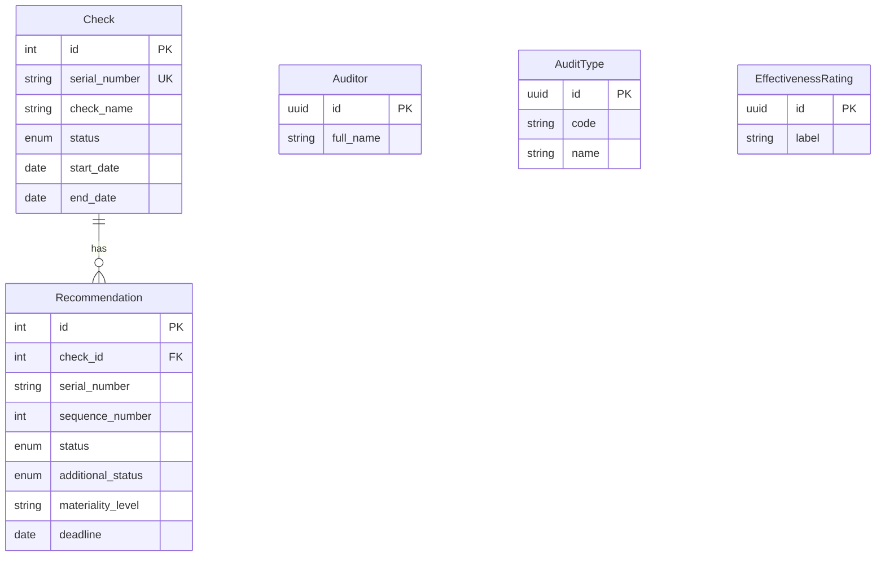
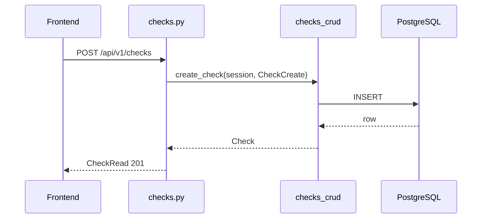
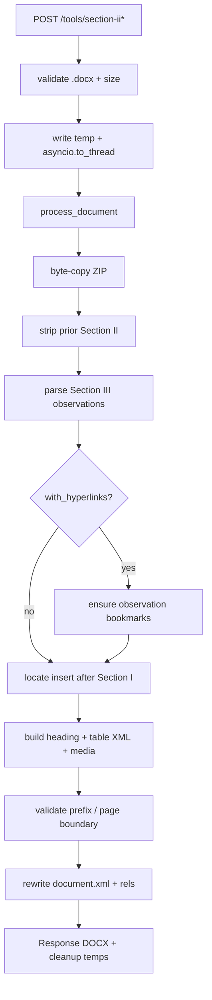
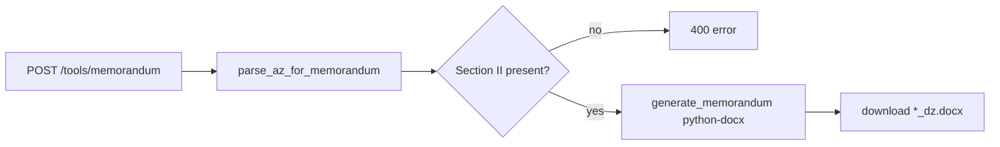
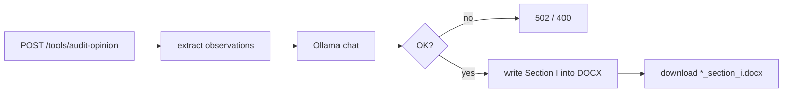

# Архитектура backend

## Назначение

SOKOL API — синхронный (по HTTP) FastAPI-сервис с async-доступом к PostgreSQL и CPU-bound обработкой DOCX в `asyncio.to_thread`. Домен: проверки, рекомендации, справочники, генерация/разбор аудиторских документов.

## Структура каталогов

```
sokol-backend/
├── app/
│   ├── main.py                 # FastAPI app, CORS
│   ├── api/
│   │   ├── router.py           # корневой api_router
│   │   └── v1/
│   │       ├── router.py       # prefix /api/v1
│   │       └── endpoints/      # health, checks, recommendations, settings, tools
│   ├── core/config.py          # Settings (pydantic-settings)
│   ├── crud/                   # async CRUD-функции (не классы-репозитории)
│   ├── db/                     # session, init_db, seeds, ad-hoc migrate_*.py
│   ├── models/                 # SQLAlchemy ORM
│   ├── schemas/                # Pydantic v2
│   ├── services/reports/       # section_ii + memorandum + audit_opinion
│   └── utils/                  # check_key, paths
├── tests/                      # unittest (DOCX)
├── scripts/                    # seed Excel, helpers
├── data/images/                # PNG материальности для Раздела II
├── docker/                     # Compose + Dockerfiles
└── .secrets/sokol.env          # DATABASE_URL, CORS, …
```

## Слои



| Слой | Роль | Что не делает |
|------|------|----------------|
| `endpoints` | HTTP, валидация UploadFile, Depends(session), HTTPException | бизнес-логику DOCX |
| `schemas` | контракт API | персистентность |
| `crud` | SQLAlchemy queries + commit | HTTP |
| `models` | таблицы и enum | API-форма |
| `services/reports` | парсинг/генерация DOCX | БД |
| `db` | engine, create_all, seed, ручные migrate | Alembic |

**Сервисного слоя для CRUD нет:** endpoint → CRUD-функция напрямую.

## Bootstrap

`app/main.py`:

1. Требует непустой `settings.database_url`, иначе `RuntimeError`.
2. Создаёт `FastAPI(title=settings.app_name)`.
3. CORS из `SOKOL_CORS_ORIGINS` (comma-separated; пусто → `*`).
4. Подключает `api_router` → `api_v1_router` с prefix `/api/v1`.
5. `GET /` → `{service, version: "v1"}`.

Нет: auth middleware, exception handlers, request logging, rate limit.

## API-модули

| Router prefix | Файл | Домен |
|---------------|------|-------|
| `/status` | `health.py` | liveness |
| `/checks` | `checks.py` | проверки |
| `/recommendations` | `recommendations.py` | рекомендации |
| `/settings/auditors` | `auditors.py` | справочник |
| `/settings/audit_types` | `audit_types.py` | справочник |
| `/settings/effectiveness_ratings` | `effectiveness_ratings.py` | справочник |
| `/tools` | `instruments_reports.py` | DOCX |

## Классы и ключевые типы

### Конфигурация и инфраструктура

| Символ | Тип | Ответственность |
|--------|-----|-----------------|
| `Settings` | `BaseSettings` | `app_name`, `api_v1_prefix`, `database_url`, Ollama URL/model/timeout |
| `Base` | DeclarativeBase | метаданные ORM |
| `get_db_session` | async generator | session per request |

Часть настроек **вне** `Settings`: `SOKOL_CORS_ORIGINS`, `SOKOL_MAX_UPLOAD_MB`.

### ORM (доменные сущности)



| Класс | Таблица | PK |
|-------|--------|-----|
| `Check` | `checks` | int |
| `Recommendation` | `recommendations` | int |
| `Auditor` | `auditors` | UUID |
| `AuditType` | `audit_types` | UUID |
| `EffectivenessRating` | `effectiveness_ratings` | UUID |

Enum’ы: `CheckStatus`, `RecommendationStatus`, `RecommendationAdditionalStatus` — см. [DATA_AND_DB.md](DATA_AND_DB.md).

### Pydantic-схемы

Паттерн: `*Base` / `*Create` / `*Update` / `*Read` / `*ListResponse` (`items` + `total`). Read-схемы с `from_attributes=True`.

### DOCX: Раздел II (`services/reports/section_ii`)

Оркестрация — **функции**, не классы. Модели данных:

| Dataclass | Назначение |
|-----------|------------|
| `Observation` | наблюдение из Раздела III → строка таблицы Раздела II |
| `RunFragment` | текстовый run + `rPr` / raw `<w:r>` для сохранения форматирования |
| `RecommendationEntry` | отдельная рекомендация внутри наблюдения |
| `DocumentBlock` / `TextboxBlock` | блоки тела документа (в `docx_blocks`) |
| `HeadingFormatSignature` | сигнатура стиля заголовка (`heading_detection`) |

| Модуль | Роль |
|--------|------|
| `docx_generator.py` | `process_document()` — ZIP copy → strip → parse → (bookmarks) → insert table → validate → rewrite |
| `docx_parser.py` | наблюдения из Раздела III с fidelity runs |
| `docx_blocks.py` | разбор `document.xml` на блоки |
| `field_parser.py` | материальность, сроки, ФИО, главы |
| `table_builder.py` | XML заголовка + таблицы Раздела II |
| `xml_utils.py` | границы разделов, точка вставки |
| `bookmark_utils.py` | TOC-bookmark для заголовка Раздела II |
| `observation_links.py` | якоря `SokolObs*` + hyperlinks |
| `heading_detection.py` | детект заголовков / Раздела III |
| `runs.py`, `fonts.py` | форматирование runs |
| `patterns.py` | regex + `W_NS` |

### DOCX: докладная (`services/reports/memorandum`)

| Dataclass | Назначение |
|-----------|------------|
| `MemorandumRecommendation` | абзацы + срок |
| `MemorandumAuditObject` | объект аудита + руководитель + список рекомендаций |
| `MemorandumSource` | список групп |

| Модуль | Роль |
|--------|------|
| `parser.py` | наличие Раздела II, `parse_az_for_memorandum`, `parse_recommendations_from_az` |
| `section_ii_table_parser.py` | разбор таблицы Раздела II |
| `docx_generator.py` | новый DOCX через **python-docx** |
| `memorandum_doc_parser.py` | парсер готовой ДЗ (в tools сейчас используется путь через АЗ) |

### DOCX: аудиторское мнение (`services/reports/audit_opinion`)

| Модуль | Роль |
|--------|------|
| `processor.py` | оркестрация: наблюдения → Ollama → правка раздела I |
| `ollama_client.py` | HTTP к Ollama (`/api/tags`, `/api/chat`) |
| `prompts.py` | дефолтный промпт и placeholder |

### Утилиты

| Символ | Назначение |
|--------|------------|
| `CheckKeySeed` / генерация serial | согласование ключа проверки с фронтом |
| `ParsedRecommendationItem` | Pydantic-ответ `/tools/parse-recommendations` |

## Поток запроса: CRUD



## Поток: Раздел II



## Поток: докладная записка



## Поток: аудиторское мнение



## Явные non-goals (текущий код)

- Auth / RBAC / JWT
- Alembic-миграции (только `create_all` + `app/db/migrate_*.py`)
- Celery / Redis / фоновые очереди
- S3 / MinIO в коде приложения (сервис может быть в Compose, но не используется)
- LanguageTool / MailHog в коде
- Analytics API (`/api/v1/analytics/*` **отсутствует**, хотя фронт его вызывает)

## Связь с фронтендом

| Контракт | Backend | Frontend |
|----------|---------|----------|
| CRUD checks/recommendations/settings | есть | `src/api/*.ts` + mappers |
| Tools DOCX + audit-opinion | `/tools/*` | `src/api/tools.ts`, `ToolsTab`, `AuditOpinionPanel` |
| Analytics by person | **нет** | `src/api/analytics.ts` → 404 |
| Auth header | не требуется | stub login в localStorage |
