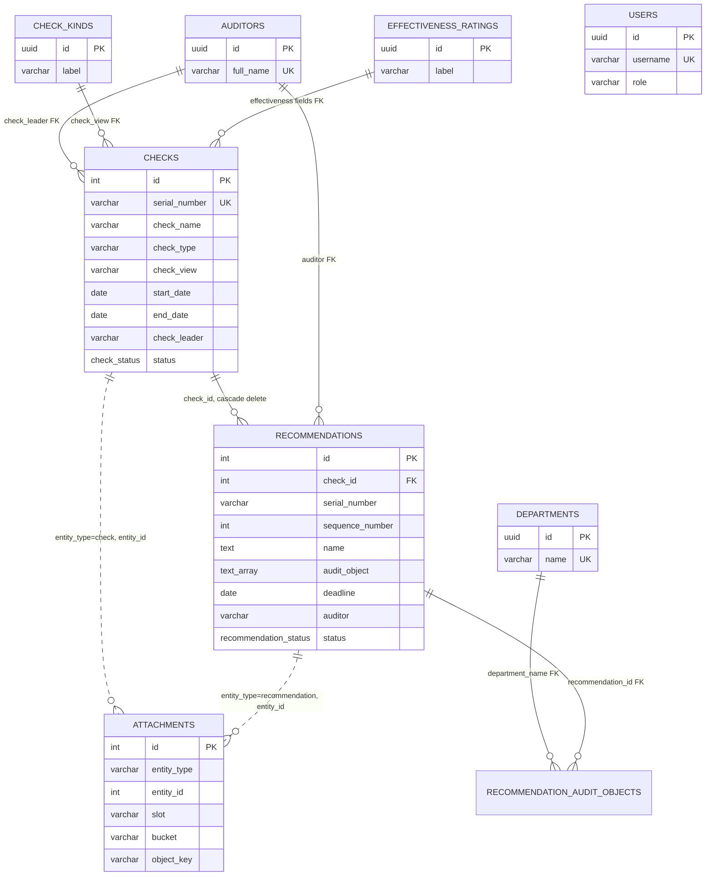
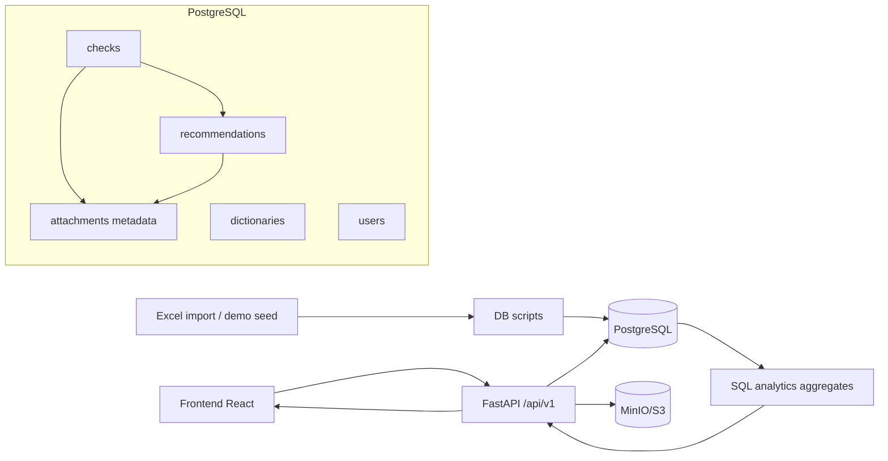
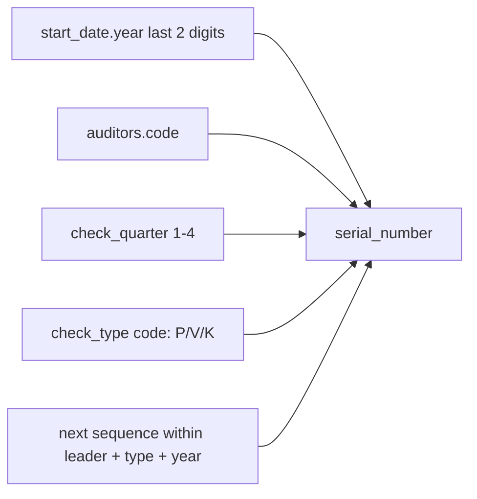
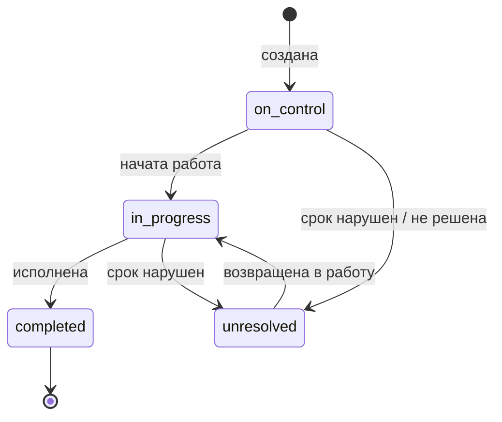
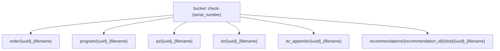
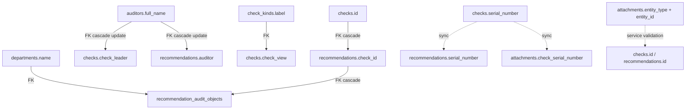
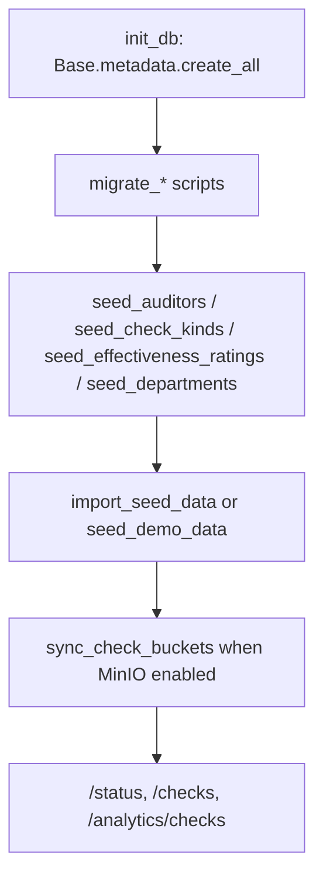

# Подробное описание базы данных SOKOL

Документ описывает фактическую модель данных backend-приложения SOKOL: какие таблицы есть в PostgreSQL, какие типы данных используются, как сущности связаны между собой и какие данные проходят через систему.

Стек хранения: PostgreSQL 16, SQLAlchemy 2 async, `asyncpg`. Схема сейчас создаётся через `Base.metadata.create_all()` и развивается набором idempotent-скриптов `app/db/migrate_*.py`; Alembic пока указан как целевая модель развития.

## 1. Назначение данных

SOKOL хранит данные службы внутреннего аудита:

| Домен | Что хранится | Основные таблицы |
|-------|--------------|------------------|
| Проверки | Карточки аудиторских проверок, сроки, руководитель, тип, документы, оценки эффективности | `checks` |
| Рекомендации | Наблюдения и рекомендации по проверкам, статус исполнения, сроки, переносы, снятия с контроля | `recommendations` |
| Вложения | Метаданные файлов, которые физически лежат в MinIO/S3 | `attachments` |
| Справочники | Допустимые аудиторы, подразделения, виды проверок, шкалы эффективности | `auditors`, `departments`, `check_kinds`, `effectiveness_ratings`, `audit_types` |
| Пользователи | Локальная авторизация, роли, отображаемые имена и алиасы | `users` |

Система хранит доменные ссылки на справочники как канонические строки с физическими `FOREIGN KEY` на уникальные labels. Например, `checks.check_leader` ссылается на `auditors.full_name` (`ON UPDATE CASCADE ON DELETE RESTRICT`). Массив `recommendations.audit_object` остаётся денормализацией для аналитики, а целостность обеспечивается таблицей связи `recommendation_audit_objects`. API-валидация по-прежнему канонизирует ввод до записи.

## 2. Общая ER-диаграмма

Обозначение сплошных связей: физический `FOREIGN KEY`. Массив `recommendations.audit_object` синхронизируется с `recommendation_audit_objects` при записи.

## 3. Поток данных

Основные правила потока:

| Шаг | Что происходит |
|-----|----------------|
| Создание проверки | API валидирует руководителя и вид проверки по справочникам, генерирует `serial_number`, создаёт строку `checks`, при включённом MinIO создаёт bucket проверки |
| Создание рекомендации | API ищет проверку по `serial_number`, записывает реальный `check_id`, назначает `sequence_number`, канонизирует `audit_object` по `departments` |
| Обновление ключа проверки | При изменении `check_leader`, `start_date`, `check_quarter` или `check_type` backend пересчитывает `checks.serial_number` и синхронизирует `recommendations.serial_number` и `attachments.check_serial_number` |
| Загрузка вложения | Файл пишется в MinIO, metadata пишется в `attachments`; при ошибке записи metadata backend удаляет уже загруженный объект |
| Удаление проверки | Удаляются вложения проверки и рекомендаций, затем `checks`; рекомендации удаляются каскадно через FK |
| Аналитика | Backend агрегирует PostgreSQL-данные по датам, статусам, аудиторам, объектам аудита, уровню существенности и срокам |

## 4. Таблица `checks`

Карточка аудиторской проверки. Это родительская сущность для рекомендаций и один из владельцев вложений.

| Поле | Тип PostgreSQL | Null | Индекс / ограничение | Назначение |
|------|----------------|------|----------------------|------------|
| `id` | `INTEGER` | нет | PK, index | Технический идентификатор проверки |
| `serial_number` | `VARCHAR(32)` | нет | unique, index | Ключ проверки, генерируется backend |
| `check_name` | `VARCHAR(255)` | нет | - | Полное название проверки |
| `short_name` | `VARCHAR(255)` | да | - | Краткое название для UI и отчётов |
| `check_type` | `VARCHAR(32)` | нет | filter field | Тип ключа: `planned`, `unscheduled`, `thematic` |
| `check_view` | `VARCHAR(255)` | нет | FK `check_kinds.label ON UPDATE CASCADE ON DELETE RESTRICT` | Вид проверки из справочника |
| `check_quarter` | `INTEGER` | нет | CHECK 1–4 | Квартал проверки, участвует в ключе |
| `start_date` | `DATE` | нет | `ix_checks_start_date` | Дата начала; год участвует в ключе и аналитике |
| `end_date` | `DATE` | да | - | Дата окончания |
| `check_leader` | `VARCHAR(255)` | нет | `ix_checks_check_leader`, FK `auditors.full_name ON UPDATE CASCADE ON DELETE RESTRICT` | Руководитель проверки |
| `status` | `check_status` enum | нет | `ix_checks_status` | Статус проверки |
| `created_at` | `DATE` | нет | - | Дата создания карточки |
| `description` | `TEXT` | да | - | Описание проверки |
| `order_document_number` | `VARCHAR(128)` | да | - | Номер приказа |
| `order_document_date` | `DATE` | да | - | Дата приказа |
| `program_document_number` | `VARCHAR(128)` | да | - | Номер программы проверки |
| `program_document_date` | `DATE` | да | - | Дата программы |
| `az_document_number` | `VARCHAR(128)` | да | - | Номер аудиторского заключения |
| `az_document_date` | `DATE` | да | - | Дата аудиторского заключения |
| `dz_document_number` | `VARCHAR(128)` | да | - | Номер дорожной карты / ДЗ |
| `dz_document_date` | `DATE` | да | - | Дата дорожной карты / ДЗ |
| `process_effectiveness` | `VARCHAR(128)` | да | logical ref to `effectiveness_ratings.label` | Оценка эффективности процесса |
| `svk_effectiveness` | `VARCHAR(128)` | да | logical ref to `effectiveness_ratings.label` | Оценка СВК |
| `sur_effectiveness` | `VARCHAR(128)` | да | logical ref to `effectiveness_ratings.label` | Оценка СУР |
| `svik_effectiveness` | `VARCHAR(128)` | да | logical ref to `effectiveness_ratings.label` | Оценка СВиК |

### Enum `check_status`

| Значение | Смысл |
|----------|-------|
| `not_started` | Проверка ещё не начата |
| `in_progress` | Проверка в работе |
| `completed` | Проверка завершена |

### Генерация `serial_number`

Ключ проверки строится из года начала, постоянного кода руководителя из справочника аудиторов, квартала проверки, типа и порядкового номера среди проверок того же руководителя/типа/года.

Пример структуры: `26KVS3P1`, где `26` - год, `KVS` - код руководителя, `3` - квартал, `P` - плановая проверка, `1` - номер.

## 5. Таблица `recommendations`

Рекомендации и наблюдения, привязанные к проверке. Физическая связь с проверкой хранится в `check_id`, а `serial_number` дублируется для удобства поиска, импорта и отображения.

| Поле | Тип PostgreSQL | Null | Индекс / ограничение | Назначение |
|------|----------------|------|----------------------|------------|
| `id` | `INTEGER` | нет | PK, index | Технический идентификатор рекомендации |
| `check_id` | `INTEGER` | нет | FK `checks.id ON DELETE CASCADE`, index | Реальная связь с проверкой |
| `serial_number` | `VARCHAR(32)` | нет | index | Дублирующий ключ проверки для API/UI/import |
| `sequence_number` | `INTEGER` | нет | default `1` | Порядковый номер рекомендации внутри проверки |
| `name` | `TEXT` | нет | search field | Текст рекомендации |
| `observation_name` | `TEXT` | да | search field | Название наблюдения |
| `description` | `TEXT` | нет | default `''` | Подробное описание / формулировка |
| `indicator` | `VARCHAR(32)` | нет | default `не указан` | Смысловой индикатор: исполнено, на контроле, не решено, в процессе и т.п. |
| `materiality_level` | `VARCHAR(32)` | нет | `ix_recommendations_materiality_level`, default `средний` | Уровень существенности |
| `audit_object` | `TEXT[]` | нет | GIN `ix_recommendations_audit_object_gin` | Денормализованный список объектов аудита; FK-целостность в `recommendation_audit_objects` |
| `deadline` | `DATE` | да | `ix_recommendations_deadline`, composite `ix_recommendations_deadline_status` | Срок исполнения |
| `auditor` | `VARCHAR(255)` | нет | `ix_recommendations_auditor`, FK `auditors.full_name ON UPDATE CASCADE ON DELETE RESTRICT` | Ответственный аудитор |
| `manager` | `VARCHAR(255)` | нет | - | Руководитель / ответственный со стороны объекта аудита, свободный текст |
| `status` | `recommendation_status` enum | нет | `ix_recommendations_status` | Основной статус исполнения |
| `additional_status` | `recommendation_additional_status` enum | нет | - | Дополнительный статус контроля |
| `created_at` | `DATE` | нет | - | Дата создания рекомендации |
| `actual_completion_date` | `DATE` | да | - | Фактическая дата исполнения |
| `extension_1_reason` | `VARCHAR(64)` | да | - | Причина первого переноса |
| `extension_1_date` | `DATE` | да | - | Дата первого переноса |
| `extension_1_comment` | `TEXT` | да | - | Комментарий к первому переносу |
| `extension_2_reason` | `VARCHAR(64)` | да | - | Причина второго переноса |
| `extension_2_comment` | `TEXT` | да | - | Комментарий ко второму переносу |
| `remove_from_control_reason` | `VARCHAR(64)` | да | - | Причина снятия с контроля |
| `remove_from_control_date` | `DATE` | да | - | Дата снятия с контроля |
| `remove_from_control_comment` | `TEXT` | да | - | Комментарий к снятию с контроля |
| `deadline_extensions` | `JSON` / `JSONB` | да | - | Список переносов срока `{date, comment}`; модель SQLAlchemy использует `JSON`, миграция для живой БД добавляет `JSONB` |
| `control_removals` | `JSON` / `JSONB` | да | - | Список снятий с контроля `{date, comment}`; модель SQLAlchemy использует `JSON`, миграция для живой БД добавляет `JSONB` |
| `closure_verification_status` | `VARCHAR(64)` | да | - | Статус проверки закрытия |
| `closure_information` | `TEXT` | да | - | Информация о закрытии |

### Enum `recommendation_status`

| Значение | Смысл |
|----------|-------|
| `completed` | Исполнена |
| `unresolved` | Не решена / просрочена |
| `on_control` | На контроле |
| `in_progress` | В процессе исполнения |

### Enum `recommendation_additional_status`

| Значение | Смысл |
|----------|-------|
| `on_time` | В срок |
| `deadline_violated` | Срок нарушен |
| `on_control` | На контроле |

### Жизненный цикл рекомендаций

Фактические переходы не закреплены DB constraint: API принимает enum-значения и сохраняет их. Бизнес-смысл переходов используется UI и аналитикой.

### `audit_object`

`audit_object` хранится массивом `TEXT[]` для фильтров и аналитики. Целостность обеспечивает таблица `recommendation_audit_objects` с FK на `departments.name`. Входные значения из UI/import могут приходить строкой с разделителями `,` или `;`; backend нормализует их в список, канонизирует по справочнику `departments` и пишет обе структуры. Системное значение `Не указан` нельзя удалить или переименовать.

Если значение пустое, используется `Не указан`. Если подразделение не найдено в справочнике при API create/update, backend возвращает ошибку валидации.

## 6. Таблица `attachments`

Метаданные файлов. Сами файлы не хранятся в PostgreSQL: они лежат в MinIO bucket проверки.

| Поле | Тип PostgreSQL | Null | Индекс / ограничение | Назначение |
|------|----------------|------|----------------------|------------|
| `id` | `INTEGER` | нет | PK, index | Технический идентификатор вложения |
| `entity_type` | `VARCHAR(32)` | нет | index, part of lookup | Тип владельца: `check` или `recommendation` |
| `entity_id` | `INTEGER` | нет | index, part of lookup | ID проверки или рекомендации |
| `slot` | `VARCHAR(64)` | нет | - | Категория вложения |
| `check_serial_number` | `VARCHAR(32)` | нет | index | Ключ проверки для bucket layout и массовых операций |
| `bucket` | `VARCHAR(128)` | нет | - | MinIO bucket, обычно `check-{serial}` |
| `object_key` | `VARCHAR(512)` | нет | - | Путь объекта внутри bucket |
| `original_name` | `VARCHAR(512)` | нет | - | Исходное имя файла |
| `content_type` | `VARCHAR(128)` | нет | default `application/octet-stream` | MIME-тип |
| `size_bytes` | `BIGINT` | нет | - | Размер файла |
| `created_at` | `TIMESTAMPTZ` | нет | server default `NOW()` | Дата загрузки |

Физического FK на `checks` или `recommendations` нет, потому что таблица полиморфная: владелец определяется парой `entity_type` + `entity_id`. Целостность проверяется сервисным слоем при загрузке, просмотре и удалении.

### Слоты вложений

| Entity | Слоты |
|--------|-------|
| `check` | `order`, `program`, `az`, `dz`, `dz_appendix` |
| `recommendation` | `recommendation_files`, `control_removal_files` |

### Layout MinIO

PostgreSQL dump не включает содержимое MinIO. Для полного восстановления нужны бэкап PostgreSQL и бэкап MinIO volume/object storage.

## 7. Таблица `users`

Локальная модель пользователей для JWT/RBAC.

| Поле | Тип PostgreSQL | Null | Индекс / ограничение | Назначение |
|------|----------------|------|----------------------|------------|
| `id` | `UUID` | нет | PK, index | Технический идентификатор |
| `username` | `VARCHAR(255)` | нет | unique, index | Логин |
| `password_hash` | `VARCHAR(255)` | нет | - | Хэш пароля |
| `role` | `VARCHAR(32)` | нет | - | Роль: обычно `admin` или `auditor` |
| `display_name` | `VARCHAR(255)` | нет | - | Имя для UI и сопоставления с аудитором |
| `aliases` | `VARCHAR(500)` | да | - | Дополнительные варианты имени для matching |
| `is_active` | `BOOLEAN` | нет | default `true` | Признак активного пользователя |

Права на операции с рекомендациями и вложениями рекомендаций зависят от роли и сопоставления пользователя с `recommendations.auditor`. Администратор имеет расширенные права, аудитор управляет собственными рекомендациями.

## 8. Справочники

Справочники используются для валидации строковых полей, фильтров, форм и аналитики.

### `auditors`

| Поле | Тип PostgreSQL | Null | Индекс / ограничение | Назначение |
|------|----------------|------|----------------------|------------|
| `id` | `UUID` | нет | PK, index | Технический идентификатор |
| `full_name` | `VARCHAR(255)` | нет | unique | ФИО аудитора |

Используется для `checks.check_leader` и `recommendations.auditor`.

### `departments`

| Поле | Тип PostgreSQL | Null | Индекс / ограничение | Назначение |
|------|----------------|------|----------------------|------------|
| `id` | `UUID` | нет | PK, index | Технический идентификатор |
| `name` | `VARCHAR(255)` | нет | unique | Название подразделения / объекта аудита |

Используется для канонизации `recommendations.audit_object` и как FK-цель `recommendation_audit_objects.department_name`.

### `recommendation_audit_objects`

| Поле | Тип PostgreSQL | Null | Индекс / ограничение | Назначение |
|------|----------------|------|----------------------|------------|
| `recommendation_id` | `INTEGER` | нет | PK part, FK `recommendations.id ON DELETE CASCADE` | Рекомендация |
| `department_name` | `VARCHAR(255)` | нет | PK part, FK `departments.name ON UPDATE CASCADE ON DELETE RESTRICT` | Объект аудита из справочника |

### `check_kinds`

| Поле | Тип PostgreSQL | Null | Индекс / ограничение | Назначение |
|------|----------------|------|----------------------|------------|
| `id` | `UUID` | нет | PK, index | Технический идентификатор |
| `label` | `VARCHAR(255)` | нет | unique | Вид проверки |

Используется для `checks.check_view`.

### `effectiveness_ratings`

| Поле | Тип PostgreSQL | Null | Индекс / ограничение | Назначение |
|------|----------------|------|----------------------|------------|
| `id` | `UUID` | нет | PK, index | Технический идентификатор |
| `label` | `VARCHAR(255)` | нет | unique | Допустимое значение оценки эффективности |

Используется для `checks.process_effectiveness`, `checks.svk_effectiveness`, `checks.sur_effectiveness`, `checks.svik_effectiveness`.

### `audit_types`

| Поле | Тип PostgreSQL | Null | Индекс / ограничение | Назначение |
|------|----------------|------|----------------------|------------|
| `id` | `UUID` | нет | PK, index | Технический идентификатор |
| `code` | `VARCHAR(255)` | нет | - | Код типа аудита |
| `name` | `VARCHAR(255)` | нет | - | Название типа аудита |

На текущем этапе это справочная таблица без прямых FK в доменных таблицах.

## 9. Физические и логические связи

| Связь | Тип | Где задана | Поведение |
|-------|-----|------------|-----------|
| `recommendations.check_id -> checks.id` | FK | SQLAlchemy model | `ON DELETE CASCADE`; при удалении проверки рекомендации удаляются |
| `checks.check_leader -> auditors.full_name` | FK | SQLAlchemy model | `ON UPDATE CASCADE ON DELETE RESTRICT`; переименование аудитора обновляет проверки |
| `recommendations.auditor -> auditors.full_name` | FK | SQLAlchemy model | `ON UPDATE CASCADE ON DELETE RESTRICT` |
| `checks.check_view -> check_kinds.label` | FK | SQLAlchemy model | `ON UPDATE CASCADE ON DELETE RESTRICT` |
| `checks.*_effectiveness -> effectiveness_ratings.label` | FK | SQLAlchemy model | `ON UPDATE CASCADE ON DELETE SET NULL` |
| `recommendation_audit_objects.recommendation_id -> recommendations.id` | FK | SQLAlchemy model | `ON DELETE CASCADE` |
| `recommendation_audit_objects.department_name -> departments.name` | FK | SQLAlchemy model | `ON UPDATE CASCADE ON DELETE RESTRICT`; массив `audit_object` синхронизируется при записи и при переименовании |
| `checks.serial_number -> recommendations.serial_number` | Денормализация | Service layer | При изменении ключа проверки backend обновляет рекомендации |
| `checks.serial_number -> attachments.check_serial_number` | Денормализация | Service layer | Нужна для bucket naming, массового удаления и миграции bucket |
| `attachments.entity_type/entity_id -> checks/recommendations.id` | Полиморфная логическая связь | Service layer | Перед upload/list/delete backend проверяет существование владельца |

## 10. Индексы и ограничения

| Таблица | Индекс / constraint | Назначение |
|---------|---------------------|------------|
| `checks` | PK on `id` | Быстрый lookup по ID |
| `checks` | unique/index on `serial_number` | Поиск проверки по ключу, защита от дублей |
| `checks` | `ix_checks_start_date` | Фильтры и аналитика по периоду |
| `checks` | `ix_checks_check_leader` | Фильтры по руководителю |
| `checks` | `ix_checks_status` | Фильтры по статусу |
| `recommendations` | PK on `id` | Быстрый lookup по ID |
| `recommendations` | index on `check_id` | Получение рекомендаций проверки |
| `recommendations` | index on `serial_number` | API-фильтры и импорт по ключу проверки |
| `recommendations` | `ix_recommendations_deadline` | Мониторинг сроков |
| `recommendations` | `ix_recommendations_auditor` | Фильтры по аудитору |
| `recommendations` | `ix_recommendations_audit_object_gin` | Пересечение массивов `audit_object` в аналитике |
| `recommendations` | `ix_recommendations_status` | Фильтры по статусу |
| `recommendations` | `ix_recommendations_materiality_level` | Аналитика уровня существенности |
| `recommendations` | `ix_recommendations_deadline_status` | Совместные фильтры срок + статус |
| `attachments` | PK on `id` | Lookup вложения |
| `attachments` | `ix_attachments_entity_type` | Фильтрация по типу владельца |
| `attachments` | `ix_attachments_entity_id` | Фильтрация по ID владельца |
| `attachments` | `ix_attachments_entity_lookup` | Быстрый список файлов сущности |
| `attachments` | `ix_attachments_check_serial_number` | Массовые операции по проверке |
| `auditors` | unique `full_name` | FK-цель для `checks.check_leader` и `recommendations.auditor` |
| `departments` | unique `name` | FK-цель для `recommendation_audit_objects` |
| `check_kinds` | unique `label` | FK-цель для `checks.check_view` |
| `effectiveness_ratings` | unique `label` | FK-цель для оценок эффективности |
| `recommendation_audit_objects` | PK `(recommendation_id, department_name)` | FK-backed объекты аудита |
| `users` | unique/index `username` | Логин |

Часть индексов создаётся не из SQLAlchemy-моделей, а миграционными скриптами. На живой БД важно выполнять `migrate_analytics_indexes`, `migrate_attachments`, `migrate_dictionary_uniqueness`, `migrate_dictionary_foreign_keys`.

## 11. Что использует аналитика

Аналитические endpoints строятся поверх доменных таблиц без отдельного data mart.

| Аналитика | Основные поля |
|-----------|---------------|
| Проверки | `checks.start_date`, `checks.status`, `checks.check_leader`, `checks.check_type`, `checks.check_view`, оценки эффективности |
| Рекомендации | `recommendations.status`, `additional_status`, `deadline`, `actual_completion_date`, `auditor`, `audit_object`, `materiality_level`, `indicator` |
| Мониторинг | `deadline`, `status`, `additional_status`, `deadline_extensions`, `control_removals`, `remove_from_control_date` |
| DVA / planning | покрытие объектов аудита через `audit_object[]`, период проверки через `checks.start_date`, существенность через `materiality_level` |

Фильтры по объектам аудита используют `TEXT[]` и GIN-индекс. Фильтры по периоду проверок опираются на `checks.start_date`, а не на дату создания записи.

## 12. Импорт и seed-данные

| Модуль | Что делает |
|--------|------------|
| `init_db.py` | Создаёт таблицы по текущим SQLAlchemy-моделям |
| `migrate_check_short_name.py` | Добавляет `checks.short_name` |
| `migrate_check_effectiveness.py` | Добавляет поля оценок эффективности |
| `migrate_recommendation_fields.py` | Добавляет `sequence_number`, `description`, `materiality_level`, `indicator` |
| `migrate_materiality_required.py` | Приводит пустую существенность к `средний` и меняет default |
| `migrate_recommendation_statuses.py` | Нормализует enum'ы рекомендаций |
| `migrate_recommendation_audit_object_array.py` | Переводит `audit_object` в `TEXT[]` и добавляет GIN-индекс |
| `migrate_recommendation_audit_object_canonical.py` | Канонизирует объекты аудита по справочнику подразделений |
| `migrate_recommendation_observation_name.py` | Добавляет `observation_name` |
| `migrate_recommendation_closure.py` | Добавляет поля закрытия, переносов и снятия с контроля |
| `migrate_recommendation_closure_lists.py` | Добавляет JSON-списки переносов и снятий |
| `migrate_attachments.py` | Создаёт `attachments` и индексы |
| `migrate_dictionary_uniqueness.py` | Нормализует справочники и добавляет unique indexes |
| `migrate_dictionary_foreign_keys.py` | Unique labels, junction `recommendation_audit_objects`, FK на доменные поля справочников |
| `migrate_analytics_indexes.py` | Добавляет индексы для фильтров и агрегатов |
| `import_seed_data.py` | Загружает реальные Excel-данные checks/recommendations |
| `seed_demo_data.py` | Загружает синтетические демо-данные |
| `sync_check_buckets.py` | Синхронизирует MinIO buckets для существующих проверок |

Перед `--replace`, ручными миграциями enum'ов и изменением живой БД нужен бэкап PostgreSQL и MinIO.

## 13. Текущие ограничения модели

| Ограничение | Последствие | Что учитывать |
|-------------|-------------|---------------|
| Нет Alembic history | Нельзя штатно понять, какие изменения схемы применены на конкретном стенде | Вести runbook применённых `migrate_*`, перед prod-изменениями делать dump |
| Много логических связей без FK у `attachments` | DB сама не защитит от orphan metadata | Использовать сервисные операции удаления; после restore сверять MinIO |
| `serial_number` денормализован | Нужно синхронизировать проверки, рекомендации и вложения | Не менять `checks.serial_number` напрямую SQL-командой |
| Нет soft-delete и audit log | Удаление физическое, история изменений не хранится | Перед массовыми операциями обязателен бэкап |
| JSON/JSONB для closure lists зависит от пути создания схемы | На чистой БД через `create_all` и на мигрированной БД тип может отличаться | При переходе на Alembic зафиксировать единый тип, предпочтительно `JSONB` |

## 14. Рекомендации по дальнейшему развитию схемы

1. Ввести Alembic baseline текущей схемы и перевести новые изменения только в revisions.
2. Зафиксировать единый тип `JSONB` для `deadline_extensions` и `control_removals`.
3. Рассмотреть FK или отдельную таблицу связи для `attachments`, если полиморфная модель начнёт мешать целостности.
4. Для больших объёмов данных перейти от bulk-загрузок UI к server pagination/search и отдельным export jobs.

## 15. Быстрая памятка

| Вопрос | Ответ |
|--------|-------|
| Главная бизнес-сущность | `checks` |
| Главная дочерняя сущность | `recommendations` |
| Доменные FK справочников | `checks.check_leader/check_view/*_effectiveness`, `recommendations.auditor`, `recommendation_audit_objects` |
| Где файлы | MinIO/S3 |
| Где metadata файлов | `attachments` |
| Как связаны справочники | FK на уникальные labels + API-валидация/канонизация |
| Чем связаны рекомендации с проверкой для UI | `serial_number` |
| Чем связаны рекомендации с проверкой для DB | `check_id` |
| Что нельзя менять прямым SQL без синхронизации | `checks.serial_number`, справочные значения, `attachments.bucket/object_key` |
