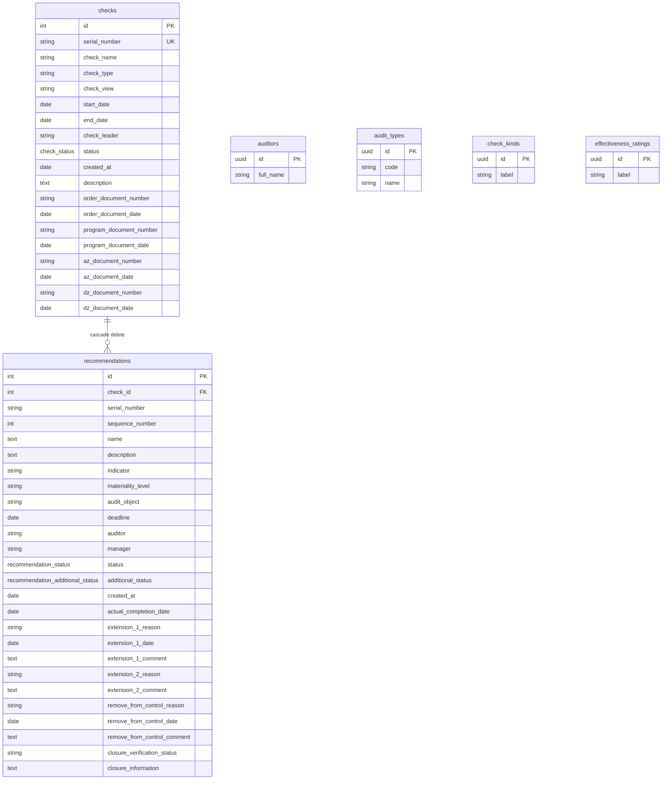

# Данные и БД

## Стек

- PostgreSQL 16 (Docker: host **5433** → container 5432).
- SQLAlchemy 2.0 async + `asyncpg`.
- Миграции: **нет Alembic**. Схема создаётся через `Base.metadata.create_all` в `app/db/init_db.py`.
- Эволюция полей — ad-hoc скрипты `app/db/migrate_*.py` (statuses, closure, closure lists, indicators, materiality, fields, check effectiveness).

## Session

`app/db/session.py`: `create_async_engine(settings.database_url)`, `async_sessionmaker`, dependency `get_db_session()`.

`DATABASE_URL` обязателен (см. `.secrets/sokol.env`).

## ER-диаграмма

Справочники **не связаны** FK с checks/recommendations: ФИО аудитора, тип проверки и т.п. хранятся как строки в основных таблицах; справочники питают UI-select’ы.

## Enum’ы

### `CheckStatus`

| Value | Смысл |
|-------|--------|
| `not_started` | не начата |
| `in_progress` | в работе |
| `completed` | завершена |

### `RecommendationStatus`

| Value | Смысл |
|-------|--------|
| `completed` | исполнена |
| `unresolved` | не устранена |
| `on_control` | на контроле |
| `in_progress` | в работе |

### `RecommendationAdditionalStatus`

| Value | Смысл |
|-------|--------|
| `on_time` | в срок |
| `deadline_violated` | нарушение срока |
| `on_control` | на контроле |

SQLAlchemy для recommendation enum’ов использует `values_callable` → в БД пишутся **values**, не имена членов.

## Ключ проверки (`serial_number`)

Генерируется на фронте (`utils/checkKey.ts`) и дублируется логикой `app/utils/check_key.py` для seed/import. Уникален в `checks`. У рекомендаций `serial_number` — ссылка на ключ проверки (строка), плюс `check_id` FK и `sequence_number` внутри проверки.

## Seed и import

| Модуль | Назначение |
|--------|------------|
| `seed_auditors.py` | аудиторы |
| `seed_audit_types.py` | типы аудита |
| `seed_check_kinds.py` | виды проверок |
| `seed_effectiveness_ratings.py` | оценки эффективности |
| `seed_demo_data.py` | синтетические проверки и рекомендации для демо-среды |
| `import_seed_data.py` | загрузка из Excel |
| `scripts/generate_seed_excel.py` | генерация seed Excel (`openpyxl`) |

## Ad-hoc migrate скрипты

Под `app/db/`:

- `migrate_recommendation_fields.py`
- `migrate_recommendation_statuses.py`
- `migrate_recommendation_closure.py`
- `migrate_recommendation_closure_lists.py`
- `migrate_recommendation_indicators.py`
- `migrate_materiality_required.py`
- `migrate_check_effectiveness.py`

Это **не** версионируемый migration framework: запускаются вручную при обновлении уже существующей БД.

## Ограничения схемы

1. Нет soft-delete.
2. Нет аудита изменений (кто/когда изменил).
3. Вложения (приказ, программа, АЗ, ДЗ) на бэкенде **не хранятся** — только метаданные номеров/дат.
4. Материальность и индикатор — строки с дефолтами (`средний`, `не указан`), не FK на справочник.
5. Смена enum’ов на живой БД требует ручного migrate-скрипта / ALTER TYPE.
