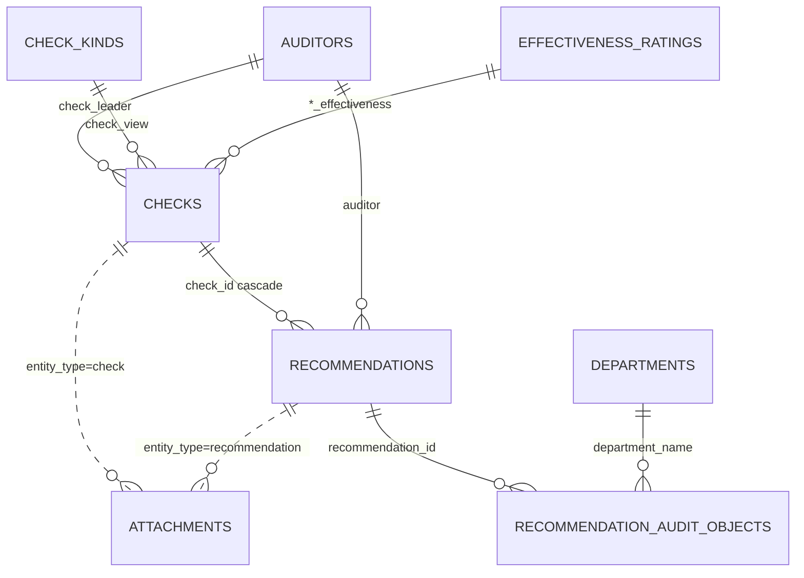

# Данные и БД

PostgreSQL 16 · SQLAlchemy 2 async · `asyncpg` · порт хоста **5433**.

Схема: `Base.metadata.create_all()` в `init_db.py` + идемпотентные `python -m app.db.migrate_*`. Alembic нет. Операции: [ALEMBIC_AND_DATA.md](ALEMBIC_AND_DATA.md). Файлы: [STORAGE.md](STORAGE.md).

## Сущности

| Таблица | PK | Связи |
|---------|-----|-------|
| `checks` | int | → recommendations (`ON DELETE CASCADE`) |
| `recommendations` | int | FK `check_id` |
| `recommendation_audit_objects` | `(recommendation_id, department_name)` | FK на recommendations и `departments.name` |
| `attachments` | int | полиморфно: `entity_type` + `entity_id`; bucket `check-{serial}` |
| `auditors` | UUID | unique `full_name`, unique `code` (3 латинские буквы) |
| `departments`, `check_kinds`, `effectiveness_ratings` | UUID | unique labels |
| `audit_types` | UUID | `code` + `name`, без unique и без FK в домен |
| `users` | UUID | unique `username`; роли `admin` / `department_head` / `auditor` |

Доменные ссылки на справочники — строки с физическим FK на unique label (`ON UPDATE CASCADE`; `ON DELETE RESTRICT`, для оценок эффективности `SET NULL`). Массив `recommendations.audit_object` дублируется для аналитики; целостность — в junction.

## ER

## Enum'ы

В БД пишутся **values**, не имена членов.

| Enum | Значения |
|------|----------|
| `check_status` | `not_started`, `in_progress`, `completed` |
| `recommendation_status` | `completed`, `unresolved`, `on_control`, `in_progress` |
| `recommendation_additional_status` | `on_time`, `deadline_violated`, `on_control` |
| `users.role` | `admin`, `department_head`, `auditor` |

Переходы статусов API не ограничивает.

## Ключ проверки

`serial_number` уникален, клиент его не задаёт. Формат: `{YY}{AUDITOR_CODE}{QUARTER}{P\|V\|K}{N}`.

Пример: `26KVS3P1` — год начала, `auditors.code`, квартал, тип (`planned`→P, `unscheduled`→V, `thematic`→K), порядковый номер среди проверок того же руководителя/типа/года (квартал в счётчик не входит).

При смене `start_date` / `check_quarter` / `check_leader` / `check_type` backend пересчитывает ключ, обновляет `recommendations.serial_number` и `attachments.check_serial_number`/`bucket`, копирует объекты MinIO в новый bucket и удаляет старый. Массово: `python -m app.db.recalculate_check_serial_numbers`.

Смена `auditors.code` запускает тот же каскад для всех проверок руководителя (`app/services/check_serial_cascade.py`).

`check_type` — код ключа, не FK на `audit_types` (КП/ВП/ПП).

## Валидация справочников

API (`dictionary_validation.py`) + FK:

- `check_leader`, `auditor` ∈ `auditors.full_name`
- `check_view` ∈ `check_kinds.label`
- непустые `*_effectiveness` ∈ `effectiveness_ratings.label` (пустое → `NULL`)
- `audit_object` канонизируется по `departments`; пишется массив и junction; пустое → `Не указан`
- `manager` — свободный текст
- удаление in-use значения и системного «Не указан» → **409**

Import/seed сначала `ensure_*` недостающие labels, затем вставляет строки. Excel-import **досоздаёт** неизвестные справочники, а не отклоняет их.

## `checks`

| Поле | Тип | Notes |
|------|-----|-------|
| `id` | int PK | |
| `serial_number` | varchar(32) UK | генерируется backend |
| `check_name` | varchar(255) | |
| `short_name` | varchar(255)? | |
| `check_type` | varchar(32) | `planned` / `unscheduled` / `thematic` |
| `check_view` | varchar(255) | FK `check_kinds.label` |
| `check_quarter` | int | CHECK 1–4 (на живой БД — migrate) |
| `start_date` | date | год в ключе и аналитике |
| `end_date` | date? | |
| `check_leader` | varchar(255) | FK `auditors.full_name` |
| `status` | `check_status` | |
| `created_at` | date | default `today`, PATCH не меняет |
| `description` | text? | |
| `order_*` / `program_*` / `az_*` / `dz_*` | varchar(128)? / date? | номер и дата документов |
| `process_effectiveness`, `svk_effectiveness`, `sur_effectiveness`, `svik_effectiveness` | varchar(255)? | FK ratings, `ON DELETE SET NULL` |

List search: `check_name`, `check_leader`, `serial_number`.

## `recommendations`

| Поле | Тип | Notes |
|------|-----|-------|
| `id` | int PK | |
| `check_id` | int FK | `ON DELETE CASCADE` |
| `serial_number` | varchar(32) | денормализация ключа проверки |
| `sequence_number` | int | назначает backend, default 1 |
| `name` | text | |
| `observation_name` | text? | |
| `description` | text | default `''` |
| `indicator`, `additional_indicator` | varchar(32) | default `не указан` |
| `materiality_level` | varchar(32) | default `средний` |
| `audit_object` | `text[]` | GIN; FK-целостность в junction |
| `deadline` | date? | |
| `auditor` | varchar(255) | FK `auditors.full_name` |
| `manager` | varchar(255) | свободный текст |
| `status` / `additional_status` | enum | |
| `created_at` | date | |
| `actual_completion_date` | date? | |
| `extension_1_*` | mixed | legacy первого переноса (`date` / `reason` / `comment`) |
| `extension_2_reason`, `extension_2_comment` | mixed | legacy второго переноса (**без** `extension_2_date`) |
| `remove_from_control_*` | mixed | legacy снятия с контроля |
| `deadline_extensions`, `control_removals` | JSON | список `{date?, comment?}`; `create_all` → `JSON`, migrate на живой БД может дать `JSONB` |
| `closure_verification_status` | varchar(64)? | |
| `closure_information` | text? | |

Create/batch ищут проверку по `serial_number`. Вход `audit_object` — массив или строка с `,`/`;`.

## `attachments`

Метаданные; байты в MinIO. Физического FK на checks/recommendations нет.

| Поле | Тип | Notes |
|------|-----|-------|
| `id` | int PK | |
| `entity_type` | varchar(32) | `check` \| `recommendation` |
| `entity_id` | int | |
| `slot` | varchar(64) | check: `order`, `program`, `az`, `dz`, `dz_appendix`; rec: `recommendation_files`, `control_removal_files` |
| `check_serial_number` | varchar(32) | для bucket layout |
| `bucket` | varchar(128) | `check-{serial}` lowercase |
| `object_key` | varchar(512) | `{slot}/{uuid}_{filename}` или `recommendations/{id}/{slot}/{uuid}_{filename}` |
| `original_name`, `content_type`, `size_bytes` | | |
| `created_at` | timestamptz | `NOW()` |

## `users`

| Поле | Тип | Notes |
|------|-----|-------|
| `id` | UUID PK | |
| `username` | varchar(255) UK | логин |
| `password_hash` | varchar(255) | PBKDF2-SHA256; legacy plaintext verify на login |
| `role` | varchar(32) | `admin` / `department_head` / `auditor`; `ADMIN_ROLES` = первые два |
| `display_name` | varchar(255) | |
| `aliases` | varchar(500)? | варианты имени через запятую; login/lookup матчит username и aliases |
| `is_active` | bool | default true; неактивные не логинятся |

Аватары в БД не хранятся. Сопоставление «своей» рекомендации: `recommendations.auditor` ↔ `username` (`person_match`).

## Справочники

| Таблица | Поля | Используется для |
|---------|------|------------------|
| `auditors` | `full_name` UK, `code` char(3) UK | `check_leader`, `auditor`, ключ проверки |
| `departments` | `name` UK | `audit_object` / junction; «Не указан» защищён |
| `check_kinds` | `label` UK | `check_view` |
| `effectiveness_ratings` | `label` UK | оценки эффективности |
| `audit_types` | `code`, `name` | без FK в домен; дубликаты API не отклоняет 409 |

Переименование аудитора/вида/оценки/департамента каскадно обновляет FK; массив `audit_object` синхронизируется отдельно.

## Связи

| Связь | Тип | Поведение |
|-------|-----|-----------|
| `recommendations.check_id → checks.id` | FK | cascade delete |
| `checks.check_leader` / `recommendations.auditor` → `auditors.full_name` | FK | update cascade, delete restrict |
| `checks.check_view → check_kinds.label` | FK | update cascade, delete restrict |
| `checks.*_effectiveness → effectiveness_ratings.label` | FK | update cascade, delete set null |
| `recommendation_audit_objects` | FK | rec cascade; department update cascade, delete restrict |
| `serial_number` на rec/attachments | денормализация | сервис при пересчёте ключа |
| `attachments.entity_*` | логическая | сервис проверяет владельца |

Нет soft-delete и audit log. Прямой SQL по `serial_number` / labels / `attachments.bucket` ломает целостность.

## Индексы

Из моделей: PK, unique `serial_number` / labels / username / auditor code, FK indexes (`check_id`, `check_leader`, `auditor`, entity lookup).

Из `migrate_analytics_indexes` (bootstrap): `ix_checks_start_date`, `ix_checks_status`, `ix_checks_check_leader`, `ix_recommendations_deadline`, `ix_recommendations_auditor`, GIN `audit_object` (`ix_recommendations_audit_object_gin`), `ix_recommendations_status`, `ix_recommendations_materiality_level`, `ix_recommendations_deadline_status`. Плюс `ix_attachments_entity_lookup` из migrate attachments.

## Аналитика

Отдельного data mart нет. Период проверок — `checks.start_date`. Контракт ответов — [API.md](API.md) / `app/schemas/analytics.py`.

| Endpoint | Поля |
|----------|------|
| checks | status, type, view, leader, effectiveness, `completionShare`, объекты через rec |
| recommendations | status, additional_status, deadline, materiality, indicator, audit_object, auditor + distribution/summary extras |
| monitoring | то же + extensions / removals / completed-during-audit + summary/series |
| dva | load/impact/execution/timeliness/documents, treemap, readiness, lifecycle |
| planning | `coverage`, department analytics, high-materiality; **без** фильтра `auditors` |

## Пакет `app/db`

| Модуль | Назначение |
|--------|------------|
| `session.py`, `init_db.py` | async engine, `create_all` |
| `catalogs/` | канонические списки |
| `seeds/` | идемпотентный insert |
| `migrations/` | ad-hoc patches; `run_bootstrap_migrations()` — Docker |
| `bootstrap.py` | Docker entrypoint и presentation demo |
| корневые `seed_*` / `migrate_*` | CLI, реэкспорт |

Docker: `init_db` → `BOOTSTRAP_MIGRATIONS` → seed audit_types / check_kinds / ratings → `sync_dictionaries` (auditors/departments/users) → `sync_check_buckets` → опциональный Excel demo (`SOKOL_LOAD_DEMO_DATA`, в bootstrap default **on**).

Bootstrap-миграции (порядок):

1. `migrate_auditor_codes`
2. `migrate_check_quarter`
3. `migrate_check_effectiveness`
4. `migrate_attachments`
5. `migrate_dictionary_uniqueness`
6. `migrate_dictionary_foreign_keys`
7. `migrate_recommendation_observation_name`
8. `migrate_recommendation_indicator_on_control`
9. `migrate_recommendation_additional_indicator`
10. `migrate_analytics_indexes`

Остальные `migrate_*` (short_name, recommendation fields, closure lists, audit_object array/canonical, statuses, materiality) — только для стендов, поднятых до появления полей в `create_all`. `migrate_recommendation_indicators` — одноразовый remap индикаторов/статусов, **не** для живой БД. Import при необходимости досоздаёт labels через `ensure_dictionary_refs`.
