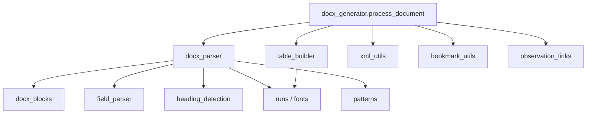
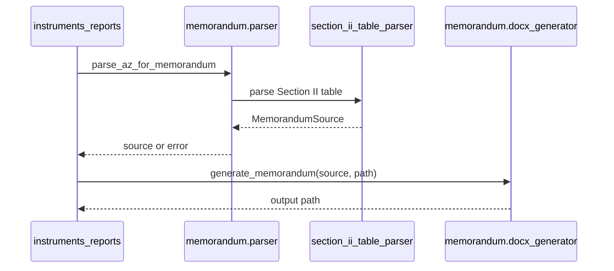
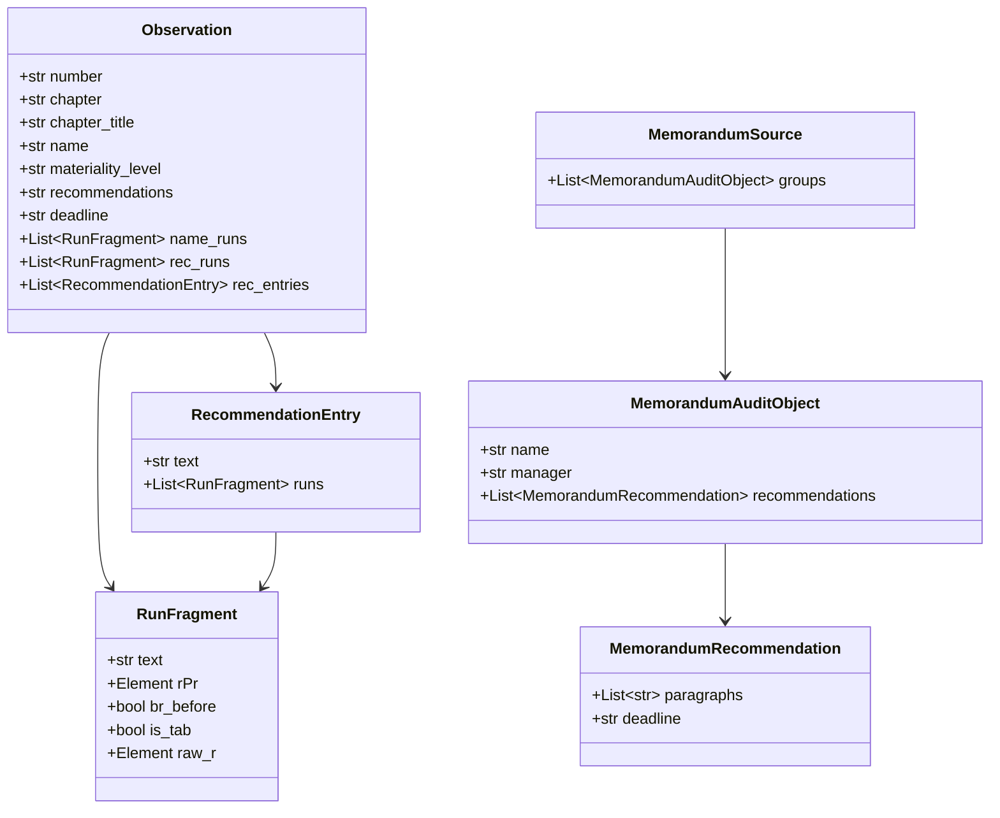

# Генерация и разбор документов (Reports)

Три пайплайна в `app/services/reports/` (section_ii, memorandum, audit_opinion). HTTP-обёртка: `app/api/v1/endpoints/instruments_reports.py`.

## Общие правила upload

1. Только `.docx`.
2. Лимит `SOKOL_MAX_UPLOAD_MB` (default 100).
3. Файл целиком читается в память → temp file → обработка в thread pool.
4. Cleanup temp через `BackgroundTasks`.

---

## 1. Раздел II аудиторского заключения

**Endpoints:**  
`POST /api/v1/tools/section-ii`  
`POST /api/v1/tools/section-ii-links` (`with_hyperlinks=True`)

**Оркестратор:** `section_ii.docx_generator.process_document(input, output, with_hyperlinks=False)`

### Цель

Вставить (или заменить) таблицу «Раздел II» после Раздела I, собрав наблюдения из Раздела III, **сохранив** титул, оглавление и стили исходного АЗ.

### Почему ZIP/XML, а не python-docx

python-docx перезаписывает документ с потерей частей пакета. Пайплайн копирует OOXML-пакет байтами и точечно правит `word/document.xml`, rels и media.

### Модули и ответственность



| Модуль | Классы / ключевые функции |
|--------|---------------------------|
| `models.py` | `Observation`, `RunFragment`, `RecommendationEntry` |
| `docx_parser.py` | извлечение наблюдений с runs из таблиц/рамок |
| `docx_blocks.py` | `DocumentBlock`, textboxes |
| `field_parser.py` | материальность, сроки, имена, главы |
| `table_builder.py` | XML заголовка + таблицы; PNG материальности из `data/images/` |
| `xml_utils.py` | границы разделов, точка вставки, page-2 safety |
| `bookmark_utils.py` | закладка заголовка для оглавления |
| `observation_links.py` | `SokolObs*` + hyperlink mode |
| `heading_detection.py` | сигнатуры заголовков |
| `patterns.py` | regex наблюдений/сроков/`W_NS` |

### Алгоритм (упрощённо)

1. Скопировать исходный DOCX.
2. Удалить ранее сгенерированный Раздел II (если был).
3. Распарсить наблюдения Раздела III → `list[Observation]`.
4. Подготовить package parts для иконок материальности.
5. Если `with_hyperlinks` — проставить bookmarks на наблюдения в Разделе III.
6. Найти безопасную точку вставки после Раздела I.
7. Собрать heading + table XML.
8. Проверки: неизменённый prefix документа, границы страниц.
9. Перезаписать ZIP (document.xml, rels, media).

### Тесты

`tests/test_section_ii_parser.py`, `test_bookmark_utils.py`, `test_observation_links.py` (+ related). Покрывают парсинг, inserts, bookmarks, защиту титула.

---

## 2. Докладная записка (ДЗ)

**Endpoint:** `POST /api/v1/tools/memorandum`

**Вход:** АЗ, в котором уже есть таблица Раздела II.  
**Выход:** новый `.docx` («Приложение 2…») через **python-docx**.



### Модели

```
MemorandumSource
  └── groups: MemorandumAuditObject[]
        ├── name, manager
        └── recommendations: MemorandumRecommendation[]
              ├── paragraphs: str[]
              └── deadline: str
```

### Связанный парсинг для UI

**Endpoint:** `POST /api/v1/tools/parse-recommendations`

Использует `parse_recommendations_from_az` → нормализация срока `ДД.ММ.ГГГГ` → ISO `YYYY-MM-DD` → JSON для импорта рекомендаций на форме проверки.

`memorandum_doc_parser.py` умеет разбирать уже готовую ДЗ, но текущий tools-endpoint идёт через АЗ.

---

## 3. Раздел I — аудиторское мнение (Ollama)

**Endpoints:**  
`GET /api/v1/tools/audit-opinion/default-prompt`  
`GET /api/v1/tools/audit-opinion/models`  
`POST /api/v1/tools/audit-opinion`

**Пакет:** `app/services/reports/audit_opinion/`

| Модуль | Роль |
|--------|------|
| `processor.py` | `process_document()` — извлечь наблюдения → вызвать LLM → вставить/заменить текст раздела I в DOCX |
| `ollama_client.py` | `list_models`, chat API (`/api/chat`), URL/model/timeout из Settings / env |
| `prompts.py` | `DEFAULT_AUDIT_OPINION_PROMPT`, placeholder наблюдений |

**Env:** `SOKOL_OLLAMA_URL`, `SOKOL_OLLAMA_MODEL` (default `qwen2.5:14b`), `SOKOL_OLLAMA_TIMEOUT_S` (default 600).

**Зависимость:** запущенный Ollama с нужной моделью (`ollama pull qwen2.5:14b`). Без Ollama `GET …/models` и `POST …/audit-opinion` отвечают **502**.

---

## 4. Карта классов reports (сводка)



---

## Ограничения

- CPU-bound на запросе: большие АЗ блокируют worker thread (не весь event loop, но нет очереди/прогресса).
- Upload целиком в RAM.
- Нет хранения исходников/результатов в object storage.
- Аудиторское мнение зависит от внешней Ollama (таймауты до 10 мин).
- Хрупкость к нестандартной вёрстке АЗ: эвристики заголовков и таблиц.
