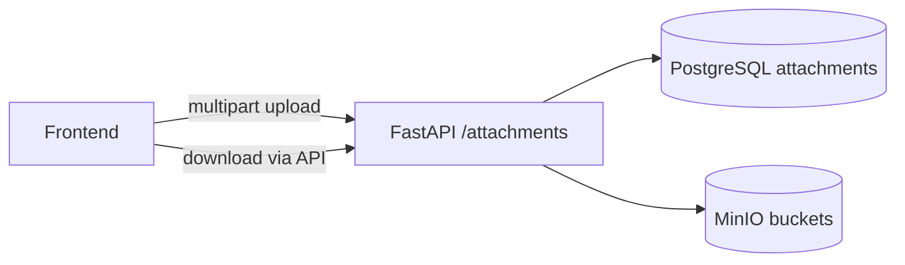

# Файловое хранилище (MinIO)

SOKOL хранит вложения проверок и рекомендаций в **MinIO** (S3-compatible). Метаданные — в PostgreSQL (`attachments`), бинарные файлы — в object storage.

## Архитектура



**Принципы:**

- UI **не** обращается к MinIO напрямую — только через API.
- **Один bucket на проверку** по ключу проверки (`serial_number`).
- Имя bucket: `check-{serial_number}` в lowercase (например `check-26ivp01p1`).
- Bucket создаётся при создании проверки; при bootstrap — для всех существующих.

## Layout объектов в bucket

```
check-{serial_number}/
  order/{uuid}_{filename}           # Приказ
  program/{uuid}_{filename}         # Программа
  az/{uuid}_{filename}              # АЗ
  dz/{uuid}_{filename}              # ДЗ
  dz_appendix/{uuid}_{filename}     # Приложение к ДЗ
  recommendations/{rec_id}/{slot}/{uuid}_{filename}
```

Слоты рекомендаций: `recommendation_files`, `control_removal_files`.

## API

| Метод | Путь | Назначение |
|-------|------|------------|
| GET | `/api/v1/attachments/storage/status` | Статус хранилища |
| GET | `/api/v1/attachments?entity_type=&entity_id=` | Список вложений |
| POST | `/api/v1/attachments` | Загрузка (multipart) |
| GET | `/api/v1/attachments/{id}/download` | Скачивание |
| DELETE | `/api/v1/attachments/{id}` | Удаление |

Параметры upload (form-data): `entity_type` (`check` | `recommendation`), `entity_id`, `slot`, `file`.

## Переменные окружения

| Переменная | Пример | Описание |
|------------|--------|----------|
| `SOKOL_MINIO_ENDPOINT` | `minio:9000` | Host:port MinIO |
| `SOKOL_MINIO_ACCESS_KEY` | `sokol` | Access key |
| `SOKOL_MINIO_SECRET_KEY` | `change-me` | Secret key |
| `SOKOL_MINIO_SECURE` | `0` | HTTPS (`1`) / HTTP (`0`) |
| `SOKOL_MAX_UPLOAD_MB` | `100` | Лимит размера файла |

Docker: `MINIO_ROOT_USER` / `MINIO_ROOT_PASSWORD` для контейнера MinIO (должны совпадать с access/secret API).

## Docker

MinIO входит в основной `docker-compose.yml`:

- API: `9000`
- Console: `9001` (http://localhost:9001)
- Том: `~/docker-share/minio-data-sokol`

## Код

| Компонент | Путь |
|-----------|------|
| MinIO client | `app/services/storage/minio_storage.py` |
| ORM | `app/models/attachments.py` |
| CRUD | `app/crud/attachments_crud.py` |
| Endpoints | `app/api/v1/endpoints/attachments.py` |
| FE client | `sokol-frontend/src/api/attachments.ts` |

## Следующие шаги

- Подключить `FileAttachmentsPanel` / `CheckAttachmentsSection` к API (сейчас UI держит `File` только в state).
- Auth: ограничить upload/download по ролям.
- Orphan GC / virus scan — по политике ИБ банка.
