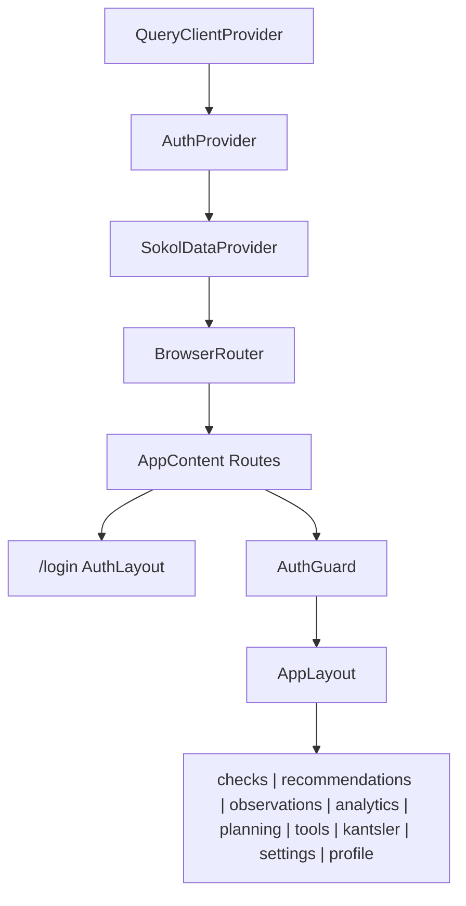
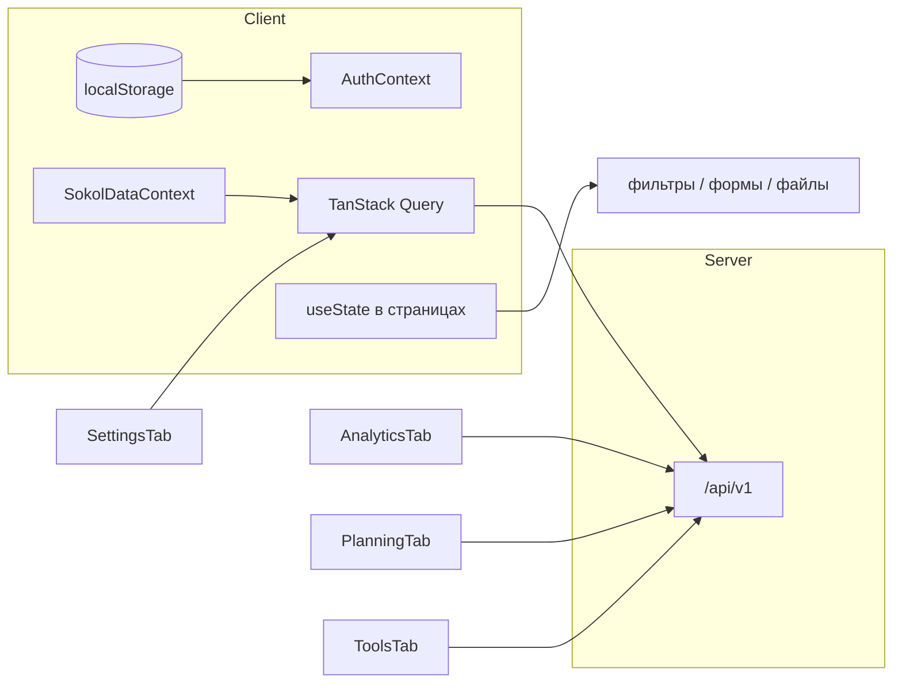
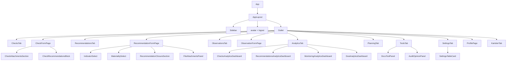
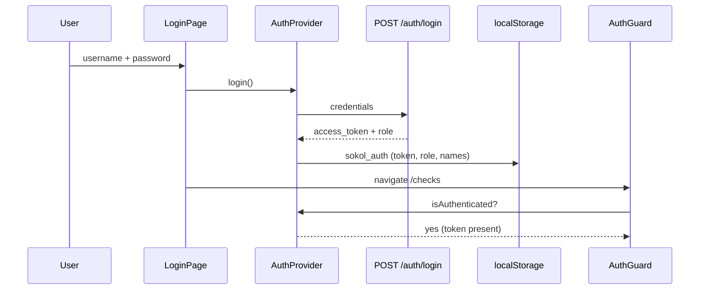
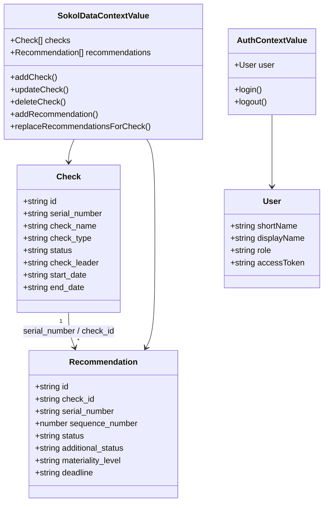
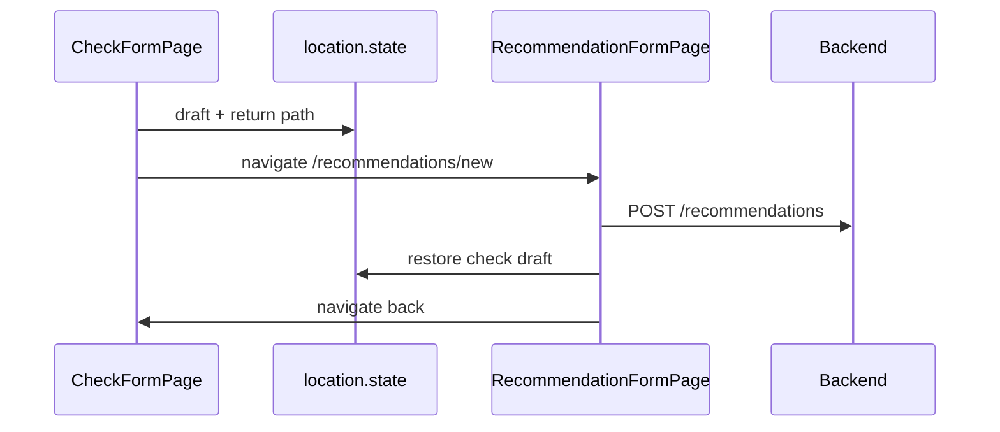
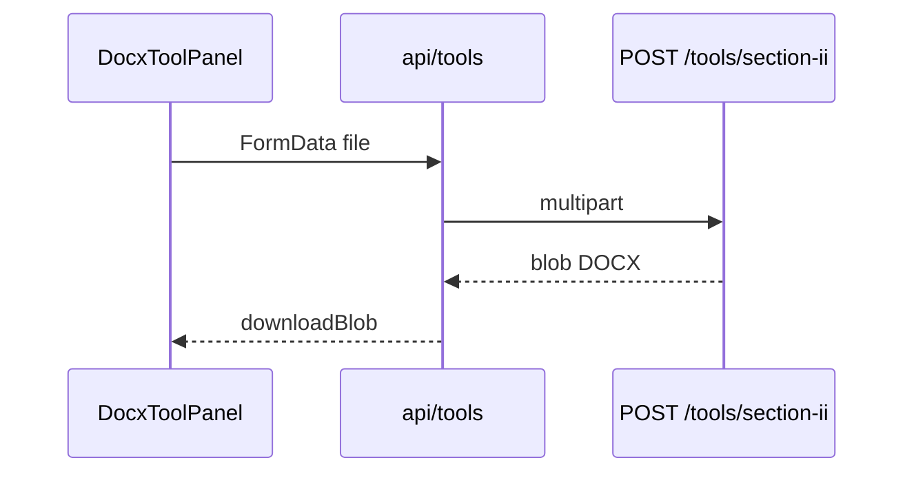

# Архитектура frontend

## Назначение

Одностраничное приложение внутреннего аудита: CRUD проверок/рекомендаций, справочники, JWT-auth, серверная аналитика и планирование, клиентский экспорт таблиц/дашбордов, вложения через API/MinIO, демо-таблица наблюдений, вызов backend DOCX-tools, заготовка канцлера и профиль.

## Структура `src/`

```
src/
├── main.tsx                 # StrictMode + App
├── App.tsx                  # QueryClient + Auth + SokolData + Router
├── api/                     # axios client, domain API, mappers, errors
├── components/
│   ├── auth/                # LoginPage, AuthGuard, AdminGuard
│   ├── layout/              # AppLayout, AuthLayout, Sidebar
│   ├── checks/              # CheckFormPage, attachments, recommendations block
│   ├── recommendations/     # Form, closure, selects
│   ├── observations/        # ObservationFormPage (форма-заготовка)
│   ├── analytics/           # Checks/Recommendations/Monitoring/DVA dashboards, chart primitives
│   ├── planning/            # PlanningAnalyticsDashboard
│   ├── attachments/         # FileAttachmentsPanel
│   ├── tools/               # DocxToolPanel, AuditOpinionPanel
│   ├── settings/            # table card, actions, helpers
│   ├── profile/             # ProfilePage
│   ├── tabs/                # Checks, Recommendations, Observations, Analytics, Planning, Tools, Settings, Kantsler
│   └── ui/                  # Button, Input, Select, Modal, DatePicker, …
├── contexts/                # Auth (JWT), SokolData
├── data/                    # локальные демо-наборы (наблюдения)
├── hooks/                   # useAuth, reference options, current user name
├── types/                   # Check, Recommendation, Observation
├── constants/               # enums/labels, form layout, storage keys
├── utils/                   # dates, exports, analytics*, checkKey, attachments, navigation
└── config/env.ts            # API_BASE_URL
```
## Дерево провайдеров и маршрутов



| Route | Компонент | Доступ |
|-------|-----------|--------|
| `/login` | `LoginPage` | публичный |
| `/` | redirect → `/checks` | AuthGuard |
| `/checks`, `/checks/new`, `/checks/:id/edit` | list / form | protected |
| `/recommendations`, `.../new`, `.../:id/edit` | list / form | protected |
| `/observations`, `.../new`, `.../:id/edit` | демо-список / заглушка формы (без API) | protected |
| `/analytics` | `AnalyticsTab` | protected |
| `/planning` | `PlanningTab` (`GET /analytics/planning`) | protected |
| `/tools` | `ToolsTab` | protected |
| `/kantsler` | stub | protected |
| `/settings` | `SettingsTab` (admin mutate) | protected |
| `/profile` | `ProfilePage` | protected |
| `*` | → `/checks` | protected |

## Управление состоянием



| Слой | Что хранит |
|------|------------|
| **AuthContext** | `user` (shortName, role, accessToken), login/logout; hydrate из `sokol_auth` |
| **SokolDataContext** | checks (limit 500) + recommendations (limit 1000) через RQ; CRUD helpers; связи recommendation↔check |
| **React Query** | кэш списков checks/recommendations, settings, analytics |
| **localStorage** | auth JWT+профиль, avatar data URL |
| **location.state** | черновики форм проверки/рекомендации при кросс-навигации |
| **Component state** | фильтры, пагинация, модалки, `File` вложений, фильтры дашбордов |

**Redux/Zustand нет.**

## API-слой

| Файл | Backend |
|------|---------|
| `api/client.ts` | Axios, `baseURL = API_BASE_URL`, Bearer interceptor, 401 → logout |
| `api/auth.ts` | `POST /auth/login`, типы токена |
| `api/checks.ts` | CRUD `/checks` |
| `api/recommendations.ts` | CRUD + `parse-recommendations` |
| `api/analytics.ts` | `/analytics/{checks,recommendations,monitoring,dva,planning}` |
| `api/attachments.ts` | list/upload/download/delete + storage status |
| `api/settings.ts` | `makeSettingsCrud` → auditors / audit_types / check_kinds / effectiveness_ratings |
| `settings/SingleFieldDictionaryPanel` | label-справочники в Settings (аудиторы, виды проверок, оценки) |
| `api/tools.ts` | section-ii, section-ii-links, memorandum (timeout 120s); audit-opinion + prompt/models (timeout 600s) |
| `api/mappers.ts` | API ↔ frontend types (id string, нормализация статусов) |
| `api/errors.ts` | `ApiError`, FastAPI 422, blob errors |

Типовой поток:

```
UI → useSokolData / useQuery → api/*.ts → axios → mappers → invalidate query keys
```

## Иерархия UI-компонентов



### UI kit (`components/ui`)

`Button`, `Input`, `Select`, `Textarea`, `DatePicker`, `Modal` / `ConfirmDialog`, `PageHeader`, `SegmentedControl`, `StateMessage` (Loading/Error/Empty).

Дизайн: Tailwind + палитра `sber` (navy `#003366`, accent `#6699FF`). Таблицы с тёмным header. Формы — токены `constants/formLayout.ts` + CSS grid helpers `.form-row-3` / `.form-row-4` (см. [UI_STANDARDS.md](UI_STANDARDS.md)).

## Ключевые модули домена

### Проверки

- `ChecksTab` — клиентские filter/sort/paginate, «Мои» по ФИО профиля, экспорт.
- `CheckFormPage` — авто `serial_number` (`utils/checkKey`), статус от дат, метаданные документов, импорт рекомендаций из АЗ.
- Вложения (`CheckAttachmentsSection`) — через `/api/v1/attachments` + MinIO (при недоступном storage — notice).

### Рекомендации

- Полный жизненный цикл + блок закрытия (`RecommendationClosureSection`).
- Статусы/метки в `constants/recommendations.ts`, mappers синхронизируют с backend enum’ами.

### Инструменты

`ToolsTab` → `DocxToolPanel` / `AuditOpinionPanel` → `api/tools.ts`:

| UI-действие | Endpoint | Timeout |
|-------------|----------|---------|
| Раздел II | `POST /tools/section-ii` | 120s |
| Раздел II + ссылки | `POST /tools/section-ii-links` | 120s |
| Докладная | `POST /tools/memorandum` | 120s |
| Аудиторское мнение | `POST /tools/audit-opinion` (+ GET prompt/models) | 600s |

### Аналитика

- `AnalyticsTab` — вкладки «Проверки» / «Рекомендации» / «Мониторинг» / «ДВА».
- Все вкладки: `GET /api/v1/analytics/*` (`api/analytics.ts` + соответствующие dashboards).
- Сетка: `AnalyticsDashboardGrid` — **статическая** (`static: true`, без `localStorage` layout).
- Экспорт: `analyticsExport` → `analyticsVisualExport` + `dashboardChartRegistry` — форматы **xlsx / pdf / docx / html**.
- Подробности: [ANALYTICS.md](ANALYTICS.md).

### Планирование

- `PlanningTab` + `PlanningAnalyticsDashboard` — `GET /api/v1/analytics/planning`; см. [PLANNING.md](PLANNING.md).
- Экспорт в UI пока отключён (`canExport={false}`).

### Наблюдения

- `ObservationsTab` — демо-набор из `src/data/demoObservations.ts`.
- `ObservationFormPage` — заглушка до backend CRUD.

### Экспорт таблиц (клиент)

`utils/exports.ts`: XLSX (Times New Roman 12), DOCX, PDF — без участия backend.

### Auth



Axios ставит `Authorization: Bearer`. 401 → событие `sokol:auth-unauthorized` → logout.  
Смена пароля в профиле — UI-only (нет API). OIDC/Keycloak — следующий шаг.

## Диаграмма классов (логические типы)



## Потоки данных

### Создание рекомендации из формы проверки



### Генерация Раздела II



## Явные ограничения архитектуры

1. Таблицы фильтруются **на клиенте** после bulk-fetch (500/1000) — не server-driven pagination UI.
2. Вложения персистятся через `/api/v1/attachments` + MinIO при настроенном storage; без MinIO upload недоступен.
3. Analytics/planning — серверные агрегаты; при росте портфеля нагрузка на API (полная выборка в память процесса).
4. Auth — internal JWT (не OIDC); fake «смена пароля» в профиле.
5. «Наблюдения» — демо-таблица без backend CRUD; «Канцлер» — заглушка.
6. Есть Vitest (`npm test`); e2e (Playwright) в CI пока нет.

## Связь с backend docs

Контракты и DOCX: `sokol-backend/docs/API.md`, `REPORTS.md`, `ARCHITECTURE.md`.  
БД / миграции / бэкапы: `sokol-backend/docs/ALEMBIC_AND_DATA.md`, `DATA_AND_DB.md`, `STORAGE.md`.
