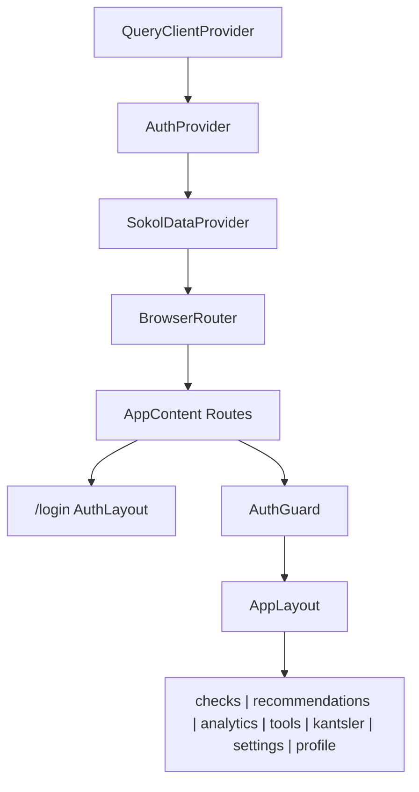
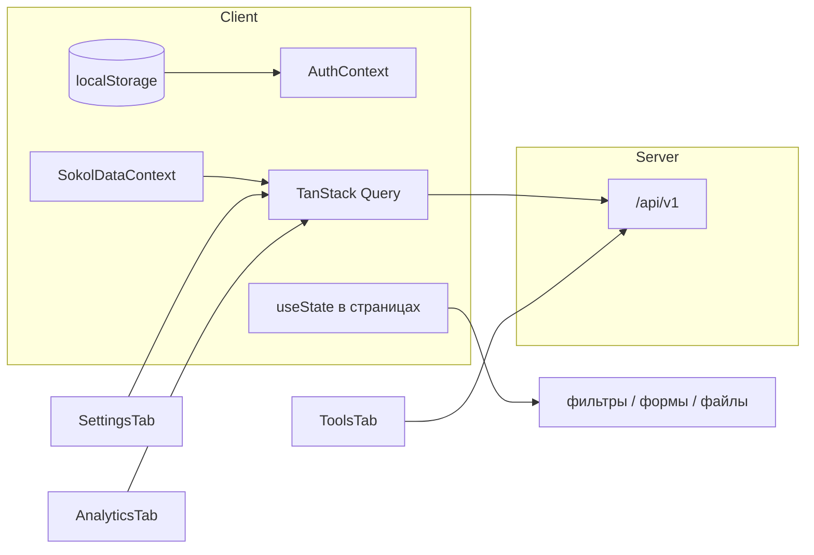
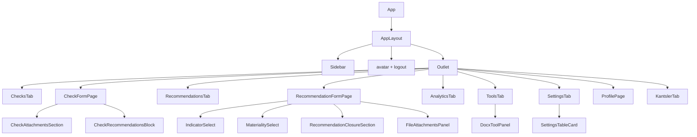
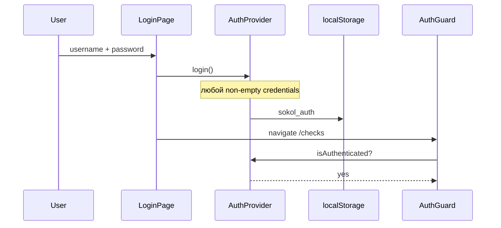
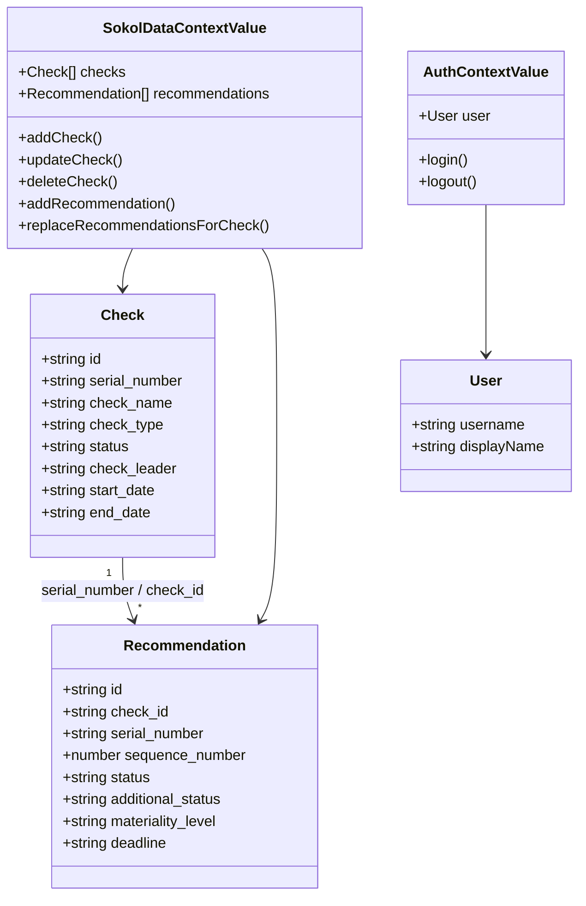
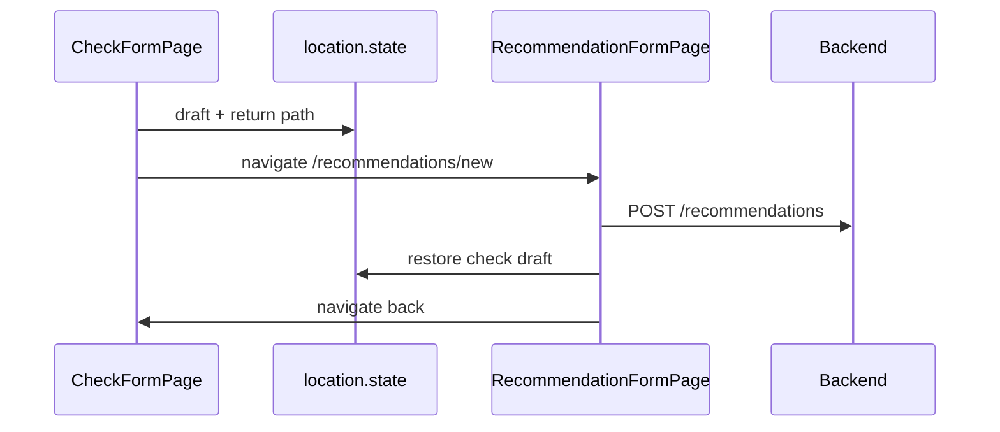
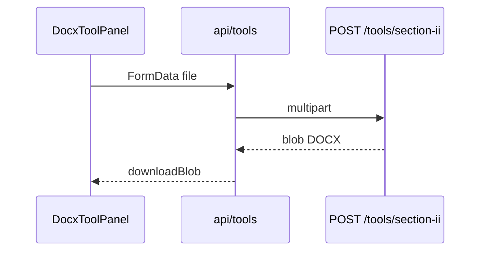

# Архитектура frontend

## Назначение

Одностраничное приложение внутреннего аудита: CRUD проверок/рекомендаций, справочники, клиентский экспорт таблиц, вызов backend DOCX-tools, заготовка аналитики и профиля.

## Структура `src/`

```
src/
├── main.tsx                 # StrictMode + App
├── App.tsx                  # QueryClient + Auth + SokolData + Router
├── api/                     # axios client, domain API, mappers, errors
├── components/
│   ├── auth/                # LoginPage, AuthGuard
│   ├── layout/              # AppLayout, AuthLayout, Sidebar
│   ├── checks/              # CheckFormPage, attachments, recommendations block
│   ├── recommendations/     # Form, closure, selects
│   ├── attachments/         # FileAttachmentsPanel
│   ├── tools/               # DocxToolPanel
│   ├── settings/            # table card, actions, helpers
│   ├── profile/             # ProfilePage
│   ├── tabs/                # Checks, Recommendations, Analytics, Tools, Settings, Kantsler
│   └── ui/                  # Button, Input, Select, Modal, DatePicker, …
├── contexts/                # Auth, SokolData
├── hooks/                   # useAuth, reference options, current user name
├── types/                   # Check, Recommendation
├── constants/               # enums/labels, form layout, storage keys
├── utils/                   # dates, export, checkKey, attachments, navigation
└── config/env.ts            # API_BASE_URL
```

## Дерево провайдеров и маршрутов



| Route | Компонент | Доступ |
|-------|-----------|--------|
| `/login` | `LoginPage` | публичный |
| `/` | redirect → `/checks` | AuthGuard |
| `/checks`, `/checks/new`, `/checks/:id/edit` | list / form | protected |
| `/recommendations`, `.../new`, `.../:id/edit` | list / form | protected |
| `/analytics` | `AnalyticsTab` | protected |
| `/tools` | `ToolsTab` | protected |
| `/kantsler` | stub | protected |
| `/settings` | `SettingsTab` | protected |
| `/profile` | `ProfilePage` | protected |
| `*` | → `/checks` | protected |

## Управление состоянием



| Слой | Что хранит |
|------|------------|
| **AuthContext** | `user`, login/logout; hydrate из `sokol_auth` |
| **SokolDataContext** | checks (limit 500) + recommendations (limit 1000) через RQ; CRUD helpers; связи recommendation↔check |
| **React Query** | кэш списков, settings, analytics |
| **localStorage** | auth, профиль ФИО, avatar data URL |
| **location.state** | черновики форм проверки/рекомендации при кросс-навигации |
| **Component state** | фильтры, пагинация, модалки, `File` вложений |

**Redux/Zustand нет.**

## API-слой

| Файл | Backend |
|------|---------|
| `api/client.ts` | Axios, `baseURL = API_BASE_URL`, `toApiError` |
| `api/checks.ts` | CRUD `/checks` |
| `api/recommendations.ts` | CRUD + `parse-recommendations` |
| `api/settings.ts` | auditors / audit_types / effectiveness_ratings |
| `api/tools.ts` | section-ii, section-ii-links, memorandum → blob, timeout 120s |
| `api/analytics.ts` | `GET /analytics/by-person` — **на backend endpoint отсутствует** |
| `api/mappers.ts` | API ↔ frontend types (id string, нормализация статусов) |
| `api/errors.ts` | `ApiError`, FastAPI 422, blob errors |

Типовой поток:

```
UI → useSokolData / useQuery → api/*.ts → axios → mappers → invalidate query keys
```

## Иерархия UI-компонентов



### UI kit (`components/ui`)

`Button`, `Input`, `Select`, `Textarea`, `DatePicker`, `Modal` / `ConfirmDialog`, `PageHeader`, `SegmentedControl`, `StateMessage` (Loading/Error/Empty).

Дизайн: Tailwind + палитра `sber` (navy `#003366`, accent `#6699FF`). Таблицы с тёмным header. Формы — CSS grid helpers `.form-row-3` / `.form-row-4`.

## Ключевые модули домена

### Проверки

- `ChecksTab` — клиентские filter/sort/paginate, «Мои» по ФИО профиля, экспорт.
- `CheckFormPage` — авто `serial_number` (`utils/checkKey`), статус от дат, метаданные документов, импорт рекомендаций из АЗ.
- Вложения (`CheckAttachmentsSection`) — **только в памяти браузера**, на API не уходят.

### Рекомендации

- Полный жизненный цикл + блок закрытия (`RecommendationClosureSection`).
- Статусы/метки в `constants/recommendations.ts`, mappers синхронизируют с backend enum’ами.

### Инструменты

`ToolsTab` → `DocxToolPanel` → `api/tools.ts`:

| UI-действие | Endpoint |
|-------------|----------|
| Раздел II | `POST /tools/section-ii` |
| Раздел II + ссылки | `POST /tools/section-ii-links` |
| Докладная | `POST /tools/memorandum` |

### Экспорт таблиц (клиент)

`utils/exports.ts`: XLSX (Times New Roman 12), DOCX, PDF — без участия backend.

### Auth



Axios **не** ставит `Authorization`. Смена пароля в профиле — UI-only.

## Диаграмма классов (логические типы)



## Потоки данных

### Создание рекомендации из формы проверки



### Генерация Раздела II



## Явные ограничения архитектуры

1. Таблицы фильтруются **на клиенте** после bulk-fetch (500/1000) — не server-driven pagination UI.
2. Вложения не персистятся.
3. Analytics зависит от несуществующего backend endpoint.
4. Auth stub — нет защиты API.
5. «Канцлер» — заглушка СЭД.
6. Нет frontend unit/e2e test script в `package.json`.

## Связь с backend docs

Подробности контрактов и DOCX: `sokol-backend/docs/API.md`, `REPORTS.md`, `ARCHITECTURE.md`.
