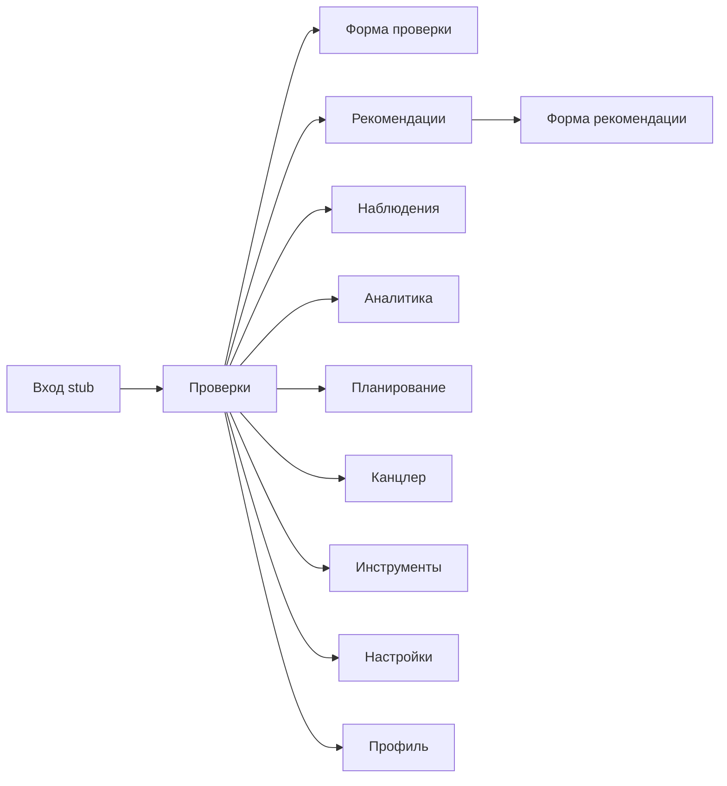
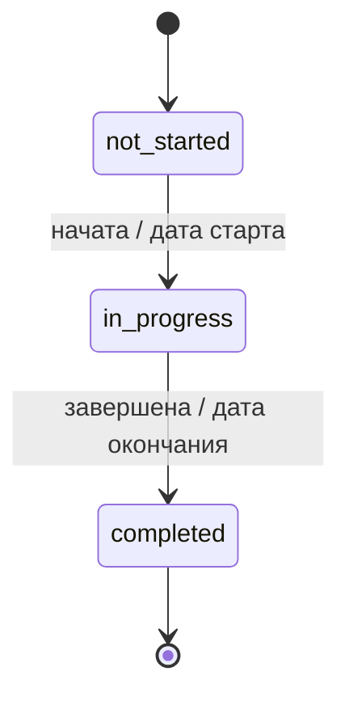
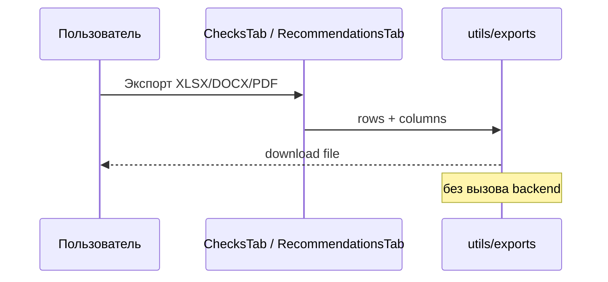
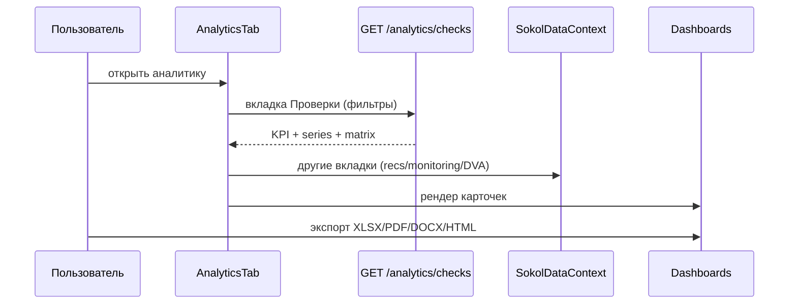
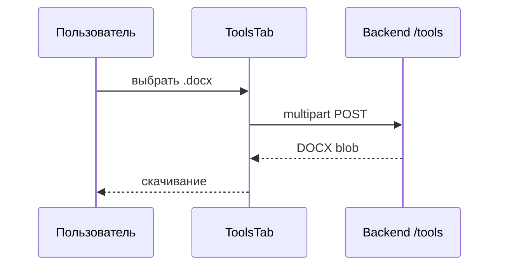
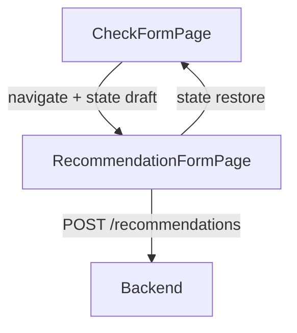

# Пользовательские истории и диаграммы

Актуально для UI августа 2026 (React SPA + FastAPI). Роли: `auditor` / `admin` (JWT).

## Роли

- **Аудитор** (`auditor`) — чтение/запись домена (проверки, рекомендации, аналитика, инструменты, вложения upload/download); без удаления записей и без CRUD справочников.
- **Администратор** (`admin`) — всё выше + CRUD справочников (`/settings`) + удаление проверок/рекомендаций/вложений.
## Пользовательские истории

### US-01 Просмотр списка проверок

Как аудитор, я хочу видеть список проверок, чтобы быстро находить нужную.

- Фильтры: название, тип, статус, руководитель, даты.
- Сортировка по колонкам; клиентская пагинация.
- Данные: `SokolDataProvider` → `GET /api/v1/checks?limit=500`.

### US-02 Фильтр «Мои»

Как аудитор, я хочу видеть проверки, где я руководитель.

- Кнопка «Мои» сравнивает руководителя с ФИО из профиля (`localStorage`), не с серверной identity.

### US-03 / US-04 Создание и редактирование проверки

- Форма: тип, вид, даты, руководитель, документы (приказ/программа/АЗ/ДЗ — номера и даты).
- Автогенерация `serial_number`.
- Статус может выводиться из дат относительно «сегодня».
- Блок вложений — локальные `File`, **без upload на API**.
- Блок рекомендаций проверки + переход к созданию рекомендации с возвратом черновика через `location.state`.
- Импорт рекомендаций из АЗ: `POST /tools/parse-recommendations` → preview → create.
- Стили секций/полей — общие токены `constants/formLayout.ts`.

### US-05 Экспорт проверок

- Форматы: XLSX / DOCX / PDF на клиенте (`utils/exports.ts`).
- XLSX: Times New Roman 12.

### US-06 / US-07 Справочники

Как администратор, я хочу CRUD аудиторов, видов аудита, видов проверок, оценок эффективности.

- UI: `SettingsTab` + `SingleFieldDictionaryPanel` (label-справочники) + модалки для видов аудита.
- API: `/api/v1/settings/auditors|audit_types|check_kinds|effectiveness_ratings`.
- UUID `id` с backend; удаление с подтверждением **реализовано** через API.
- **Ограничение:** справочник «Виды проверок» пока только в Настройках; форма проверки может ещё использовать локальные константы — wire запланирован в [PLAN.md](../../PLAN.md).

### US-08 Рекомендации

- Список с фильтрами (аудитор, руководитель, статусы, объект, срок), бейджи материальности/индикатора.
- Форма: описание, статусы, срок, контрольная зона (срок исполнения → снять с контроля → перенос срока).
- Поля «Статус» / «Дополнительный статус» подсвечиваются теми же цветами, что бейджи в таблице.
- Экспорт XLSX/DOCX/PDF.
- Данные: `GET /api/v1/recommendations?limit=1000`.

### US-09 Аналитика

Как аналитик или руководитель ДВА, я хочу видеть сводки по проверкам, рекомендациям, мониторингу и портфелю ДВА.

- Вкладки «Проверки» / «Рекомендации» / «Мониторинг» / «ДВА» (`AnalyticsTab`).
- **Проверки:** серверный `GET /api/v1/analytics/checks` (агрегация по всей БД).
- **Остальные вкладки:** данные из `SokolDataContext` (checks ≤ 500, recommendations ≤ 1000).
- Фильтры периода на клиенте; сетка карточек статическая.
- Выбор секций и экспорт: XLSX / PDF / DOCX / HTML (`analyticsExport` / `analyticsVisualExport`).
- Бизнес-смысл карточек: [ANALYTICS.md](ANALYTICS.md).

### US-10 Инструменты

- Загрузка `.docx` → скачивание результата.
- Раздел II / Раздел II + ссылки / Докладная записка.
- Раздел I «Аудиторское мнение»: выбор модели Ollama, редактирование промпта (`AuditOpinionPanel`).
- Timeout клиента: 120s (DOCX tools), **600s** (audit-opinion).
- Требуется доступный Ollama на backend для audit-opinion.

### US-11 Профиль

- ФИО → формат «Фамилия И.О.», аватар в localStorage.
- «Смена пароля» — только UI (нет API auth).

### US-12 Канцлер

- Заглушка «в разработке» (будущая интеграция с СЭД).

### US-13 Наблюдения

- UI списка (`/observations`) показывает демо-наблюдения из АЗ: номер наблюдения, проверку, раздел АЗ, название, существенность, срок, аудитора, статус и связанные рекомендации.
- Связанные рекомендации открываются ссылками на карточку рекомендации.
- Форма наблюдения остается заглушкой; backend/API пока отсутствуют, данные не персистятся.

### US-14 Планирование

- Рабочие клиентские дашборды охвата (`PlanningTab` / `PlanningAnalyticsDashboard`).
- Фильтры: год / квартал / месяц, департаменты.
- Экспорт пока отключён в UI.
- Подробности: [PLANNING.md](PLANNING.md).

---

## Диаграммы

### Навигация

### Жизненный цикл проверки (UI-статусы)

### Экспорт таблицы

### Аналитика (клиент)

### DOCX tools

### Создание рекомендации из проверки

