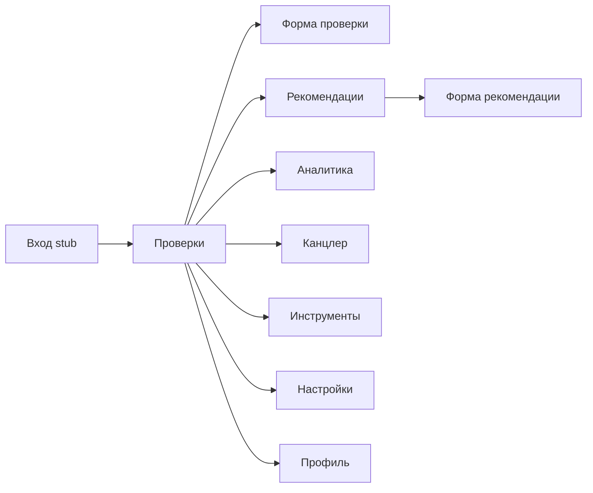
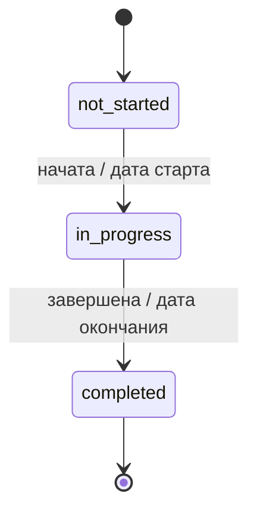
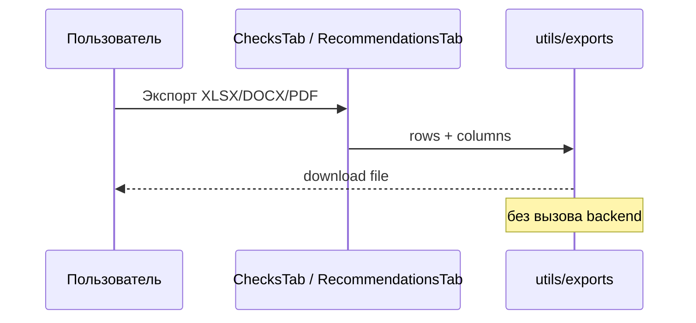
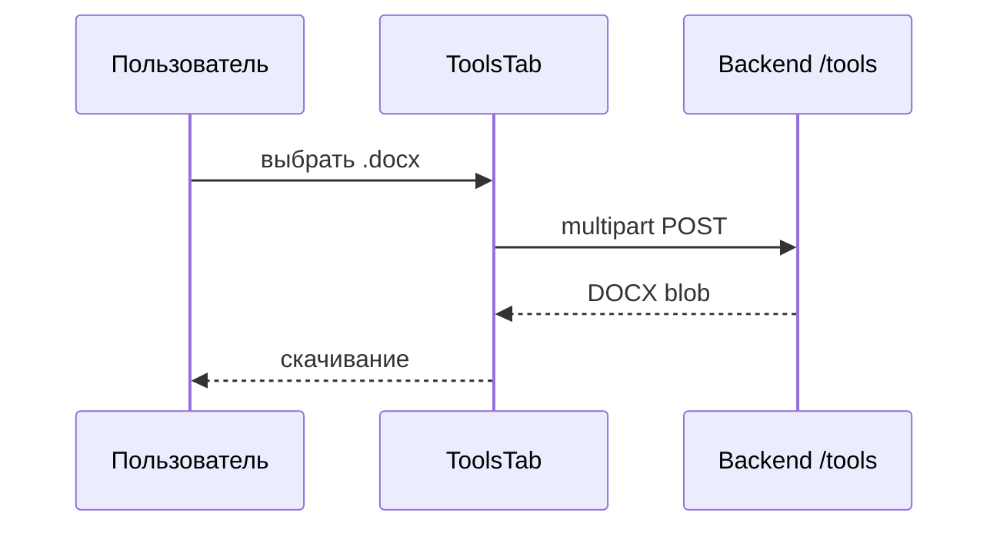
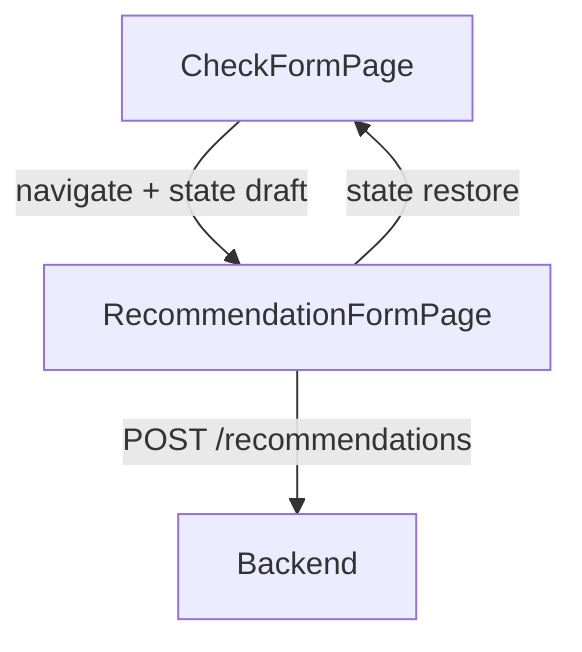

# Пользовательские истории и диаграммы

Актуально для UI июля 2026 (React SPA + FastAPI). Роли ниже — логические; технической RBAC пока нет (stub login).

## Роли

- Аудитор
- Руководитель проверки
- Аналитик
- Администратор справочников
- Пользователь профиля

## Пользовательские истории

### US-01 Просмотр списка проверок

Как аудитор, я хочу видеть список проверок, чтобы быстро находить нужную.

- Фильтры: название, тип, статус, руководитель, даты.
- Сортировка по колонкам; клиентская пагинация.
- Данные: `SokolDataProvider` → `GET /api/v1/checks?limit=500`.

### US-02 Фильтр «Мои»

Как аудитор, я хочу видеть проверки, где я руководитель.

- Кнопка «Мои» сравнивает руководителя с ФИО из профиля (`localStorage`), не с серверной identity.

### US-03 / US-04 Создание и редактирование проверки

- Форма: тип, вид, даты, руководитель, документы (приказ/программа/АЗ/ДЗ — номера и даты).
- Автогенерация `serial_number`.
- Статус может выводиться из дат относительно «сегодня».
- Блок вложений — локальные `File`, **без upload на API**.
- Блок рекомендаций проверки + переход к созданию рекомендации с возвратом черновика через `location.state`.
- Импорт рекомендаций из АЗ: `POST /tools/parse-recommendations` → preview → create.

### US-05 Экспорт проверок

- Форматы: XLSX / DOCX / PDF на клиенте (`utils/exports.ts`).
- XLSX: Times New Roman 12.

### US-06 / US-07 Справочники

Как администратор, я хочу CRUD аудиторов, типов аудита, оценок эффективности.

- UI: `SettingsTab` + модалки.
- API: `/api/v1/settings/auditors|audit_types|effectiveness_ratings`.
- UUID `id` с backend; удаление с подтверждением **реализовано** через API.

### US-08 Рекомендации

- Список с фильтрами (аудитор, руководитель, статусы, объект, срок), бейджи материальности/индикатора.
- Форма: описание, статусы, срок, закрытие (продления, снятие с контроля).
- Экспорт XLSX/DOCX/PDF.
- Данные: `GET /api/v1/recommendations?limit=1000`.

### US-09 Аналитика

- Фильтр сотрудник + период, режим «Обо мне».
- UI вызывает `GET /api/v1/analytics/by-person`.
- **Ограничение:** endpoint на backend **не реализован** — вкладка показывает ошибку API до появления сервиса или client-side fallback.

### US-10 Инструменты

- Загрузка `.docx` → скачивание результата.
- Раздел II / Раздел II + ссылки / Докладная записка.
- Раздел I «Аудиторское мнение»: выбор модели Ollama, редактирование промпта (`AuditOpinionPanel`).
- Timeout клиента: 120s (DOCX tools), **600s** (audit-opinion).
- Требуется доступный Ollama на backend для audit-opinion.

### US-11 Профиль

- ФИО → формат «Фамилия И.О.», аватар в localStorage.
- «Смена пароля» — только UI (нет API auth).

### US-12 Канцлер

- Заглушка «в разработке» (будущая интеграция с СЭД).

---

## Диаграммы

### Навигация

### Жизненный цикл проверки (UI-статусы)

### Экспорт таблицы

### DOCX tools

### Создание рекомендации из проверки

